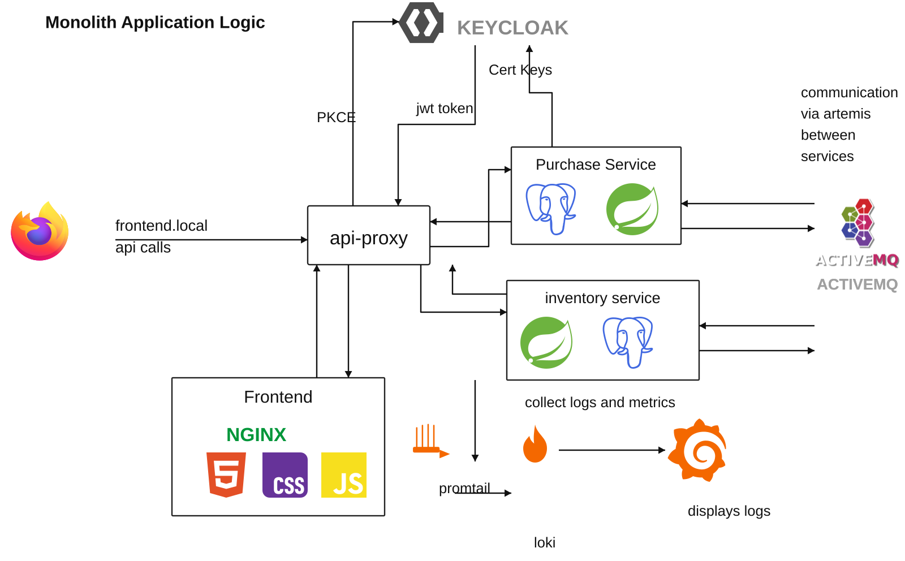
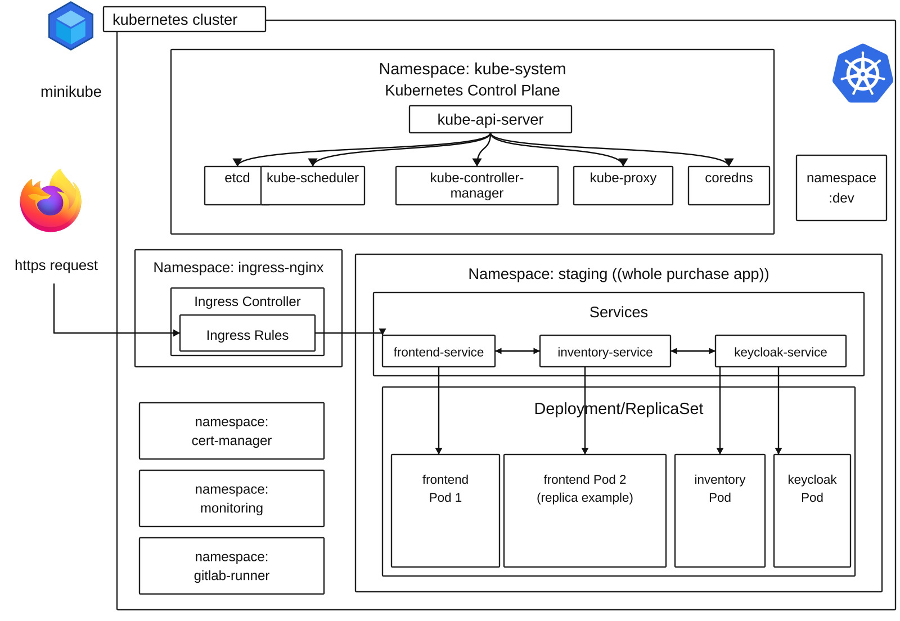

# Recreated Figures 3.1 and 3.2

High-fidelity recreations of the thesis architecture figures, built as vector SVGs with **real brand logos** from [Simple Icons](https://simpleicons.org/) (CC0 — free for commercial use, no attribution required). Each figure also has an editable **draw.io XML** file and a **PNG** preview.

These are draft files for review. No authentication was needed — draw.io is free and open-source, and the SVGs were generated locally.

## Figure 3.1 — Overall architecture and internal logic

Browser → api-proxy → Purchase / Inventory services (Spring Boot + PostgreSQL), Keycloak with PKCE/JWT, ActiveMQ Artemis between services, and the Promtail → Loki → Grafana log path.

| Format | File |
| --- | --- |
| Vector SVG | [figure-3.1-recreated.svg](recreated/figure-3.1-recreated.svg) |
| Editable draw.io | [figure-3.1-recreated.drawio.xml](recreated/figure-3.1-recreated.drawio.xml) |
| PNG preview | [figure-3.1-recreated.png](recreated/figure-3.1-recreated.png) |

Logos used: Firefox, Keycloak, Spring Boot, PostgreSQL, Apache (Artemis), Nginx, HTML5, CSS, JavaScript, Grafana (for Loki/Promtail/Grafana), Prometheus.

## Figure 3.2 — High-level Kubernetes architecture

The `dev` and `staging` isolation, the `kube-system` control plane, ingress-nginx, shared platform namespaces (`cert-manager`, `monitoring`, `gitlab-runner`), and the Services → Deployment/ReplicaSet → Pods layout in staging.

| Format | File |
| --- | --- |
| Vector SVG | [figure-3.2-recreated.svg](recreated/figure-3.2-recreated.svg) |
| Editable draw.io | [figure-3.2-recreated.drawio.xml](recreated/figure-3.2-recreated.drawio.xml) |
| PNG preview | [figure-3.2-recreated.png](recreated/figure-3.2-recreated.png) |

Logos used: Kubernetes, Firefox, plus styled badges for the namespaced components (Simple Icons has no icon for Minikube, Artemis, Loki or Promtail).

## How these were made

1. **Research:** AI *image* generators were ruled out — they garble labels and cannot place logos precisely. The right class of tool is **diagram-as-code** (Mermaid, D2, draw.io) combined with real vector logos.
2. **Tool choice:** **draw.io (diagrams.net)** — free, no account, Apache 2.0, 10,000+ shapes including Kubernetes icons, and git-friendly XML. No Figma/Canva login needed.
3. **Logos:** Simple Icons CDN (`cdn.simpleicons.org/<slug>`) — CC0, commercially usable, brand colours preserved.
4. **Build:** A local Python script composes the SVGs from logo data-URIs and positioned shapes, renders PNG previews with `rsvg-convert`, and emits draw.io XML for editing.

To edit a figure, open the `.drawio.xml` file at [app.diagrams.net](https://app.diagrams.net/) (File → Open From → Device) — no sign-in required. The SVGs can be opened directly in any vector editor (Inkscape, Figma, browser).
