# Thesis concept diagrams — Mermaid drafts

Reconstructions of the conceptual flows described in the bachelor thesis but never drawn as figures. These diagrams are editable Mermaid so they can be dropped into the real docs. Draft only; not in navigation.

## Authentication and security

### Authorization Code Flow (confidential client)

Source: thesis §2.11.3, "Authorization Code Flow". Client `my-thymeleaf-app` (confidential), redirect `http://localhost:8080/login/oauth2/code/keycloak`.

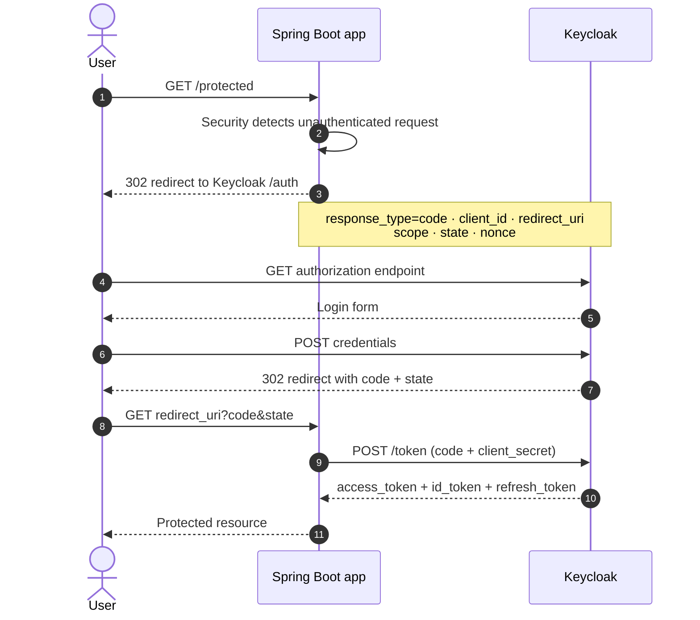

### Authorization Code Flow with PKCE (public client)

Source: thesis §2.11.3, "Authorization Code Flow with PKCE". Client `web-frontend-client` / `my-spa-app` (public), challenge method `S256`. No client secret.

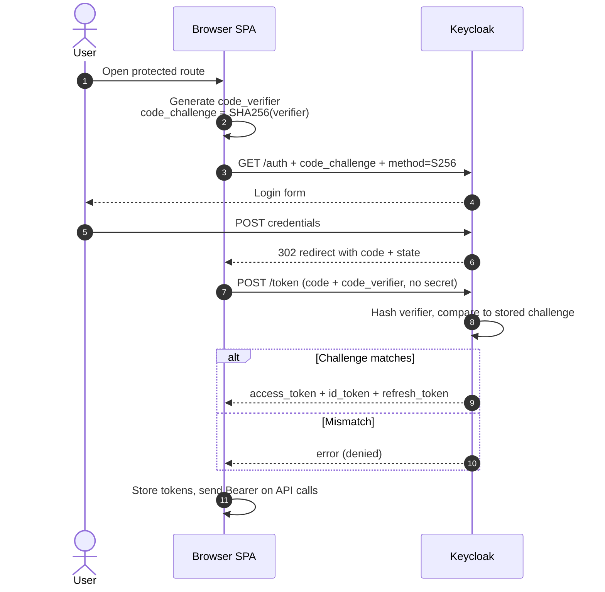

### Zero Trust: from perimeter to identity-centric

Source: thesis §2.11–2.11.2 (NIST SP 800-207). "Never trust, always verify".

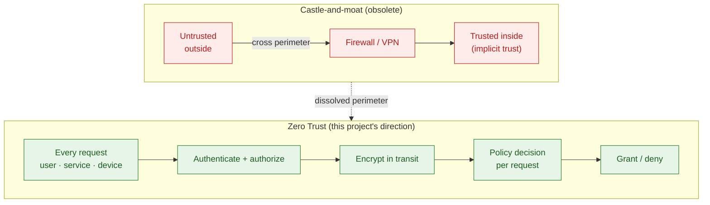

### JWT validation and role mapping in Spring

Source: thesis §2.12, §4.3.2 (JwtAuthConverter, SecurityConfig).

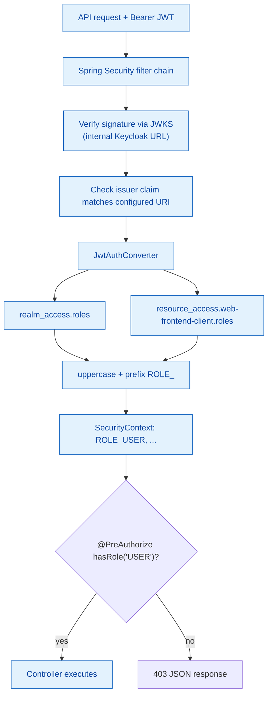

## Aspect-Oriented Programming

### Proxy interception chain

Source: thesis §2.13, "Client → Proxy → Advice Execution → Target Object".

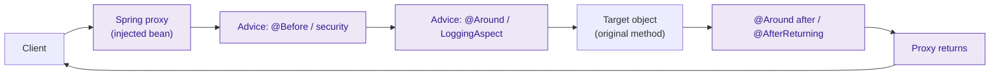

### Advice chain and proceed() unwind

Source: thesis §2.13, "Advice chain" (1–5).

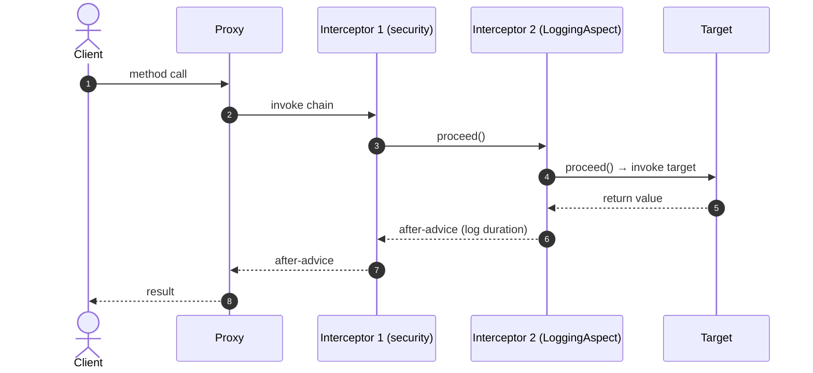

## Messaging and event flow

### Request-reply with JMS reply queues

Source: thesis §2.14.4, Figure 2.2 description (PurchaseMadeEvent / ResultEvent).

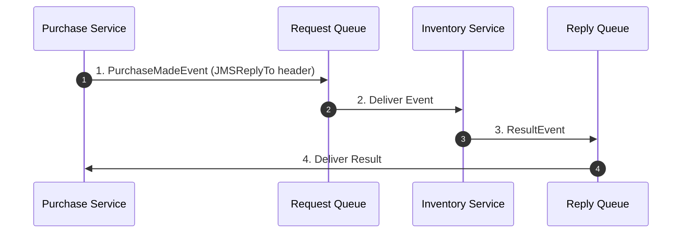

### BaseEvent polymorphic message contract

Source: thesis §4.3.3, "Event-Driven Communication Foundation".

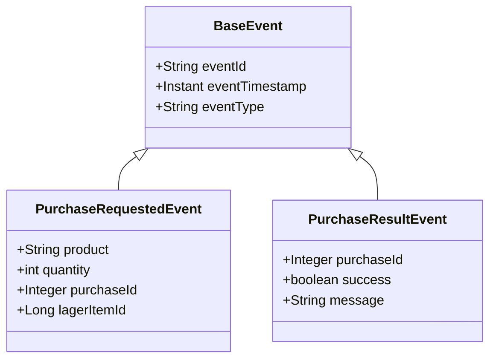

## Observability

### Layered logging: four components around a request

Source: thesis §4.3.3 "Layered Logging Strategy", §4.8.

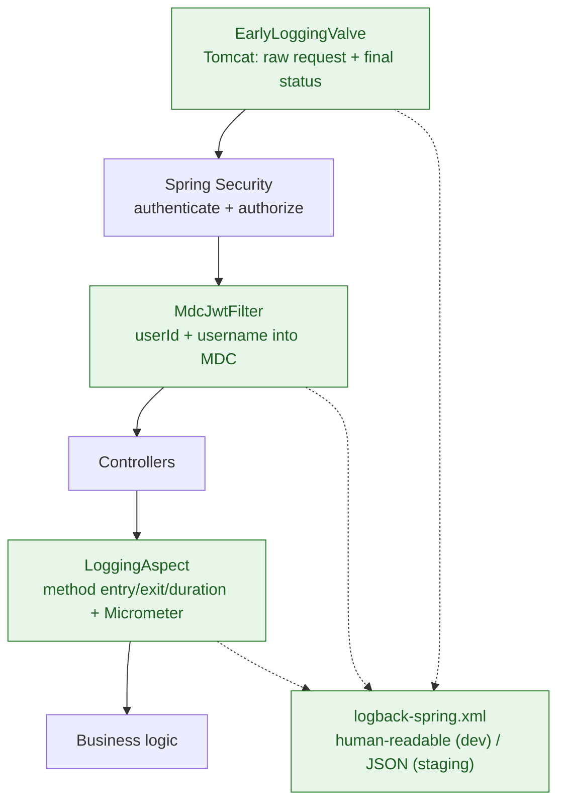

### Log pipeline to Grafana

Source: thesis §4.8.1, Figure description for Alloy/Loki/Grafana.

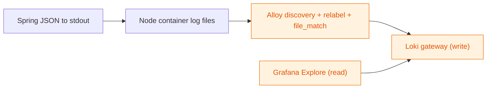

## Data and build

### Flyway migration flow

Source: thesis §2.22, §4.4.1 (V1__init.sql, V2__addData.sql).

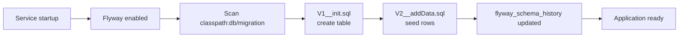

### Docker Bake build order

Source: thesis §4.5.7 (base-images → application-images → local registry).

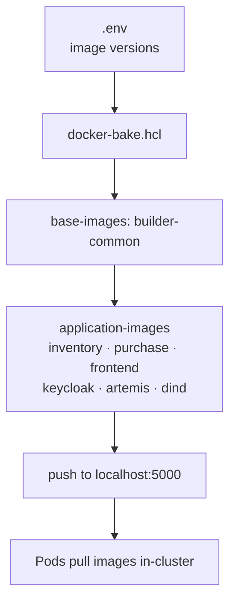

## CI/CD

### GitLab Runner Kubernetes executor lifecycle

Source: thesis §3.4.2, §4 (CI/CD), Figure 3.3 description.

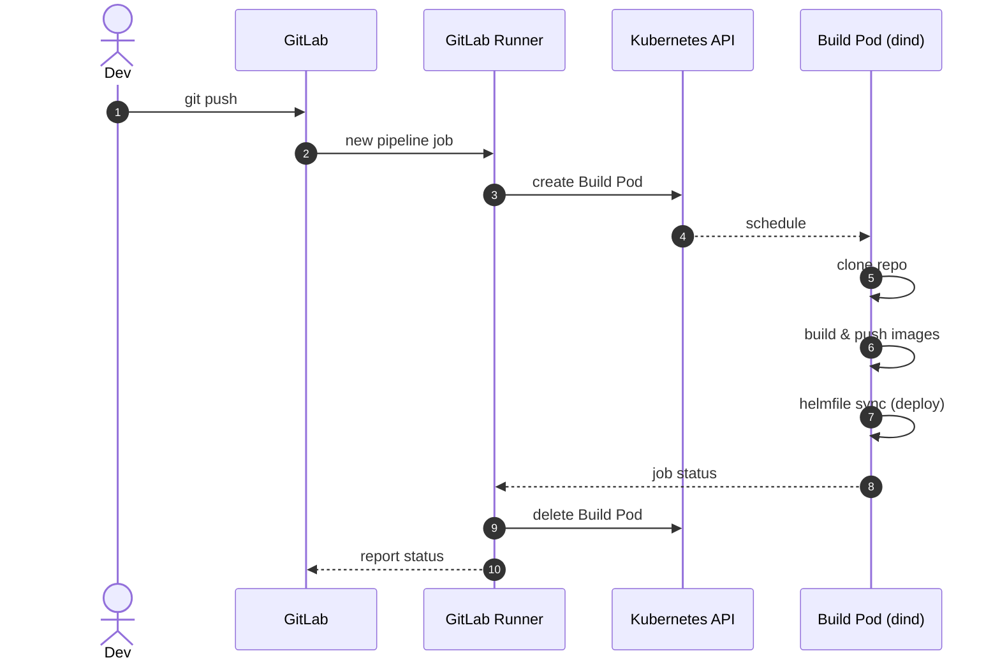
