# Thesis concept diagrams — Mermaid drafts

Reconstructions of the conceptual flows described in the bachelor thesis but never drawn as figures. These diagrams are editable Mermaid so they can be dropped into the real docs. Draft only; not in navigation.

Each diagram is verified against the thesis and the checked-in source. Where the thesis uses an **illustrative example** that differs from the deployed system, this is stated explicitly.

## Authentication and security

### Authorization Code Flow (confidential client)

**Thesis illustration** (§2.11.3). The client `my-thymeleaf-app`, redirect `http://localhost:8080/login/oauth2/code/keycloak`, and secret `abc123` are the thesis's teaching example — they are **not** in the deployed realm. The deployed confidential client is `purchase-service-client`; the browser client is the public `web-frontend-client`.

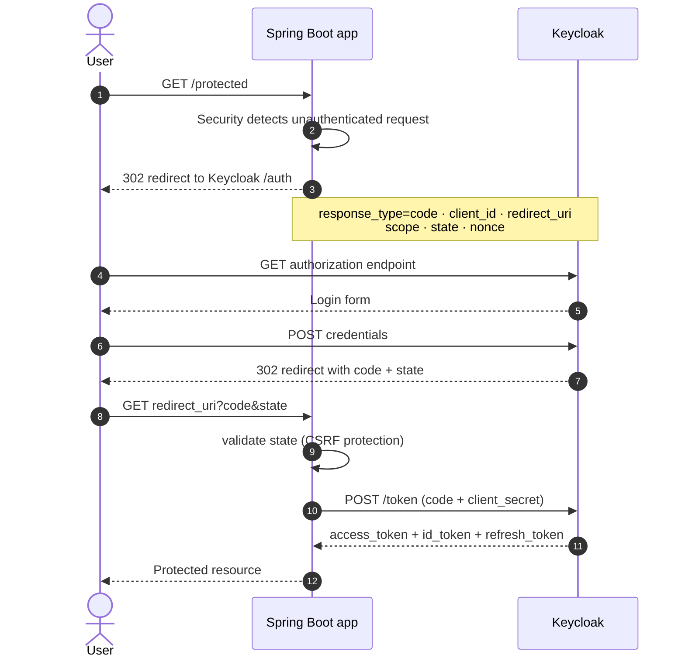

### Authorization Code Flow with PKCE (public client)

The deployed browser client is `web-frontend-client` (`publicClient: true`, PKCE `S256`, redirects `http://localhost:4200/*` and `https://frontend.local/*`) — `my-spa-app` / `localhost:3000` in the thesis (§2.11.3) are illustrative.

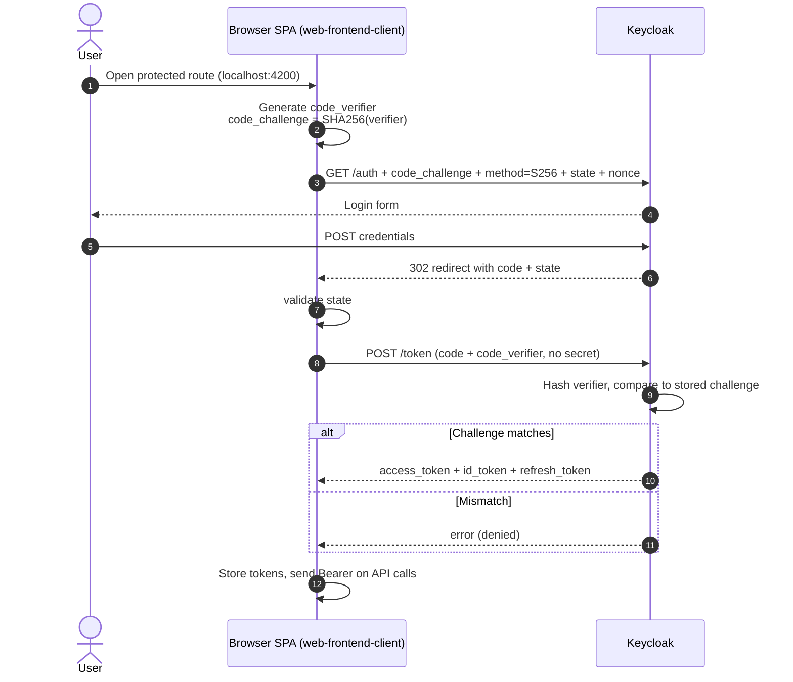

### Zero Trust: from perimeter to identity-centric

Source: thesis §2.11–2.11.2 (NIST SP 800-207). "Never trust, always verify". The project implements the IAM foundation, not a service mesh.

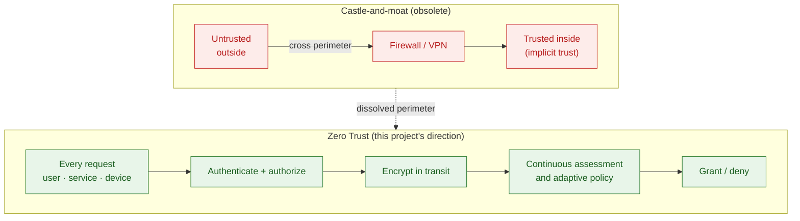

### JWT validation and role mapping in Spring

Source: thesis §2.12, §4.3.2 (`JwtAuthConverter`, `SecurityConfig`). The uppercase step matches the code (`"ROLE_" + role.toUpperCase()`), which is more precise than the thesis listing.

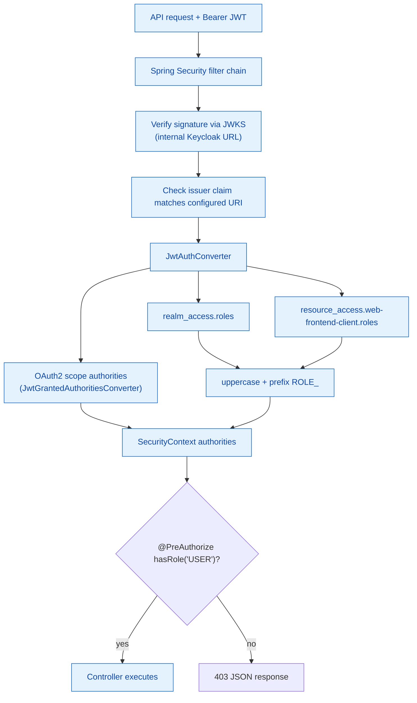

## Aspect-Oriented Programming

### Generic Spring AOP proxy flow (theory)

Source: thesis §2.13, "Client → Proxy → Advice Execution → Target Object". **Generic model** — in this project the only advice is a single `@Around` `LoggingAspect`; there is no security AOP advice (Spring Security is a servlet filter).

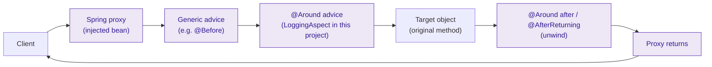

### Advice chain and proceed() unwind (generic model)

Source: thesis §2.13. The thesis example lists a security interceptor before logging, but the implemented project has only `LoggingAspect` — the diagram below is the **generic AOP model**, not this project's runtime chain.

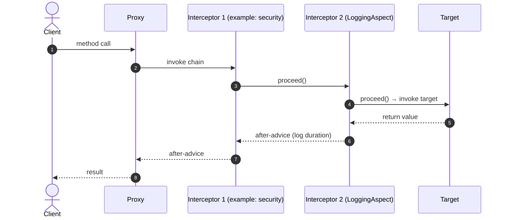

## Messaging and event flow

### Implemented request/reply over two fixed queues

**Implementation version** (code + thesis §4.3.3). The thesis §2.14.4 Figure 2.2 shows an illustrative JMSReplyTo pattern with `PurchaseMadeEvent`/`ResultEvent`. The actual code uses two **fixed named queues** (`purchase.requested`, `purchase.result`) and `PurchaseRequestedEvent`/`PurchaseResultEvent`; there is no JMSReplyTo header.

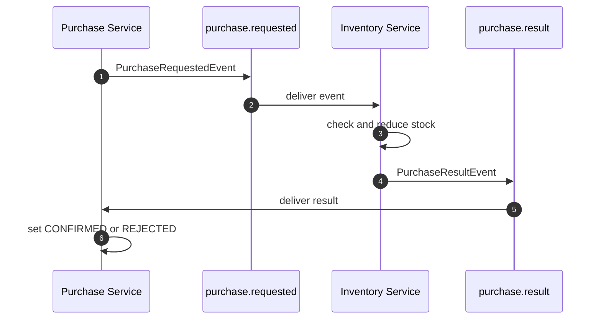

### BaseEvent polymorphic message contract

Source: thesis §4.3.3, Listings 4.23–4.25, and `JmsConfig`. The `_type` discriminator is the key to polymorphic deserialization.

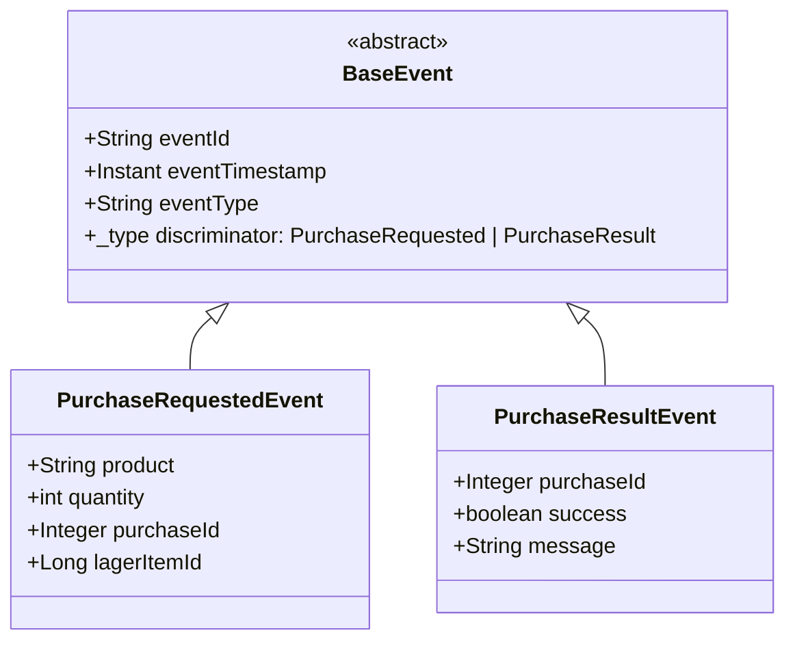

## Observability

### Layered request logging (thesis §4.3.3)

Source: thesis §4.3.3 "Layered Logging Strategy", §4.8. The five components are PropertyLogger (startup), EarlyLoggingValve, MdcJwtFilter, LoggingAspect, and Logback. The return path clears the MDC and logs the final status.

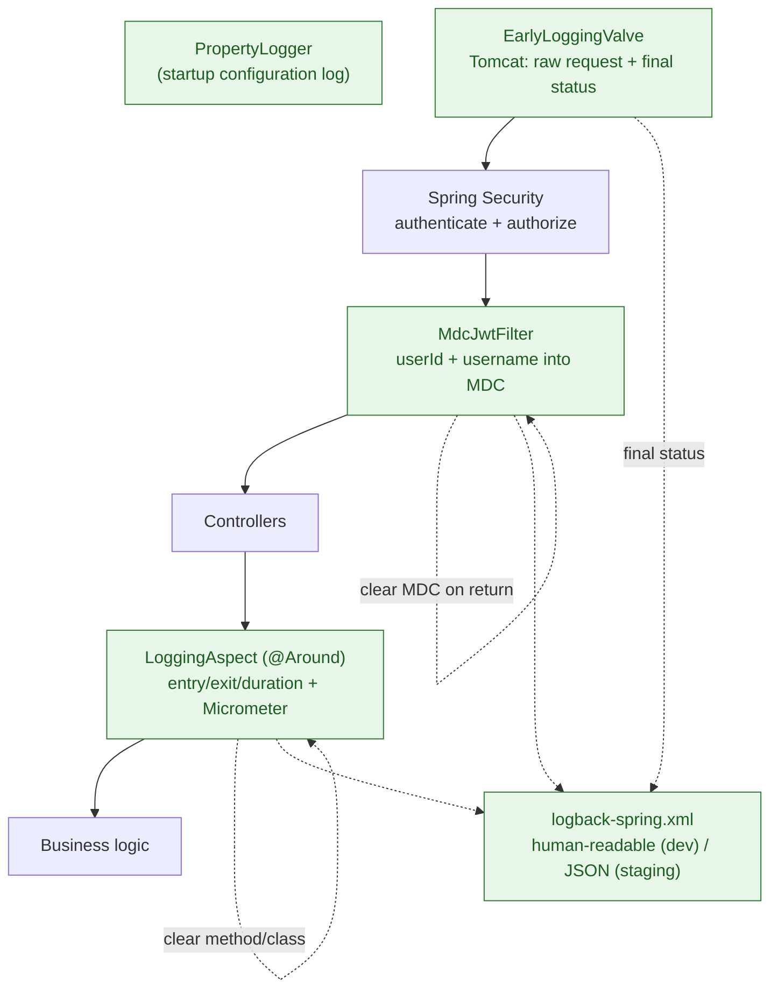

### Log pipeline to Grafana

Source: thesis §4.8.1 and `alloy-configmap.yaml`. The same `loki-gateway` serves both writes (`/loki/api/v1/push`) and Grafana queries.

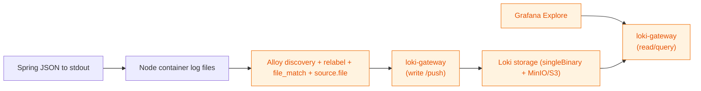

## Data and build

### Flyway migration flow (Inventory Service)

The Inventory Service has `V1__init.sql` (creates `lager_item`) and `V2__addData.sql` (seed rows). Other services own their own scripts (e.g. Purchase has `V1__init.sql`, `V2__status.sql`, `V3__userId.sql`).

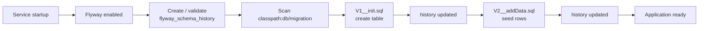

### Docker Bake build order

Only `inventory-service` and `purchase-service` inherit `builder-common`; the frontend, Artemis, Keycloak and dind images build independently. In CI the registry is rewritten from `localhost:5000/` to `registry.kube-system.svc.cluster.local:80/`.

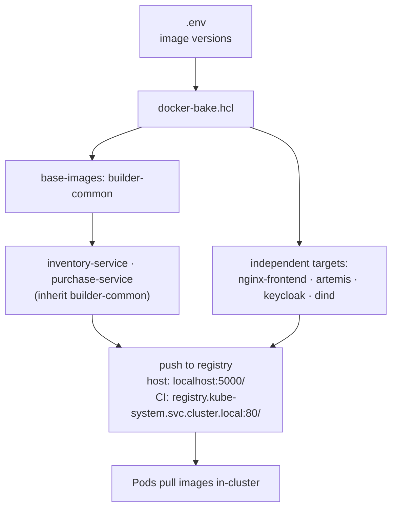

## CI/CD

### GitLab Runner Kubernetes executor lifecycle

Source: thesis §3.4.2, Figure 3.3. The actual `.gitlab-ci.yml` has three stages (`test`, `build`, `deploy`) plus a conditional `docs-build`; with the Kubernetes executor each job runs in its own ephemeral Pod. The thesis's two-stage single-Pod view is simplified.

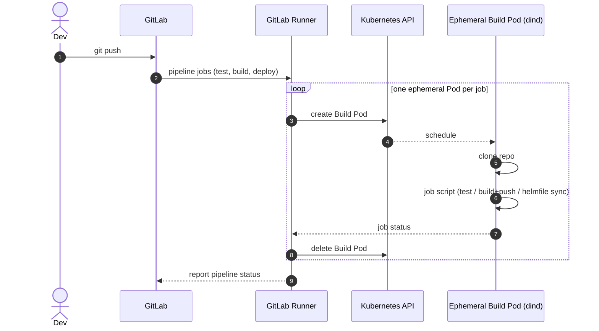
