# Thesis figures — review page

Pseudo-page for checking the figures extracted from `Thesis.pdf`. Each figure is numbered as in the thesis, with its original caption and PDF page. This page is a working draft and is not in the site navigation.

For the conceptual flows that were described in text but never drawn as figures (authentication, AOP, observability, and so on), see [thesis concept diagrams](thesis-concepts.md).

Figures with a `Figure N.N` caption are numbered in the thesis itself. Note the source has no Figure 2.3, so Chapter 2 jumps from 2.2 to 2.4.

## Chapter 2 — Background

### Figure 2.1 — Orchestration

PDF page 26. Caption in source: "Caption for orchestration".

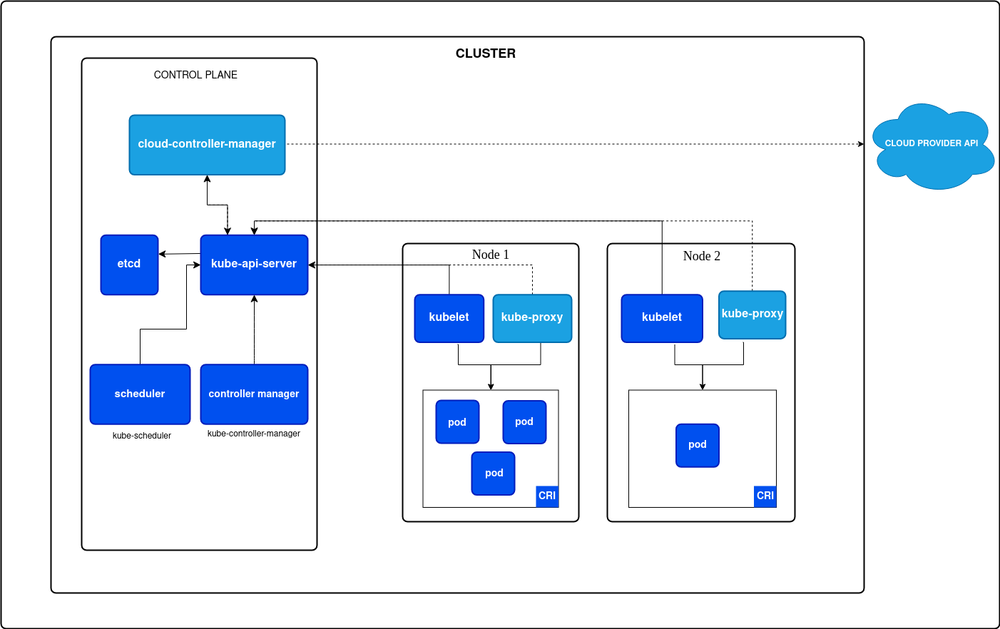

### Figure 2.2 — Request-reply event flow

PDF page 84. Source caption: "Request-Reply event flow between Purchase and Inventory services".

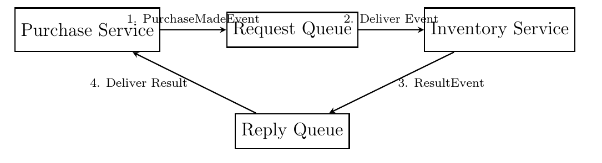

### Figure 2.4 — Helm architecture and workflow

PDF page 47. Source caption: "Helm Architecture and Workflow". **No image exists for this figure in the thesis** — the source contains only the caption followed by a parenthetical text description. It describes the Helm client running `helm install my-app ./my-chart -f prod-values.yaml`, combining the Chart (templates + `values.yaml`) and a custom Values File, rendering them into Kubernetes manifests, and sending them to the Kubernetes API Server.

## Chapter 3 — System design

### Figure 3.1 — Overall architecture and internal logic

PDF page 111. Source caption: "Overall architecture and internal logic of the monolithic project." Shows the browser, api-proxy, Keycloak (PKCE), Purchase and Inventory services, Artemis, and the Loki/Grafana logging path.

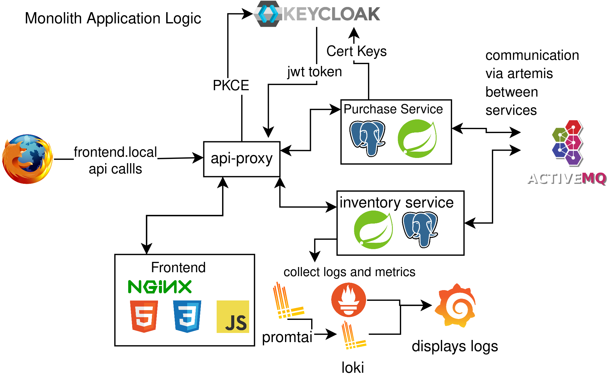

### Figure 3.2 — High-level Kubernetes architecture

PDF page 113. Source caption: "High-level Kubernetes architecture for the project, showing the dual application environments (dev and staging) and supporting namespaces."

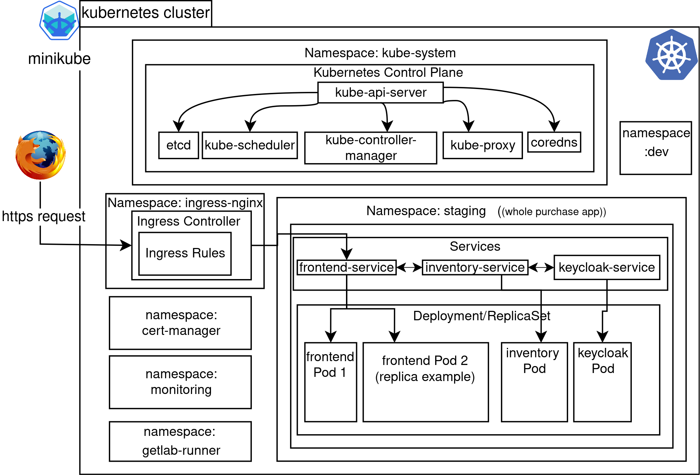

### Figure 3.3 — CI/CD infrastructure and deployment layer

PDF page 115. Source caption: "CI/CD infrastructure and deployment layer architecture."

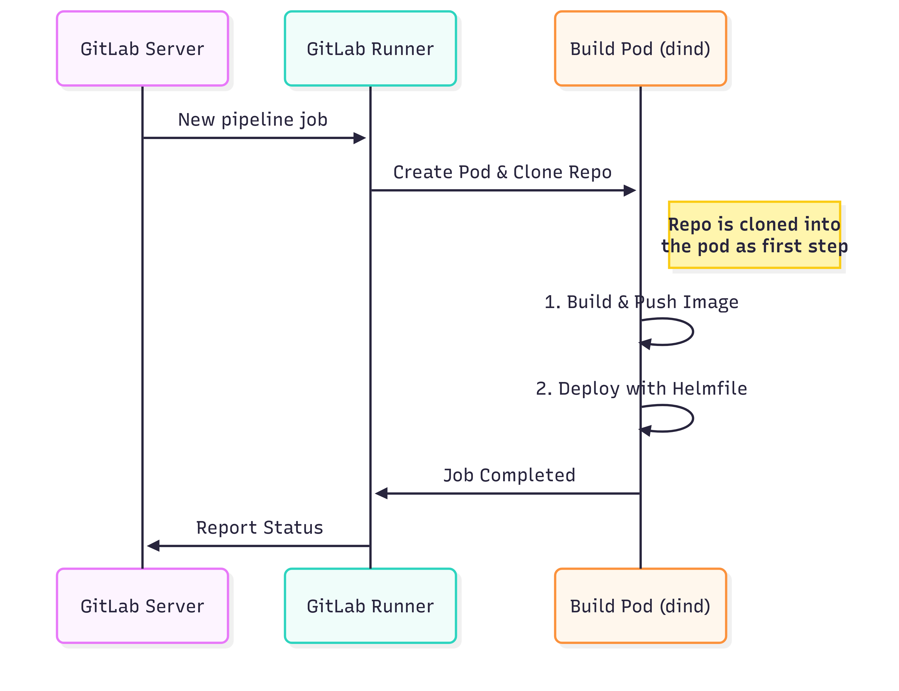

### Figure 3.4 — Security and authentication layer

PDF page 117. Caption in source: "Caption for design".

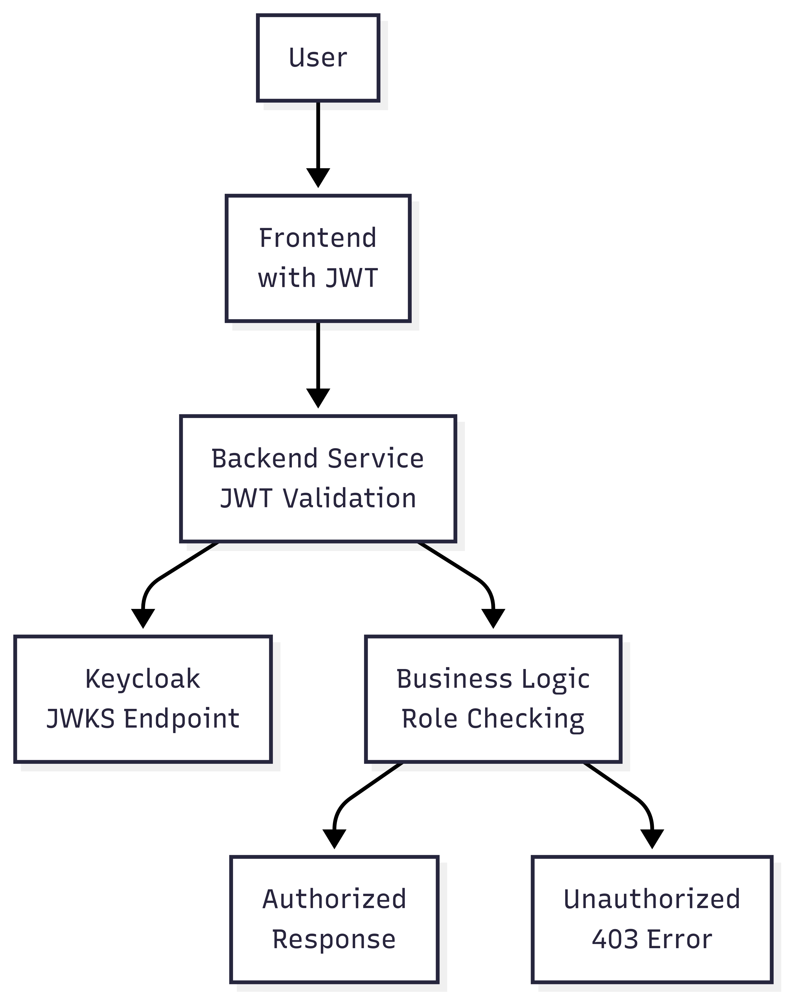

### Figure 3.5 — Maven dependency management hierarchy

PDF page 118. Source caption: "Maven dependency management hierarchy showing inheritance and composition."

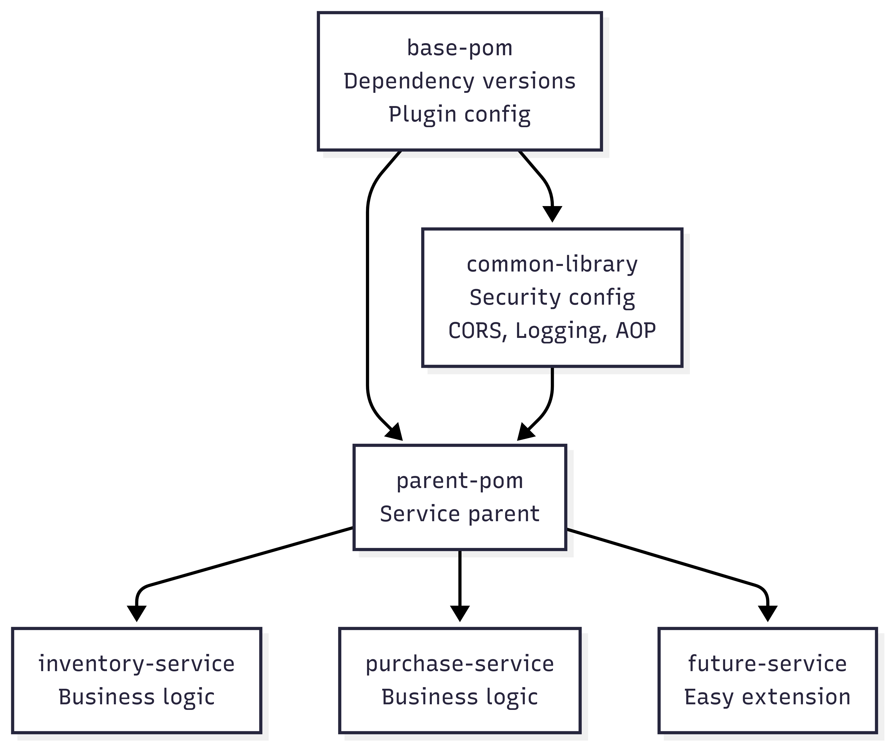

### Figure 3.6 — Observability layer

PDF page 120. Caption in source: "Caption for design".

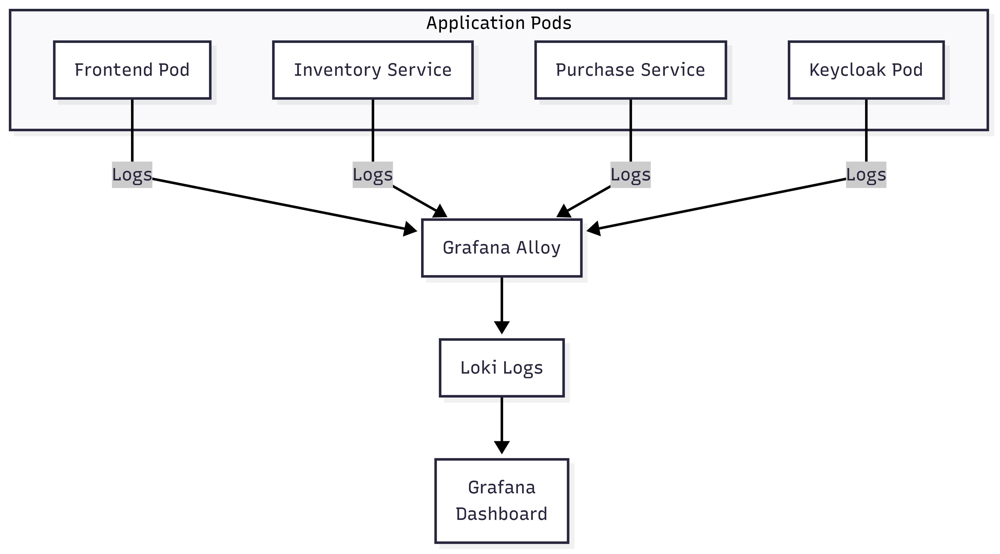

### Figure 3.7 — PKI layer

PDF page 122. Source caption: "PKI layer architecture showing certificate issuance and management flow."

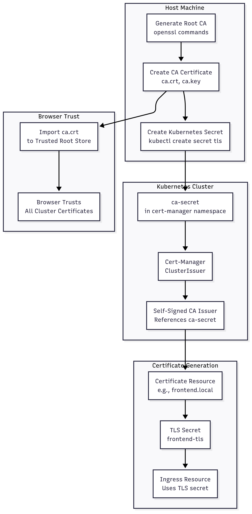

## Chapter 5 — System demonstration

These figures are screenshots from the running system.

### Figure 5.1 — Initial frontend landing page

PDF page 185.

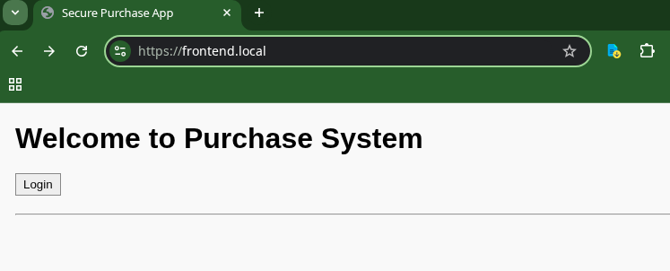

### Figure 5.2 — Secured frontend before authentication

PDF page 186.

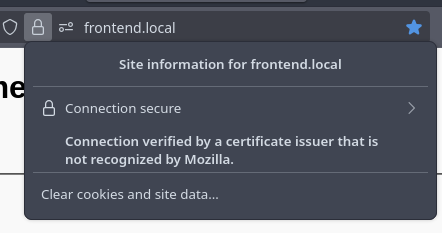

### Figure 5.3 — Keycloak authentication portal

PDF page 187.

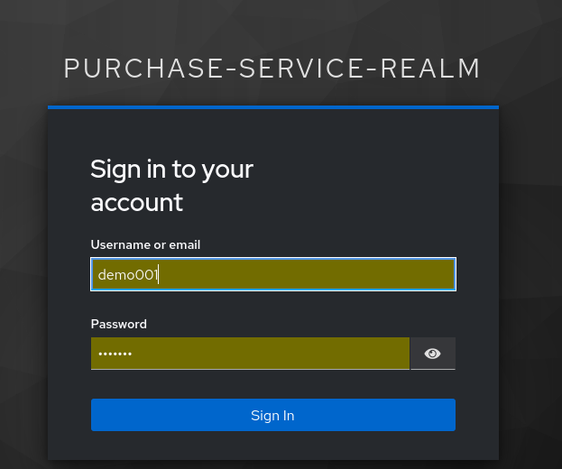

### Figure 5.4 — Frontend dashboard after login

PDF page 187.

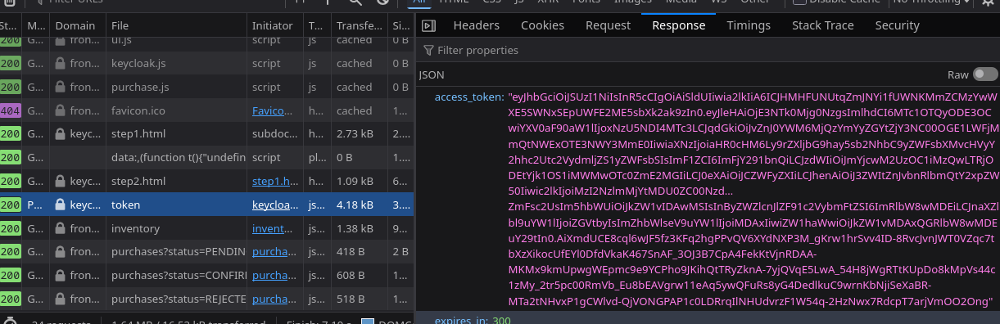

### Figure 5.5 — Decoded JWT token

PDF page 188.

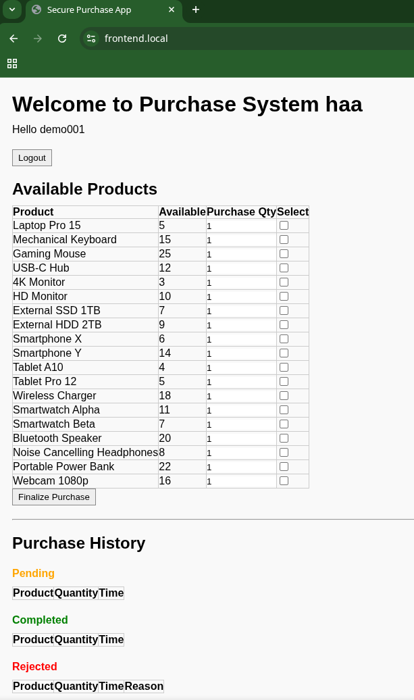

### Figure 5.6 — Final purchase states

PDF page 189. Source caption: "User interface showing the final states of purchase requests: Rejected due to insufficient stock and Completed successfully."

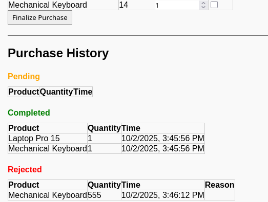

### Figure 5.7 — GitLab CI/CD pipeline

PDF page 190. Source caption: "GitLab CI/CD pipeline interface showing all jobs completed successfully."

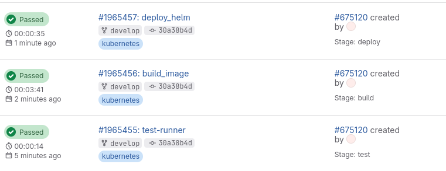

### Figure 5.8 — Two GitLab runner pods

PDF page 190. Source caption: "Kubernetes Pods view showing two GitLab runner pods: one for a completed job and one actively running."

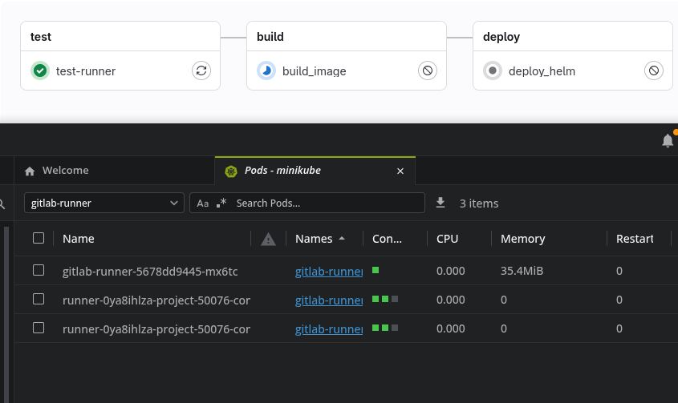

### Figure 5.9 — One active runner after cleanup

PDF page 191.

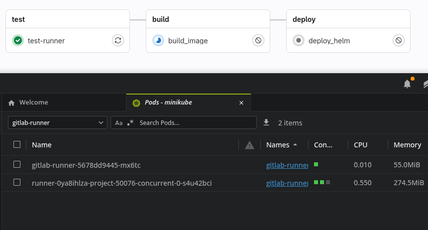

### Figure 5.10 — Healthy pods in the development namespace

PDF page 191.

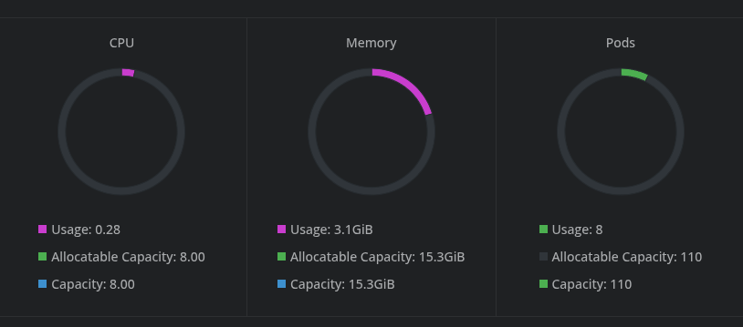

### Figure 5.11 — Namespaces list

PDF page 192.

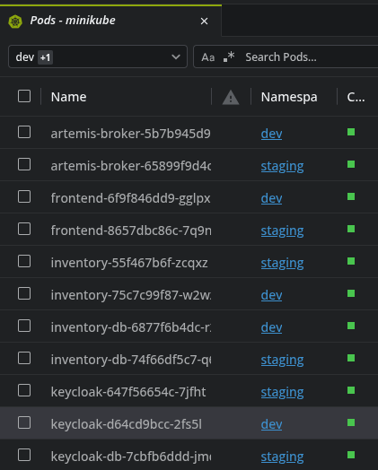

### Figure 5.12 — Staging namespace pods

PDF page 193.

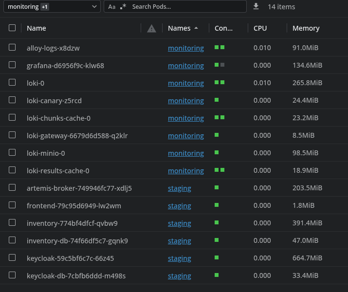

### Figure 5.13 — Grafana Loki log explorer

PDF page 193.

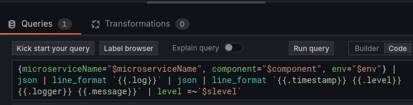

### Figure 5.14 — Filtered log output

PDF page 194.

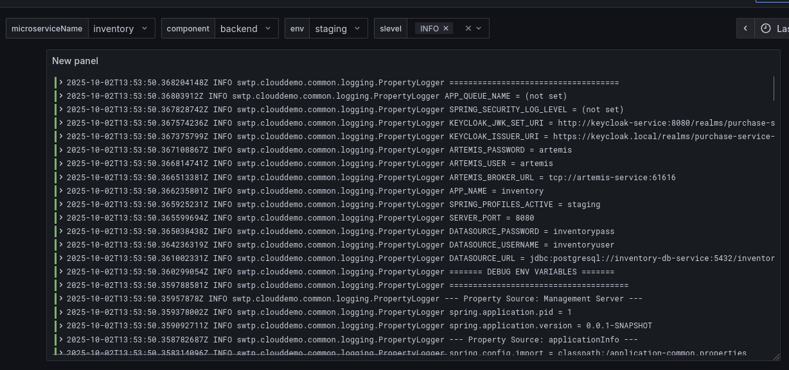
