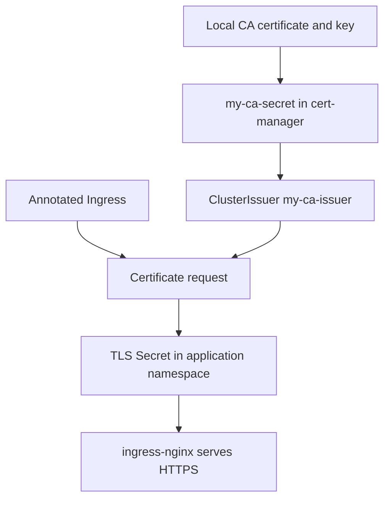

# Certificate management

The staging environment exposes `frontend.local` and `keycloak.local` through ingress-nginx using HTTPS. cert-manager issues their certificates from a **local certificate authority**. The HTTP development tutorial does not require certificates.

## How the pieces connect



The CA secret is in cert-manager's cluster resource namespace (`cert-manager` in this setup). The ClusterIssuer references `secretName: my-ca-secret`; it does not use a `secretNamespace` field. Leaf TLS Secrets such as `frontend-tls` and `keycloak-tls` live with their respective Ingress resources, normally in `staging`.

## 1. Prepare a CA

Use your own CA for a fresh learning cluster. Keep its private key local. The example below writes to an ignored `.local` directory and should be run once for that CA; reuse it for subsequent deployments rather than overwriting it.

```bash
mkdir -p .local/certificate-authority
openssl genrsa -out .local/certificate-authority/ca.key 4096
chmod 600 .local/certificate-authority/ca.key
openssl req -x509 -new -nodes \
 -key .local/certificate-authority/ca.key -sha256 -days 3650 \
 -out .local/certificate-authority/ca.crt \
 -subj '/CN=Purchase System Local Root CA'
openssl x509 -in .local/certificate-authority/ca.crt \
 -noout -subject -issuer -dates
```

Import the **certificate**, not the private key, into the trust store used by your operating system and browser. Trust-store commands differ between Arch/RHEL, Debian/Ubuntu, and browsers with separate stores. The [cert-manager CA issuer documentation](https://cert-manager.io/docs/configuration/ca/) explains the issuer's trust and renewal responsibilities.

The older `scripts/setup-certs.sh` changes into `scripts/` and writes `scripts/certificate-authority/ca7.*`, while `scripts/startup.sh` expects `certificate-authority/ca7.*` at the repository root. Those paths do not match. The explicit commands here use one consistent location.

## 2. Install cert-manager and the issuer

With the cluster from the [Kubernetes tutorial](tutorials/local-kubernetes.md) active:

```bash
helmfile --file environments/helmfile.yaml -e staging \
 --selector name=cert-manager sync
kubectl get pods -n cert-manager
kubectl create secret tls my-ca-secret -n cert-manager \
 --cert=.local/certificate-authority/ca.crt \
 --key=.local/certificate-authority/ca.key \
 --dry-run=client -o yaml | kubectl apply -f -
helmfile --file environments/helmfile.yaml -e staging \
 --selector name=ca-issuer sync --skip-needs
kubectl get clusterissuer my-ca-issuer
```

The repository pins cert-manager to `v1.18.2`, enables its CRDs, and verifies the chart using the checked-in keyring. Wait for its controllers and webhook to be ready before applying resources that depend on them. The issuer should report `Ready=True`; inspect `kubectl describe clusterissuer my-ca-issuer` if it does not.

## 3. Deploy staging application ingress

Start the registry port forward and build the images as described in the tutorial, then enable ingress and deploy only the staging application releases:

```bash
minikube addons enable ingress
helmfile --file environments/helmfile.yaml -e staging \
 --selector name=frontend --selector name=keycloak \
 --selector name=message-broker --selector name=inventory-service \
 --selector name=purchase-service sync --skip-needs
bash scripts/update-hosts.sh
```

The hosts script maps `frontend.local` and `keycloak.local` to `minikube ip` and edits `/etc/hosts` using sudo. The host must be able to route to that IP. Staging values enable the Ingress objects and point the frontend at HTTPS Keycloak.

The frontend template includes this relationship:

```yaml
metadata:
 annotations:
 cert-manager.io/cluster-issuer: my-ca-issuer
spec:
 ingressClassName: nginx
 tls:
 - hosts:
 - frontend.local
 secretName: frontend-tls
```

cert-manager's ingress integration creates the Certificate resource from this annotated Ingress. You do not need to create an unrelated `hello.local` Certificate manually.

## 4. Verify HTTPS

```bash
kubectl get ingress,certificate -n staging
kubectl describe certificate frontend-tls -n staging
kubectl get secret frontend-tls keycloak-tls -n staging
curl --cacert .local/certificate-authority/ca.crt https://frontend.local
```

Open <https://frontend.local> and <https://keycloak.local> after trusting the CA. If the certificate is not ready, inspect CertificateRequests and issuer events. If the certificate is ready but the browser complains, check SAN hostnames, expiry, host routing, and browser trust. Bypassing verification would hide those causes.

This setup uses local names and a private CA for learning. It does not configure public DNS, a public ACME issuer, or production secret management.
