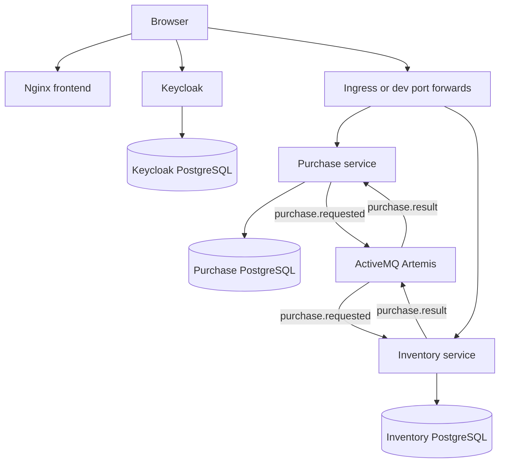
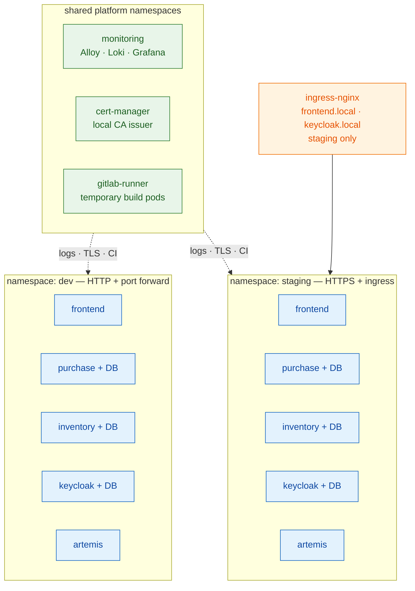

# System architecture

The application separates purchase records from stock management. The browser communicates with both services over HTTP, while the services coordinate stock decisions through a broker.

In staging, ingress-nginx routes `frontend.local` paths to the frontend and API Services and exposes Keycloak at `keycloak.local`. In development, ingress is disabled and the browser reaches the forwarded ports directly.

Namespaces provide the isolation between the two environment instances. Platform tooling lives in shared namespaces that are not selected by `dev` or `staging`.

## Responsibilities

| Component | Responsibility | Source directory |
| --- | --- | --- |
| Frontend | Sign in, display inventory, submit purchases, query history | `services/web-client` |
| Purchase | Save purchase requests, publish events, apply result status | `services/purchase-service` |
| Inventory | List available stock and reduce quantities for requests | `services/inventory-service` |
| Common Java module | Security, event types, JMS conversion, logging, AOP | `services/common` |
| Keycloak | Realm, clients, users, and access tokens | `services/keycloak` and `charts/keycloak-chart` |
| Artemis | Queues between the business services | `services/artemis` and `charts/message-broker-chart` |
| Alloy, Loki, Grafana | Collect, store, and query logs | `charts/monitoring-stack-chart` and `environments/values/charts` |

The Java module structure reflects shared infrastructure code, while each business service keeps its controller, service, repository, entity, and migration files. PostgreSQL instances are deployed separately by the relevant charts. Flyway migrations define the business schemas.

## Why use asynchronous messages?

Purchase does not directly call Inventory to reserve stock. It saves a request and publishes a message. Inventory consumes that message and sends a result later. That makes the intermediate `PENDING` state part of the application model and introduces a useful learning problem: observing a workflow that spans processes and does not complete in one HTTP exchange.

This small implementation does not include an outbox, a complete distributed transaction strategy, or an idempotency mechanism for repeated inventory processing. The [messaging page](messaging.md) explains those boundaries so that the example is not mistaken for a complete order-processing design.

## What Kubernetes contributes

Deployments keep application containers running, Services provide stable names, ConfigMaps and Secrets supply runtime configuration, and persistent volume claims back the stateful components. Helm packages those resources, and Helmfile passes environment values to each release.

Kubernetes is the maintained runtime because the project evolved toward learning orchestration. The [history](../project-history.md) describes the move during the final development month. Continue with [Kubernetes, Helm, and Helmfile](kubernetes-and-helm.md) to follow a value into a manifest.
