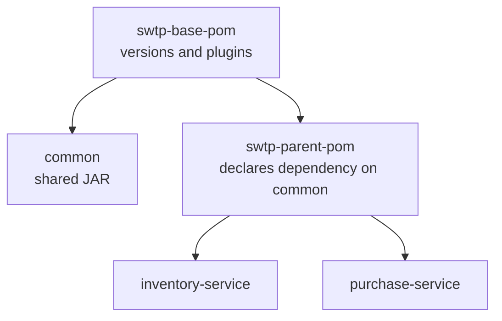
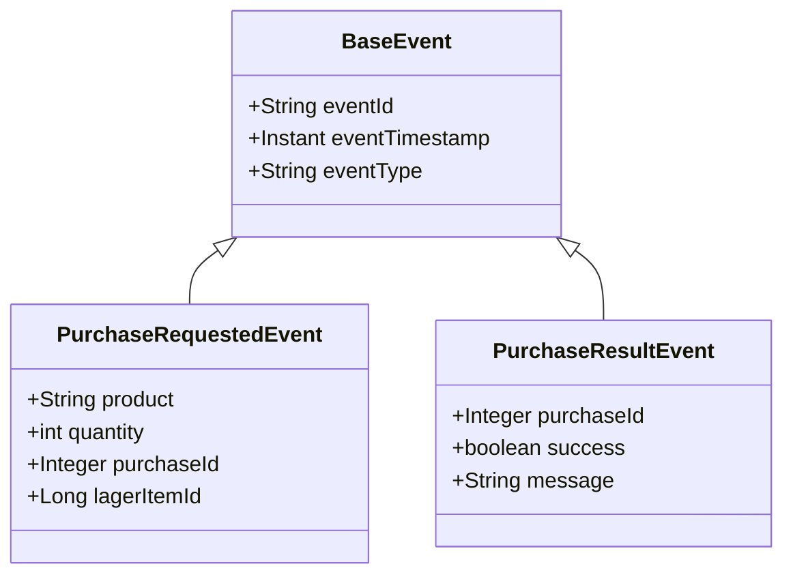

# The shared Java library

Both business services depend on the same `services/common` module. It is packaged as a JAR and carries the concerns that should behave identically everywhere: security, JWT handling, message contracts, logging, and exception handling. This keeps the services small and is the concrete implementation of the DRY principle described in the implementation chapter of the project's thesis (§4.2–4.3).

You do not need to read this page to [run the application](../tutorials/local-kubernetes.md). Read it when you change a cross-cutting concern and need to know where that change will land.

## The Maven hierarchy

There is no root reactor POM; the inheritance is explicit and must be installed in order for a local build.



| POM | Version | Responsibility |
| --- | --- | --- |
| `services/poms/swtp-base-pom` | `1.0.5` | Spring Boot `3.5.3`, Java `21`, dependency versions and plugin configuration |
| `services/common` | `1.0-SNAPSHOT` | Shared runtime code, packaged as a JAR |
| `services/poms/swtp-parent-pom` | `1.0.5` | Inherits the base and adds `common` as a dependency |
| `services/inventory-service`, `services/purchase-service` | — | Inherit the parent and therefore get both versions and shared code |

Each service imports the shared beans with `@Import(CommonConfig.class)` on its application class. `CommonConfig` component-scans `swtp.clouddemo.common` and exposes the `JwtAuthConverter` bean. The [development workflow](../guides/development.md#build-java-outside-docker) shows the install order; in Docker builds, the `builder-common` image caches these dependencies before the service images compile.

The straightforward hierarchy keeps dependency versions in one place and gives every service the same runtime components.

## Security foundation

`SecurityConfig` defines one shared `SecurityFilterChain` for both services:

| Rule | Behavior | Reason |
| --- | --- | --- |
| CSRF | Disabled | Tokens are stateless; there is no browser session cookie to protect |
| CORS | Enabled, with `OPTIONS` permitted for both API paths | Browsers send preflight requests before cross-origin calls |
| `/actuator/prometheus` | `permitAll()` | Allows metric scraping without a user token |
| Every other request | `authenticated()` | The API is not anonymously readable |
| OAuth2 resource server | JWT with the custom converter | Validates tokens issued by Keycloak |

The issuer and JWK URLs come from `KEYCLOAK_ISSUER_URI` and `KEYCLOAK_JWK_SET_URI`. They deliberately differ: the browser validates against the public Keycloak address, while Pods fetch signing keys through cluster DNS. See [authentication and roles](authentication.md#issuer-and-signing-keys-are-different-concerns).

`JwtAuthConverter` bridges Keycloak's nested claims and Spring Security's authority model:

- It reads roles from both `realm_access.roles` and `resource_access["web-frontend-client"].roles`.
- It uppercases each role and prefixes `ROLE_`, so `user` becomes `ROLE_USER` for `@PreAuthorize("hasRole('USER')")`.
- It also keeps the standard OAuth2 scope-derived authorities.
- The authentication principal name is `preferred_username`, falling back to `sub`.

`JwtService` is the small helper business code uses to read claims from the security context. Purchase creation uses `getUserId()` — the token's `sub` — as the stored user ID. The [API reference](../reference/api.md) notes that this ID is stored but not used to filter history.

!!! warning "Verbose token logging"
    The checked-in converter logs JWT claims, metadata, and a token fragment on each request. That is useful while learning and dangerous in a shared environment. Do not copy those log statements into a public deployment.

`CorsConfig` allows the development origins (`localhost:4200`, `127.0.0.1:4200`, a LAN test address) plus `https://frontend.local`, permits common REST methods, allows credentials, and exposes `Authorization`, `Content-Type`, and `X-Requested-With`. The realm's actual redirect URIs and web origins are in `services/keycloak/realms/purchase-service-realm-realm.json`.

## How a request is observed

The common module layers four mechanisms around a request. The thesis presents them as a single "observability foundation"; the checked-in code implements them as follows.

```text
Tomcat valve          raw request in / final status out
  Spring Security       authenticate, authorize
    MdcJwtFilter          userId + username into the MDC
      Controllers         ... AOP around service and repository methods
    MdcJwtFilter          MDC cleared
  Spring Security       response headers
Tomcat valve          response status logged
```

| Component | Where it acts | What it adds |
| --- | --- | --- |
| `PropertyLogger` | Application startup | Logs active profile and resolved configuration values; skips the `prod` profile |
| `EarlyLoggingValve` | Embedded Tomcat, before Spring | Logs `method` and `uri` on entry and the final `status` on exit, even if a filter rejects the request |
| `MdcJwtFilter` | Servlet filter, after authentication | Adds `userId` and `username` to every log line, then clears the MDC to avoid leaking context between pooled threads |
| `LoggingAspect` | AOP around `service`, `controller`, and `repository` packages | Logs entry, exit, duration, and errors; adds `method` and `class` to the MDC; records Micrometer timers and counters; warns when a call exceeds one second |
| `logback-spring.xml` | Log encoding | Human-readable output in development, JSON with `app` and MDC fields in staging |

`LoggingAspect` is proxy-based method interception, not distributed tracing. The checked-in code adds **user, method, and class context only** — there is no trace or correlation ID in the current logs.

The meters are named `app.method.execution.duration`, `app.method.execution.count`, and `app.method.execution.errors`. They are exposed through Actuator, but no Prometheus server is deployed; see [Grafana Alloy and logging](../monitoring-and-logging.md#metrics-are-exposed-but-collection-is-unfinished).

## The event contract and JMS setup

Messaging types live in `common` so both services compile against the same contract.



`BaseEvent` uses Jackson's `@JsonTypeInfo` to write a `_type` property and `@JsonSubTypes` to resolve `PurchaseRequested` and `PurchaseResult` back to Java classes. `JmsConfig` registers a `MappingJackson2MessageConverter` with `MessageType.TEXT`, the `JavaTimeModule` for `Instant` fields, and `_type` as the type-id property — the two `_type` settings must agree.

| Shared class | Responsibility |
| --- | --- |
| `BaseEvent` and the two event classes | Serializable event payloads with a UUID, timestamp, and correlation ID (`purchaseId`) |
| `QueueNames` | The two queue constants: `purchase.requested` and `purchase.result` |
| `MessageProducer` | Thin wrapper over `JmsTemplate.convertAndSend` |
| `JmsConfig` | JSON conversion for JMS text messages |

The services connect to Artemis in native mode with point-to-point queues (`spring.jms.pub-sub-domain=false`) and 1–5 listener threads. The full message path — including where the transaction and idempotency gaps are — is in [asynchronous purchases](messaging.md).

## What's next

- [Authentication and roles](authentication.md) for the Keycloak side of token validation.
- [Asynchronous purchases](messaging.md) for the event flow through both queues.
- [Grafana Alloy and logging](../monitoring-and-logging.md) for what happens to these logs after they leave the Pod.
- [Repository map](../reference/repository.md#follow-a-feature-through-the-java-code) for a file-by-file reading path.
