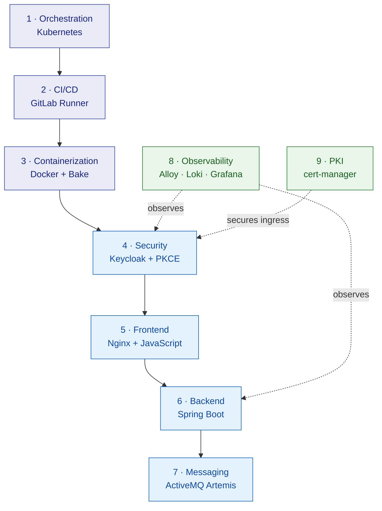

# Design decisions and rationale

The [architecture page](architecture.md) describes what the system does. This page explains **why it is put together this way**, what alternatives were considered, and which trade-offs were accepted. It follows the design chapter of the project's accompanying bachelor thesis (§3.2–3.5) and is included here because the reasoning behind a choice matters as much as the choice itself. The [repository map](../reference/repository.md) points to the files behind each claim.

## Design methodology

The design was pragmatic rather than greenfield. Several technologies were fixed from the start — Kubernetes and Minikube, Apache Artemis, Spring Boot, PostgreSQL, and plain HTML/CSS/JavaScript — and the remaining pieces were chosen to make that core workable. Five principles guided the work:

| Principle | What it meant in this project |
| --- | --- |
| Layered architecture | Separate orchestration, CI/CD, containerization, security, frontend, backend, messaging, observability, and PKI so each layer can change independently |
| Best-practice integration | Add GitLab CI/CD, cert-manager, and logging/visualization tools around the fixed core |
| Incremental refinement | Design, test, and integrate one layer at a time instead of deploying everything at once |
| Reusability and modularity | Shared Maven POMs, a common Java library, and repeated Helm chart templates |
| Security first | Keycloak with the OIDC authorization-code flow and PKCE from the beginning, rather than as an afterthought |

This is a learning system, so "best practice" means *demonstrating the pattern in a small, understandable form*. Several layers are deliberately minimal; the [learning process](../learning-process.md) puts that in context.

## The nine layers at a glance

The thesis describes the system as nine layers. The table maps each one to the checked-in implementation.

| Layer | Role | Where to look |
| --- | --- | --- |
| 1. Orchestration | Deploy, network, and scale all components | `environments/helmfile.yaml`, `charts/` |
| 2. CI/CD | Automate build and deployment | `.gitlab-ci.yml`, `services/dind/` |
| 3. Containerization | Consistent runtime images | `docker-bake.hcl`, each service's Dockerfile |
| 4. Security and authentication | Central identity, distributed authorization | `services/keycloak/`, `services/common/.../security/` |
| 5. Frontend | Sign-in UI, inventory display, purchase submission | `services/web-client/` |
| 6. Backend application | REST APIs and business logic | `services/purchase-service/`, `services/inventory-service/` |
| 7. Message broker | Asynchronous service-to-service workflow | `services/artemis/`, `charts/message-broker-chart/` |
| 8. Observability | Collect, store, and query logs | `charts/monitoring-stack-chart/`, `environments/values/charts/` |
| 9. Certificate authority / PKI | TLS for the staging ingress | `certificate-authority/`, `charts/ca-issuer/` |

The layers stack from the platform up to the business workflow. Observability and PKI apply across the stack rather than sitting in the request path.

Layer 8 is only partially realized: logs have a working Alloy → Loki → Grafana pipeline, but no Prometheus server is deployed even though the applications expose metrics. [Grafana Alloy, explained](../technologies/grafana-alloy.md) goes deep on the collector, and [Grafana Alloy and logging](../monitoring-and-logging.md#metrics-are-exposed-but-collection-is-unfinished) covers the operational side.

Two supporting namespaces are shared by both application environments: `monitoring` for the logging stack and `cert-manager` for TLS. CI/CD work uses `gitlab-runner`. The application itself runs in `dev` or `staging`, as described in [Kubernetes, Helm, and Helmfile](kubernetes-and-helm.md#namespaces-and-shared-infrastructure).

## Decisions and alternatives

Each decision below is recorded the way the thesis does: the option considered, the option chosen, and the reason.

### Maven dependency management: custom hierarchy instead of a BOM

**Alternative:** a conventional Bill of Materials module that declares only versions, with each service importing it and declaring its own dependencies. This is more flexible and follows typical Spring Boot guidance, but it adds configuration and makes it easier for services to drift apart.

**Chosen:** a custom parent hierarchy — `swtp-base-pom` holds versions and plugin configuration, `common` holds shared runtime code, `swtp-parent-pom` inherits the base and declares `common` as a dependency, and the two services inherit the parent. See [the shared Java library](common-library.md#the-maven-hierarchy).

**Why:** with only two or three services, consistency and a short path for new services matter more than selective dependency control. **Trade-off accepted:** services inherit dependencies they may not use and cannot easily exclude them.

### Container registry: Minikube addon instead of Nexus or Harbor

**Alternatives:** Harbor (CNCF project with scanning and replication, but a large footprint) and Nexus (enterprise features and proxy caching, likewise heavy).

**Chosen:** the Minikube registry addon at `localhost:5000/`, with images pushed from the host and pulled by cluster nodes. Builds are defined in `docker-bake.hcl` and pushed by `make build-and-push`.

**Why:** the development machine has limited memory and this is a single-user setup; the addon needs little memory and almost no configuration. **Trade-off accepted:** no scanning, replication, or enterprise access control, and the host/node reachability mismatch that [troubleshooting](../guides/troubleshooting.md#image-builds-and-image-pulls) explains.

### Development environment: Kubernetes only instead of Compose plus Kubernetes

**Alternative:** keep Docker Compose for fast local development and Kubernetes for deployment. It starts faster and is simpler to debug, but the two environments drift apart: different networking, different service discovery, and two configuration sets to maintain.

**Chosen:** one Kubernetes-based workflow with two namespaces. The early Compose implementation is preserved as the `Docker-Compsoe-Version` tag and is no longer maintained; see [project history](../project-history.md).

**Why:** dev/prod parity, ingress features such as host-based routing and TLS termination, and one source of truth for configuration. **Trade-off accepted:** slower iteration — every code change requires an image rebuild and, usually, a workload restart, as the [development workflow](../guides/development.md) notes.

### CI/CD: external GitLab with an in-cluster runner

**Alternative:** host a full GitLab instance inside the cluster for complete data control and no usage limits. The thesis estimates roughly 8 GB RAM, 4 CPU cores, and 50 GB storage for that control plane, plus ongoing patching and backup work.

**Chosen:** an external GitLab instance with a lightweight GitLab Runner deployed in the `gitlab-runner` namespace. Each job creates a temporary build Pod from the custom `dind` image, which carries Docker Buildx, Helm, Helmfile, and kubectl. See [the CI/CD workflow](../guides/development.md) and the runner values under `environments/values/charts/`.

**Why:** avoid running and maintaining a GitLab control plane; the runner needs far fewer resources. **Trade-off accepted:** the pipeline depends on an external service, and the checked-in runner values include a specific external GitLab host, credentials, `hostNetwork`, and a `cluster-admin` binding. Those values belong to the original setup and need review before reuse.

### Configuration: one Helmfile with a values template

**Alternative:** separate `helm install/upgrade` commands per environment and chart, with duplicated values files.

**Chosen:** a single `environments/helmfile.yaml` selecting `dev` or `staging` values, plus `env-magic.gotmpl` to compose values per release. The thesis presents this unified values strategy as one of its main contributions.

**Why:** one source of truth for environment settings, explicit release ordering through `needs`, and no per-chart deployment scripts. **Trade-off accepted:** the template merges at the top level rather than recursively, and `needs` does not wait for applications to become ready. Both behaviors are explained in [Kubernetes, Helm, and Helmfile](kubernetes-and-helm.md#environment-values-and-merge-behavior).

## What's next

- [Learning process](../learning-process.md) — how the project was built and what was learned.
- [System architecture](architecture.md) for the component map and request flow.
- [The shared Java library](common-library.md) for the cross-cutting code that makes the layers consistent.
- [End-to-end use cases](use-cases.md) to see the layers working together.
- [Grafana Alloy, explained](../technologies/grafana-alloy.md) for the logging collector in depth.
