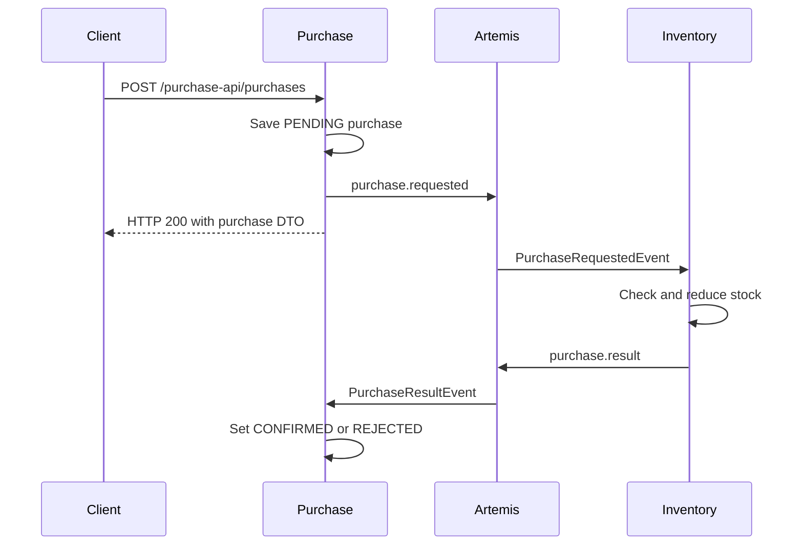

# Asynchronous purchases

Submitting a purchase and deciding whether stock exists happen in different services. ActiveMQ Artemis carries the request and result using JMS queues.

The response and background processing can overlap; the diagram shows the logical steps, not a guarantee that the result listener always runs after the client receives its response.

## Implementation path

1. `PurchaseServiceImpl.createPurchase` obtains the JWT subject, saves the purchase, and sends a `PurchaseRequestedEvent` to `purchase.requested`.
2. `PurchaseRequestedListener` in Inventory receives the event and calls `LagerService.consumeProductIfAvailable`.
3. Inventory sends a `PurchaseResultEvent` to `purchase.result`, indicating success or failure.
4. `PurchaseResultListener` in Purchase maps the result to `CONFIRMED` or `REJECTED` and updates the stored purchase.

The event classes and queue constants live in `services/common`. `JmsConfig` configures Jackson text messages and the `_type` property used to identify Java event types. Both services therefore depend on the shared event contract.

## Eventual consistency in this example

There is a window when a purchase exists while its stock decision is still pending. The UI can query purchases by status to observe the result later. The current response DTO omits status, so use a status-filtered query or inspect the database when you need to verify completion.

A pending purchase is also a useful diagnostic signal. It can mean that the broker is unavailable, an inventory consumer failed, or the result was not processed. Inspect both service logs and broker connectivity before retrying the HTTP request, because another POST creates another purchase.

## Current limits

Saving a purchase and sending a JMS message are separate operations in the current method. There is no transactional outbox or coordinated database-and-broker transaction, so a failure between them can leave a stored request without a corresponding message.

Inventory checks stock and then saves a reduced quantity. The implementation does not provide an explicit idempotency check for duplicate events or a complete concurrency-control strategy for simultaneous purchases. Input validation also does not enforce all business constraints, such as a positive quantity, at the controller boundary. These are useful follow-up exercises, not features implemented by the existing queue configuration.

See [ActiveMQ Artemis documentation](https://activemq.apache.org/components/artemis/documentation/) and [Spring JMS](https://docs.spring.io/spring-framework/reference/integration/jms.html) for the underlying systems. Try [your first purchase](../tutorials/first-purchase.md) to observe the implemented workflow.
