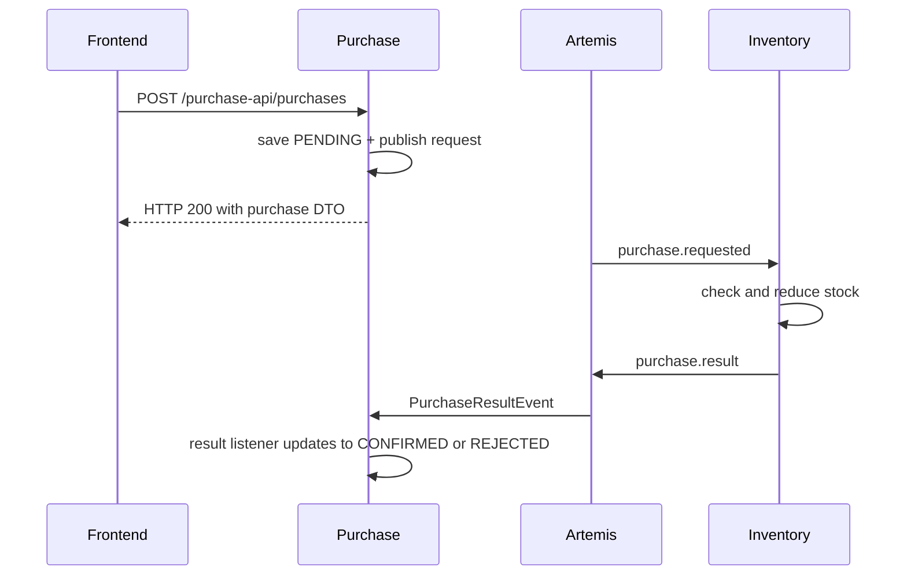

# End-to-end use cases

This page walks through the running system from a user's point of view. This page keeps those scenarios and connects each one to the code and configuration behind it. To reproduce them yourself, follow [local Kubernetes](../tutorials/local-kubernetes.md) and [make your first purchase](../tutorials/first-purchase.md).

## 1. Sign in and load the frontend

A user opens the application. In staging, the request reaches the frontend through the HTTPS ingress at `frontend.local`; in development it reaches a forwarded port at `localhost:4200`. The frontend shows a login page and redirects to Keycloak's authorization endpoint.

The authorization request carries the standard OIDC parameters:

| Parameter | Value in this project |
| --- | --- |
| `client_id` | `web-frontend-client` |
| `redirect_uri` | `https://frontend.local/*` in staging, `http://localhost:4200/*` in development |
| `response_type` | `code` |
| `scope` | `openid profile email offline_access` |
| `code_challenge_method` | `S256` (PKCE) |
| `state`, `nonce` | Random values for the flow |

The checked-in realm includes a demo user `demo001` with password `demo001` and a default group that assigns the `USER` role. After login, Keycloak redirects back to the frontend with a code that the client exchanges for a JWT. The frontend keeps that token and attaches it to API calls; see [authentication and roles](authentication.md#browser-flow).

## 2. Submit a purchase

The authenticated user loads the inventory and clicks *Finalize Purchase*. What follows is deliberately not a single request:

The design describes the outcome the user sees: if stock is sufficient the purchase becomes **Completed**, otherwise **Rejected**. In the checked-in code those states are named `CONFIRMED` and `REJECTED`, with `PENDING` while the broker work is in flight; the [messaging page](messaging.md) explains the names and the timing.

Under heavy use, Inventory can become the bottleneck and purchases accumulate in `PENDING`. The design points to horizontal scaling — more Inventory replicas — as the response. The charts expose replica counts as values, though no Horizontal Pod Autoscaler is configured.

## 3. Run the CI/CD pipeline

A push to GitLab triggers the pipeline defined in `.gitlab-ci.yml`:

1. **test** — a job confirms that the Kubernetes runner works.
2. **build** — a temporary build Pod starts a Docker daemon, creates a Buildx builder, switches the registry to the cluster-local address, and runs `docker buildx bake base-images --push` and `application-images --push`.
3. **deploy** — Helmfile syncs the staging environment.

The Runner uses the Kubernetes executor with a custom Docker-in-Docker image, so each job gets a clean Pod that is deleted afterwards. The [development workflow](../guides/development.md) and [design decisions](design-decisions.md#cicd-external-gitlab-with-an-in-cluster-runner) explain the tooling and the trade-off of keeping GitLab itself outside the cluster.

## 4. Run two environments side by side

The system runs in separate `dev` and `staging` namespaces on the same cluster. Each environment contains its own frontend, both services, their databases, Keycloak, and the broker. `dev` uses HTTP and port forwarding; `staging` uses ingress, hostnames, and TLS. Shared namespaces hold the monitoring stack, cert-manager, and the runner. See [Kubernetes, Helm, and Helmfile](kubernetes-and-helm.md#namespaces-and-shared-infrastructure).

## 5. Inspect what happened

The final scenario is operational: open Grafana, select the Loki data source, and filter logs by service and level using template variables. The logs come from Spring Boot through the Alloy pipeline. The labels you can filter on — `namespace`, `pod`, `container`, `microserviceName`, `component`, and `env` — are created in Alloy's relabel stage; [Grafana Alloy, explained](../technologies/grafana-alloy.md) walks through that configuration, and [Grafana Alloy and logging](../monitoring-and-logging.md#query-the-labels-this-project-creates) gives ready-to-use LogQL queries.

## What these scenarios show

Together they cover the full path: a browser flow secured by OIDC, a workflow that stays correct while it is incomplete, an automated path from commit to deployment, isolated environments on one cluster, and a way to see what the services did. The same scenarios are used as checkpoints in the tutorials, so you can verify each claim on a local cluster.
