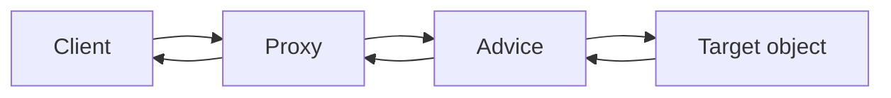
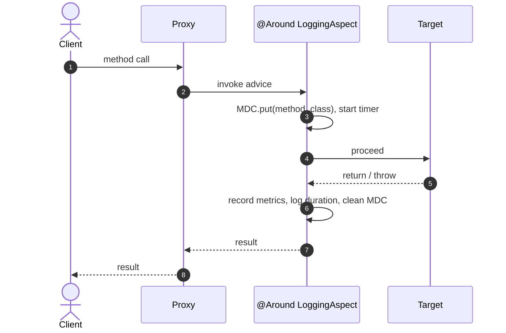

# Aspect-Oriented Programming explained

How the project adds logging and metrics to every service method without writing logging code in every method. Spring AOP covers the theory; this page implements it in `LoggingAspect`. The [shared Java library](../concepts/common-library.md#how-a-request-is-observed) shows where it sits in a request.

## The problem AOP solves

Some concerns cut across every part of an application: logging, security, transactions, metrics. Writing them into each method duplicates code and makes business logic hard to read. Aspect-Oriented Programming moves those concerns into separate units called **aspects**, woven into the right places automatically.

The design uses a bank-transfer example: without AOP, `transferMoney` is cluttered with logging, security checks, and timing; with AOP those lines disappear from the method and live in an aspect.

## Core vocabulary

| Term | Meaning |
| --- | --- |
| **Aspect** | A class (`@Aspect`) combining advice and pointcuts |
| **Join point** | A point in program execution — in Spring AOP, always a method execution |
| **Advice** | Code run at a join point: `@Before`, `@After`, `@AfterReturning`, `@AfterThrowing`, `@Around` |
| **Pointcut** | A predicate selecting join points, written in AspectJ expression syntax |
| **Weaving** | Applying aspects to target objects — at compile time, load time, or runtime |

Spring AOP does **runtime weaving with proxies**; it does not run the AspectJ weaver. Adding `@Aspect` to a Spring bean makes Spring parse the annotation and build proxies.

## Pointcut expressions

The design explains the common designators:

- `execution(public * com.example.service.*.*(..))` — any public method in that package
- `@annotation(com.example.Logged)` — methods carrying an annotation
- `within(com.example..service..*)` — methods in a package tree
- `bean(*Service)` — beans whose name matches

Expressions combine with `&&`, `||` and `!`. The project uses a `within` pointcut over three package trees:

```java
@Pointcut("within(swtp.clouddemo..service..*) || " +
 "within(swtp.clouddemo..controller..*) || " +
 "within(swtp.clouddemo..repository..*)")
public void applicationPackagePointcut {}
```

That single pointcut covers controllers, services and repositories in both business services, because the `common` module is shared by both.

## How proxies work

At startup, Spring wraps matching beans in a **proxy** that implements the same interface. Callers receive the proxy, not the target. A call goes:



Spring chooses between two proxy strategies:

| Strategy | When | Limitation |
| --- | --- | --- |
| **JDK dynamic proxy** | Bean implements an interface (framework default) | Cannot intercept methods declared only on the implementation class |
| **CGLIB proxy** | No interface, or `proxyTargetClass = true` | Runtime subclass; cannot advise `final` or `private` methods |

Spring Boot 3's AOP auto-configuration defaults to CGLIB, so this project effectively uses class-based proxies even though the design describes the framework-level JDK default.

### The self-invocation trap

If one method calls another on the same object (`this.otherMethod`), the call never passes through the proxy, so its advice does not run. Private methods cannot be advised at all. Workarounds: inject the proxy into itself, restructure the code, or switch to AspectJ compile-time/load-time weaving. The design compares the approaches (Table 2.2): Spring proxies are simpler and work only on Spring beans but miss internal calls; AspectJ weaving is more powerful but heavier.

## Advice chains and ordering

Several advice units form a **chain** of `MethodInterceptor`s. `proceed` on a `ProceedingJoinPoint` advances to the next interceptor; after the target returns, control unwinds so "after" advice runs in reverse order.

When more than one aspect applies, `@Order` controls precedence: lower numbers run first for `@Before`, and last for `@After`/`@AfterReturning`; `@Around` wraps the whole chain. The design notes that without `@Order`, order is unpredictable.

This project has **exactly one aspect** and no `@Order`, so ordering is not an issue here.



## The project's `LoggingAspect`

`services/common/src/main/java/swtp/clouddemo/common/aop/LoggingAspect.java` is a single `@Around` advice:

1. Reads the method and class names from `joinPoint.getSignature`.
2. Puts `method` and `class` into the MDC so every log line on that thread carries them.
3. Starts a nanosecond timer and logs "Method Entered" at DEBUG.
4. Calls `joinPoint.proceed` — this is the actual business method.
5. On success, logs exit with duration; on exception, logs the error, records a failure counter, and rethrows.
6. In `finally`, records a Micrometer `Timer`, `Counter`, and error counter, warns when the call exceeds 1000 ms, and removes the MDC keys to avoid context leaking between pooled threads.

The meters are named `app.method.execution.duration`, `app.method.execution.count`, and `app.method.execution.errors`, tagged with `class`, `method` and `success` (plus `error_type` on failures). They are exposed through Actuator, but no Prometheus server is deployed — see [observability](observability.md#metrics-exposed-but-not-collected).

## Theory vs. implemented code

The design describes extra features that the checked-in aspect does **not** have. Keep these straight when comparing:

| claim | Actual `LoggingAspect` |
| --- | --- |
| Logs method arguments and return values | Logs only class/method names and duration |
| Timer tags include `userId` and `username` | Tags are `class`, `method`, `success`, `error_type` |
| JSON fields `event`, `args`, `traceId` | `logback-spring.xml` includes `method`, `class`, `userId`, `username` only |
| Several advices with `@Order` | One `@Around`, no ordering needed |

Likewise there is no security advice in AOP: Spring Security runs as a servlet filter chain, not a proxy interceptor. The generic proxy diagrams in the drafts are labelled as theory for exactly that reason.

## Where to read next

- [Observability explained](observability.md) — the rest of the logging pipeline.
- [The shared Java library](../concepts/common-library.md#how-a-request-is-observed) — the valve/filter/aspect stack.
- [Grafana Alloy](../technologies/grafana-alloy.md) — what happens to the JSON logs after they leave the Pod.
- [Limitations](limitations.md#observability-gaps) — missing tracing and metrics.
