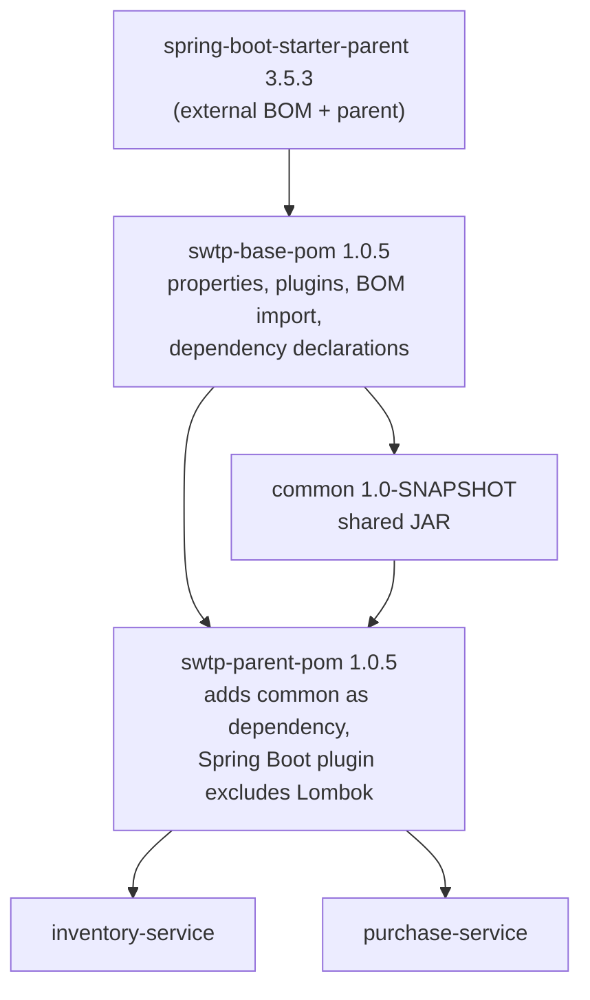
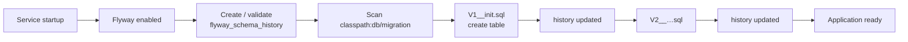

# Maven, Lombok and Flyway

The Java-side build and database tooling. The [shared Java library](../concepts/common-library.md) shows the Maven hierarchy in the context of the application code; this page explains the tools themselves.

## The Maven hierarchy

Maven builds Java projects and manages their dependencies. Two mechanisms matter here:

- A **parent POM** is inherited by child modules. It contributes properties, plugin configuration and dependency declarations.
- A **BOM** (Bill of Materials) imports only *versions* via `<scope>import</scope>`; it does not put libraries on the classpath.

The repository combines both. The design notes that many projects do this.



`swtp-base-pom` imports `spring-boot-dependencies:3.5.3` with `<type>pom</type><scope>import</scope>` (a textbook BOM import), then declares the starters most services need — web, security, data-jpa, PostgreSQL, Flyway, Artemis, AOP, Actuator, springdoc — mostly **without** versions. Version properties are centralised for PostgreSQL (42.7.7), Flyway (11.10.4), Artemis (2.42.0), springdoc (2.8.9), and the Logstash JSON encoder (7.4). Java is set to **21**.

`swtp-parent-pom` adds the `common` JAR as a dependency, so both services inherit the shared security, logging, and event classes automatically. The service POMs are tiny — they contain no versions of their own, which is exactly the design's "explicit declaration, versions inherited" pattern.

> The design examples use Java 17 and Spring Boot 3.2.0. The repository has moved on to Java 21 and Spring Boot 3.5.3. See [configuration](../reference/configuration.md#images-and-application-versions).

## Lombok

Lombok is a compile-time annotation processor that generates boilerplate into the bytecode, so source files stay short. The dependency is declared with `provided` scope in the base POM and registered in the compiler plugin's `annotationProcessorPaths`; the Spring Boot plugin excludes it from the final JAR.

| Annotation | What it generates | Where it is used here |
| --- | --- | --- |
| `@Data` | getters, setters, `toString`, `equals`/`hashCode`, required-args constructor | entities and DTOs, `BaseEvent` |
| `@Getter` / `@Setter` / `@ToString` | individual methods | the two event subclasses |
| `@RequiredArgsConstructor` | constructor for final fields | controllers, `LoggingAspect` |
| `@Slf4j` | a `log` field | services, converters, filter, aspect |

For example `ProductEntity` combines `@Entity`, `@Table(name = "lager_item")` and `@Data`; `LoggingAspect` uses `@Slf4j` and `@RequiredArgsConstructor` to get both a logger and its `MeterRegistry` injected with no constructor code. The design also lists `@NoArgsConstructor` and `@EqualsAndHashCode`, but this repository does not use them.

## Flyway

Flyway owns the database schema. The workflow explains why: each microservice has its own database, so schema changes must be versioned and applied automatically per service.

Configuration in `application-common.properties`:

```properties
spring.flyway.enabled=true
spring.flyway.locations=classpath:db/migration
spring.flyway.baseline-on-migrate=true
spring.flyway.baseline-version=1
spring.jpa.hibernate.ddl-auto=validate
```

`ddl-auto=validate` means Hibernate checks the schema rather than creating it — Flyway is the single source of schema truth.

### Migration naming and history

- **Versioned** migrations follow `V<version>__<description>.sql` and run once.
- **Repeatable** migrations follow `R__<description>.sql` and re-run when their checksum changes. The design covers these in detail, but the repository has **no** `R__` files.

Flyway records every applied script in a metadata table called `flyway_schema_history`. The process is:

1. **Initialise** — create/check the history table.
2. **Discover** — find scripts under `classpath:db/migration`.
3. **Validate** — detect changed or missing applied scripts.
4. **Apply** — run pending migrations in version order, updating history after each.
5. **Application ready**.



### The real migrations

| Service | Scripts |
| --- | --- |
| Inventory | `V1__init.sql` (creates `lager_item`), `V2__addData.sql` (20 seed rows) |
| Purchase | `V1__init.sql` (creates `purchases`), `V2__status.sql` (adds `status`), `V3__userId.sql` (adds `user_id`) |

A `dev/afterMigrate.sql` file exists in each service but is entirely commented out and sits outside the auto-applied migration root. The design discusses idempotent patterns such as `CREATE OR REPLACE`, `ON CONFLICT DO UPDATE` and `IF NOT EXISTS`; the checked-in scripts use a simpler `DROP TABLE IF EXISTS` / `CREATE TABLE` style for the initial migration.

## Automation and reproducibility

The design describes Bash scripts as "executable documentation" and a **Just** command runner. The repository has since moved from `Justfile` to `Makefile`:

| / earlier repo | Current repository |
| --- | --- |
| `just deploy-dev` | `make release` (build + staging sync) |
| `./scripts/build-application-images.sh` | `docker buildx bake application-images --push` |
| `Justfile` recipes | `Makefile` targets incl. `build-and-push`, `deploy`, `rollout-restart-*`, `stern-*` |

The scripts that remain are documented in the [repository map](../reference/repository.md): `install.sh` (OS-aware dependency install), `startup.sh` (cluster bootstrap), `setup-buildx.sh`, `setup-certs.sh`, `free-ports.sh`, `update-hosts.sh`, `stern.sh`, and `portforwarding/port-forward.sh`. Their known rough edges are listed in [troubleshooting](../guides/troubleshooting.md#existing-helper-script-limitations).

## BFG Repo-Cleaner

The design records an incident: a `secrets.properties` file was committed by mistake. Deleting the file in a new commit would leave it reachable in history, so the team used BFG Repo-Cleaner:

1. Create a mirror clone.
2. Run `bfg --delete-files secrets.properties`.
3. Run Git garbage collection to expunge unreachable objects.
4. Force-push the rewritten history.

No BFG artifact remains in the repository — that is the point. The current practice is to keep secrets out of Git entirely: `.env` is ignored, and runtime credentials are injected as Kubernetes Secrets (`DATASOURCE_PASSWORD`, `ARTEMIS_PASSWORD` through `b64enc` in each chart's config template). See [configuration](../reference/configuration.md#backend-runtime-environment).

## Where to read next

- [Containers and builds](containers.md) — how Maven output becomes an image.
- [CI/CD pipeline](cicd.md) — how build stages use these tools.
- [Shared Java library](../concepts/common-library.md) — the code that lives in `common`.
- [Limitations](limitations.md) — testing and reliability gaps.
