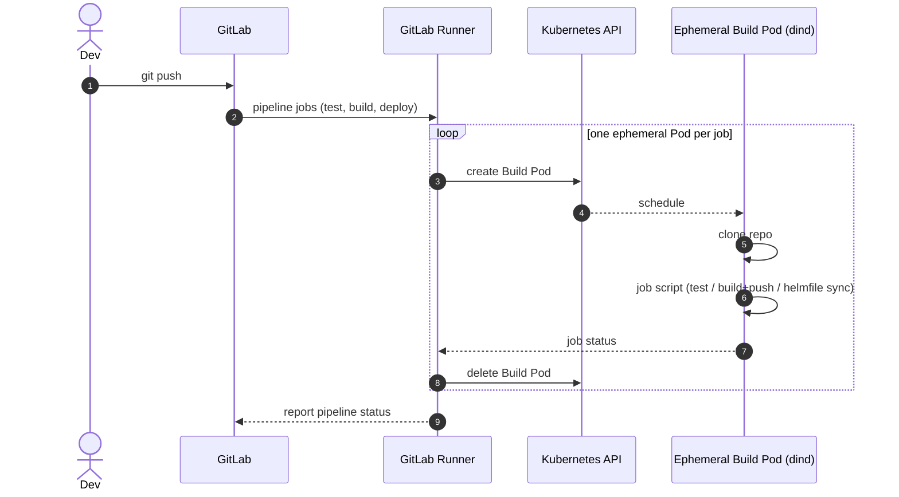

# CI/CD pipeline in depth

How a push becomes a deployment. Thesis §§2.20–2.21 introduce GitLab CI and the Runner; §3.4.2 describes the infrastructure; §4 documents the build Pod. The [development workflow](../guides/development.md) shows the local equivalent.

## Continuous integration and delivery

**CI** means developers merge changes frequently and each merge triggers an automated build and test. **CD** means changes that pass the automated stages are deployed automatically (deployment) or kept ready (delivery). GitLab defines pipelines in `.gitlab-ci.yml`.

The project's pipeline has three stages — `test`, `build`, `deploy` — plus a documentation job:

| Job | Stage | What it does |
| --- | --- | --- |
| `test-runner` | test | Echoes "Hello from Minikube runner" to verify the runner works |
| `build_image` | build | Starts a Docker daemon, creates a Buildx builder, rewrites the registry, bakes and pushes images |
| `deploy_helm` | deploy | Runs `helmfile --file ./environments -e staging sync` |
| `docs-build` | test | Installs `requirements-docs.txt` in `python:3.13-slim`, runs `zensical build --strict`, uploads `site/` as an artifact; only runs when docs-related files change |

All jobs are tagged `kubernetes`, so the in-cluster runner picks them up. The thesis describes a simpler two-stage pipeline (build + deploy); the extra test and docs jobs are additions.



## The GitLab Runner

A **Runner** is an agent separate from GitLab that executes jobs. It "phones home" to the GitLab instance using a registration token, then polls for work. The thesis (§2.21) shows the registration flow; this project registers a runner deployed inside Kubernetes.

The **Kubernetes executor** creates a temporary Pod for each job rather than running jobs on a fixed machine. Benefits: isolation, automatic cleanup, and scaling with the cluster. The relevant settings in `environments/values/charts/runner.yaml` are:

| Setting | Value / meaning |
| --- | --- |
| `executor` | `kubernetes` |
| `image` | `localhost:5000/dind:latest` — the custom build image |
| `namespace` | `gitlab-runner` |
| `service_account` | `gitlab-runner` |
| `privileged` | `true` — required for Docker-in-Docker |
| `hostNetwork` | `true` — lets build Pods reach node-local services |

The runner's ServiceAccount is bound to the built-in `cluster-admin` role through a ClusterRoleBinding in `charts/gitlab-runner-sa/`. That is convenient for a learning cluster but is a significant security weakness — see [Zero Trust](zero-trust.md#kubernetes-rbac) and [limitations](limitations.md#security-posture).

## The build image

`services/dind/Dockerfile` is built from `docker:dind` and adds:

- Bash, curl, Git
- `kubectl`, Helm and Helmfile (versions pinned through `.env`)
- `daemon.json` — configures the Docker daemon for the insecure cluster registry
- `buildkitd.toml` — marks `registry.kube-system.svc.cluster.local:80` as insecure HTTP
- Environment defaults: `DOCKER_BUILDKIT=1`, `REGISTRY=registry.kube-system.svc.cluster.local:80/`
- A pre-created `mybuilder` Buildx builder using that config

An entrypoint starts `dockerd` and drops into a shell, so the pipeline script can run `docker buildx` commands directly. See [containers and builds](containers.md#buildx-and-buildkit).

## Registry rewrite inside the pipeline

The host build uses `localhost:5000`, but a Pod cannot reach the host's loopback address. The pipeline therefore patches the Bake file before building:

```yaml
NEW_REGISTRY="registry.kube-system.svc.cluster.local:80/"
sed -i "/variable \"REGISTRY\"/,/}/ s|default = \".*\"|default = \"$NEW_REGISTRY\"|" docker-bake.hcl
docker buildx bake base-images --push
docker buildx bake application-images --push
```

This is why the [build flow diagram](../technologies/overview.md#build-and-deployment-flow) shows two registries. The same issue caused one of the early debugging problems recorded in [problems and fixes](../problems-and-fixes.md#pods-could-not-pull-images-from-the-in-cluster-registry).

## Deploy stage

The final job runs:

```bash
helmfile --file ./environments -e staging sync
```

Helmfile reads `environments/helmfile.yaml`, selects `staging.yaml` values, composes per-release values through `env-magic.gotmpl`, and applies all releases in dependency order. The details of that mechanism are in [Helm values in depth](helm-values.md).

## Runner command examples (§2.21)

The thesis gives concrete examples of what job scripts can do. These are the categories worth knowing.

### Runner lifecycle commands

| Command | Purpose |
| --- | --- |
| `gitlab-runner register` | Register the agent with a GitLab URL and token |
| `gitlab-runner run` | Start polling for and executing jobs |
| `gitlab-runner verify` | Check whether the runner is reachable from GitLab |
| `gitlab-runner list` | Show configured runners |
| `gitlab-runner status` / `start` / `stop` | Manage the runner service |

In this project the runner is installed by a Helm chart, so lifecycle management happens through Helmfile rather than direct `gitlab-runner` commands.

### Basic and filesystem commands (§2.21.1–2.21.2)

A job runs arbitrary shell commands in the build image. Common groups:

```bash
mkdir -p build && cp target/app.jar build/       # prepare artefacts
find . -name '*.log' -delete                     # clean up
```

### Build and dependency commands

```bash
mvn clean compile
mvn package
mvn verify
docker build -t my-service:latest .
docker push my-registry/my-service:latest
```

The project's build job uses `docker buildx bake` instead of plain `docker build`, but the principle is the same: produce an artefact and push it where the cluster can pull it.

### Kubernetes and Minikube commands

```bash
kubectl get pods -n dev
kubectl apply -f deployment.yaml
kubectl rollout status deployment/inventory -n dev
kubectl config use-context minikube
minikube status
minikube service list
```

These appear throughout the tutorials and Make targets; see [development workflow](../guides/development.md).

### A simple three-stage pipeline (§2.21.3)

The thesis illustrates a pipeline with `build`, `test`, `deploy` stages — compile, run tests, then apply manifests and restart a rollout. This project's real pipeline is in `.gitlab-ci.yml` and adds a `docs-build` validation job; see [the pipeline definition](#continuous-integration-and-delivery).

### Multi-environment deployment (§2.21.3)

The thesis shows separate deploy jobs selecting different kubectl contexts and Helm values files for Minikube and production. This project instead uses **one** Helmfile with `-e dev` or `-e staging`, and CI always deploys `staging`. That keeps a single source of deployment truth; see [Helm values in depth](helm-values.md#helmfile-orchestration).

### Local-machine execution (§2.21.4)

Runners can also execute on the host with a shell executor. Diagnostic commands such as `uname -a`, `df -h`, `free -m`, `curl -I` and `ping` help verify the environment. The `prerequisites` page gives the equivalent checks for a local setup — see [prerequisites](../getting-started/prerequisites.md#for-the-application).

## Attaching the local runner automatically

`scripts/setup-gitlab-ci.sh` connects a local cluster to a GitLab project through the GitLab API using a **Personal Access Token with the `api` scope**. It:

1. validates the token and resolves the project (by numeric ID or `namespace/project` path, auto-detected from the git remote),
2. creates a **project runner** through `POST /projects/:id/runners`, receiving a `glrt-…` runner authentication token,
3. installs `charts/gitlab-runner-sa` and the `gitlab/gitlab-runner` chart (v0.80.1) in the `gitlab-runner` namespace with that token in a temporary mode-0600 values file (removed on exit — the token is never committed),
4. optionally sets CI/CD variables and triggers a pipeline.

```bash
GITLAB_TOKEN=glpat-... ./scripts/setup-gitlab-ci.sh --dry-run   # preview
GITLAB_TOKEN=glpat-... ./scripts/setup-gitlab-ci.sh             # attach runner
GITLAB_TOKEN=glpat-... ./scripts/setup-gitlab-ci.sh --trigger  # also run a pipeline
```

The runner is registered with tag `kubernetes`, matching the `tags: [kubernetes]` in `.gitlab-ci.yml`. The generated values override the build image with `registry.kube-system.svc.cluster.local:80/dind:latest`, which is the address Pods can actually reach (the checked-in `runner.yaml` still uses the host-only `localhost:5000` default).

Set `GITLAB_URL`, `GITLAB_PROJECT_ID`, `GITLAB_PROJECT_PATH`, `RUNNER_DESCRIPTION` or `RUNNER_TAGS` to override the defaults. Run `--check` to verify cluster access before supplying a token. See `--help` for the full list.

## Documentation validation

The `docs-build` job makes the documentation part of CI: any change under `docs/`, `zensical.toml`, `requirements-docs.txt`, `README.md`, `CONTRIBUTING.md`, or `.gitlab-ci.yml` triggers a strict Zensical build. See [contributing to the docs](../contributing.md#build-and-check).

## Where to read next

- [Technology stack](../technologies/overview.md) — the whole pipeline at a glance.
- [Helm values in depth](helm-values.md) — what `helmfile sync` actually renders.
- [Kubernetes objects](kubernetes-objects.md) — the resources the deploy stage creates.
- [Problems and fixes](../problems-and-fixes.md#cicd) — runner, dind, and Maven artifact debugging.
