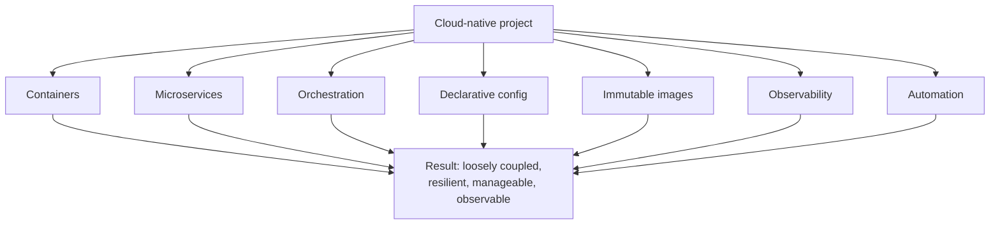

# What is a cloud project?

Before the architecture makes sense, it helps to define what "cloud" and "cloud-native" mean — and why this project, which runs entirely on a laptop, still belongs to that category. This page explains both.

## Cloud computing in one paragraph

The design cites the NIST definition of cloud computing (SP 800-145 [22]): a model for enabling convenient, on-demand network access to a shared pool of configurable computing resources — networks, servers, storage, applications and services — that can be rapidly provisioned and released with minimal management effort. The essential characteristics are on-demand self-service, broad network access, resource pooling, rapid elasticity and measured service.

Cloud services are usually described by **service models**:

| Model | What you get | Example |
| --- | --- | --- |
| **IaaS** | Virtual machines, storage, networking | AWS EC2, a Kubernetes cluster on a cloud provider |
| **PaaS** | A platform to deploy applications without managing the OS | managed Kubernetes, managed databases |
| **SaaS** | A complete application used over the network | GitLab.com, Gmail |

And by **deployment models**: public cloud, private cloud, hybrid cloud, and community cloud.

## Cloud-native is defined by attributes, not location

The key distinction in: **cloud-native is not about where the application runs, but how it is built**. A cloud-native system can run on AWS, on a private data centre, or on a developer's laptop — what matters is that it uses the techniques that make software agile, scalable and resilient.

The CNCF definition quoted in the design:

> "Cloud-native technologies empower organizations to build and run scalable applications in modern, dynamic environments such as public, private, and hybrid clouds. Techniques like containers, service meshes, microservices, immutable infrastructure, and declarative APIs exemplify this approach."

The result is a system that is loosely coupled, resilient, manageable and observable.

## The foundational principles

The design breaks cloud-native down into concrete practices. Here is each principle paired with where it appears in this repository:

| Principle | What it means | Here |
| --- | --- | --- |
| **Containerization** | Package an app with its dependencies into a portable image | Dockerfiles + `docker-bake.hcl` |
| **Microservices orientation** | Split the app into small, independent services | Purchase, Inventory, Keycloak |
| **Dynamic orchestration** | Automate deployment, scaling and recovery | Kubernetes in Minikube |
| **Declarative APIs** | Describe desired state, let controllers reconcile it | Helm charts, Helmfile |
| **Immutable infrastructure** | Replace rather than modify; rebuild an image per change | CI builds and pushes new images |
| **Service mesh** | Dedicated layer for service-to-service traffic | Discussed but **not** implemented |
| **Scalability and resilience** | Scale horizontally; recover from failure | Replica counts, Pod self-healing |
| **Observability** | Logs, metrics, traces | Logs work; metrics/traces do not |
| **DevOps and CD** | Automate build, test and deploy | GitLab CI |

## Why a local Minikube project is still cloud-native

The design makes this explicit: the "cloud" in cloud-native refers to the **architectural model and operational practices**, not the physical hosting location. This project runs on a self-hosted Minikube cluster with its own local registry, yet it uses Kubernetes, Docker, Helm and microservices — so it exhibits the core characteristics.

That brings three practical benefits:

- **Portability.** The same charts and manifests can be redeployed to a private cluster or a managed service (EKS, GKE, AKS) with configuration changes only. The `/registry`, namespace and hostname values are environment-specific, not architecture-specific.
- **Scalability and resilience.** Kubernetes provides horizontal scaling and self-healing natively. The Inventory service, for example, can handle more load by raising its replica count in the chart.
- **Development consistency.** Developers use the same tools and APIs locally as in a real cluster; the `dev` and `staging` environments differ mainly in ingress and TLS.

## What this project deliberately leaves out

Cloud-native does not mean production-ready. This learning system keeps several patterns at demonstration level — see [limitations](limitations.md):

- No service mesh, so no mTLS between services.
- No Horizontal Pod Autoscaler.
- Single-instance databases and broker.
- No metrics pipeline and no tracing.

These are gaps in maturity, not in the definition: the project still demonstrates the architecture, just without the operational hardening a real deployment would need.

## Where to read next

- [Microservices and cloud-native foundations](microservices.md) — monoliths, DevOps, Twelve-Factor and containers.
- [System architecture](../concepts/architecture.md) — the concrete components.
- [Technology stack](../technologies/overview.md) — every tool in the project.
- [Limitations and evaluation](limitations.md) — how far the implementation goes.
