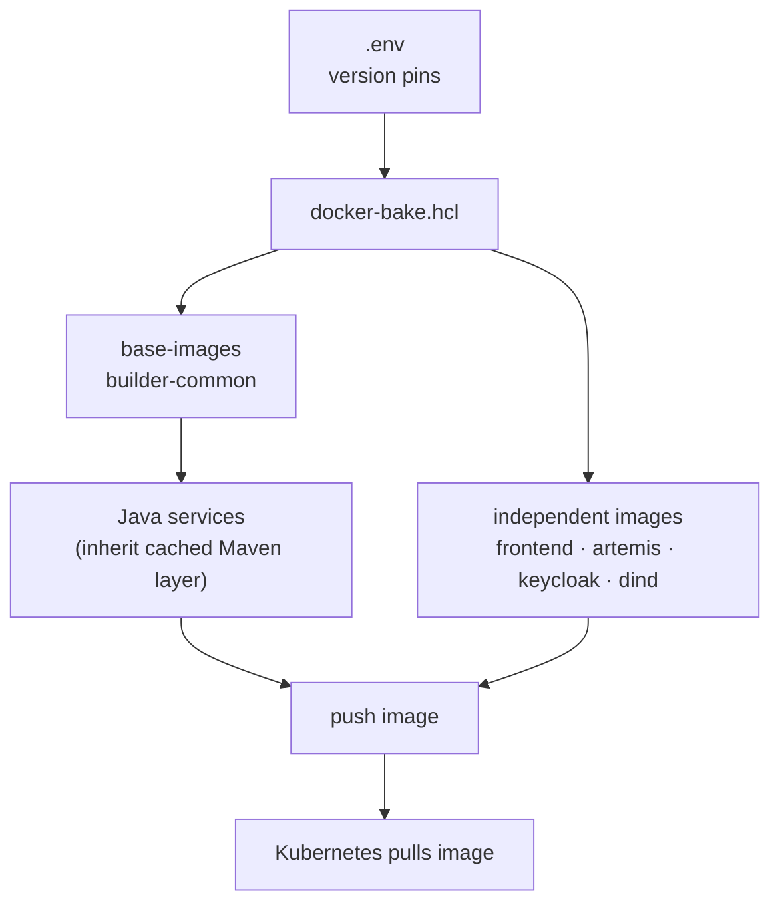

# Containers and builds

How source code becomes an image that Kubernetes can run. This page explains the theory and maps every claim to the checked-in build files.

## Containers vs virtual machines

A virtual machine virtualises hardware and runs a full guest operating system. A container virtualises at the **operating-system level**: it shares the host kernel but isolates processes, filesystems and networks. The following reasons explain why containers suit microservices: the reasons containers suit microservices:

- **Environment consistency** — the image carries the runtime and libraries, so "works on my machine" disappears.
- **Isolation** — each service has its own filesystem and process space.
- **Efficiency** — no guest OS per service; far less memory than VMs.
- **Rapid deployment and scaling** — starting a container is near-instant.
- **Portability** — the same image runs on a laptop, on-prem, or in a cloud cluster.

## Image layers and multi-stage builds

Each Dockerfile instruction adds a cached **layer**. The Java services use a multi-stage build to keep the final image small: one stage compiles with Maven, a second stage copies only the JAR into a JRE image.

The design's illustrative example:

```dockerfile
FROM maven:3.8.6-eclipse-temurin-17 AS build
WORKDIR /app
COPY . .
RUN mvn clean package -DskipTests

FROM eclipse-temurin:17-jre-alpine
COPY --from=build /app/target/*.jar app.jar
EXPOSE 8080
ENTRYPOINT ["java", "-jar", "app.jar"]
```

The repository takes this one step further. It first builds a shared `builder-common` image that pre-installs the parent POMs and common module into Maven's local cache:

```dockerfile
FROM ${REGISTRY}builder-common:latest AS builder-base
WORKDIR /app
COPY pom.xml .
COPY src ./src
RUN mvn clean package -DskipTests

FROM eclipse-temurin:${JRE_VERSION}
COPY --from=builder-base /app/target/*.jar app.jar
EXPOSE 8080
ENTRYPOINT ["java", "-jar", "app.jar"]
```

Both Java service Dockerfiles follow this pattern. Because they inherit from the same base image, Maven cache layers are reused — the reason `docker-bake.hcl` declares `inherits = ["builder-common"]` for `inventory-service` and `purchase-service`. See [Maven and build tools](build-tools.md#the-maven-hierarchy).

## Buildx and BuildKit

**Buildx** is a Docker CLI plugin backed by BuildKit. The design emphasises multi-platform images and manifest lists: a single tag can point to amd64 and arm64 variants, chosen automatically by the pulling client.

The project uses Buildx mainly for its **builder configuration** rather than multi-arch output:

| File | What it configures |
| --- | --- |
| `scripts/setup-buildx.sh` | Creates `mybuilder` with the `docker-container` driver and `network=host` |
| `scripts/install.sh` | Creates the same builder idempotently during installation |
| `services/dind/buildkitd.toml` | Marks `registry.kube-system.svc.cluster.local:80` as insecure HTTP |
| `services/dind/daemon.json` | Configures the Docker daemon inside the CI build Pod |
| `.gitlab-ci.yml` | Creates `mybuilder` inside each CI job with the BuildKit config |

The local registry uses plain HTTP, so BuildKit must be told it is insecure — this is the `http = true, insecure = true` setting shown in the [Kubernetes tutorial](../tutorials/local-kubernetes.md#3-configure-buildx-for-the-local-http-registry).

All Bake targets pin `platforms = ["linux/amd64"]`. The multi-platform manifest-list scenario is theory in the design, not something this project builds. See [limitations](limitations.md#reliability-and-performance).

## Bake targets and groups

`docker-bake.hcl` declares images as **targets** and collections as **groups**:

| Group | Targets |
| --- | --- |
| `base-images` | `builder-common` |
| `application-images` | `nginx-frontend`, `artemis`, `inventory-service`, `purchase-service`, `keycloak`, `dind` |
| `default` | the application images |

Variables come from `.env`: `ARTEMIS_VERSION`, `KEYCLOAK_VERSION`, `NGINX_VERSION`, `MAVEN_VERSION`, `JRE_VERSION`, `DOCKER_DIND_VERSION`, `HELM_VERSION`, `HELMFILE_VERSION`, plus `REGISTRY` and `TAG`. Targets set `context`, `dockerfile`, `tags`, `args`, `platforms`, `push`, and `inherits`.



## Registries

The design compares enterprise registries (Nexus, Artifactory, Harbor) with a local `registry:2`. This project uses the **Minikube registry addon** because it is light and needs almost no configuration; the reasoning is in [design decisions](../concepts/design-decisions.md#container-registry-minikube-addon-instead-of-nexus-or-harbor).

Two addresses are in play:

| Context | Registry | Set by |
| --- | --- | --- |
| Local `make build-and-push` | `localhost:5000/` | `docker-bake.hcl` default + `dev.yaml`/`staging.yaml` |
| CI pipeline | `registry.kube-system.svc.cluster.local:80/` | `.gitlab-ci.yml` rewrites `REGISTRY` with `sed` before Bake |

`localhost:5000` means the host on your machine but the Pod itself inside a node — the classic image-pull confusion documented in [troubleshooting](../guides/troubleshooting.md#image-builds-and-image-pulls).

## The other Dockerfiles

The non-Java images are simpler, single-stage builds pinned by `.env` arguments:

- **Web client** — Nginx with a custom `nginx.conf` and the static files copied into `/usr/share/nginx/html`.
- **Keycloak** — the official Keycloak image with the realm JSON copied into `/opt/keycloak/data/import`; see [Keycloak and OIDC](keycloak.md#how-the-realm-is-loaded).
- **Artemis** — the official image with a custom entrypoint that reuses an existing broker instance instead of trying to create a second one.
- **dind** — `docker:dind` plus `kubectl`, Helm, Helmfile, Git, and the daemon/BuildKit configs; this is the image the GitLab Runner uses for build Pods. See [CI/CD pipeline](cicd.md#the-build-image).

## Building images yourself

```bash
make build-and-push
```

or, for a narrower build:

```bash
set -a; source .env; set +a
docker buildx bake builder-common --push
docker buildx bake inventory-service --push
```

Remember that pushing a new image with the same `latest` tag does not restart a running Deployment — see [development workflow](../guides/development.md#build-one-backend-without-the-ci-image).

## Where to read next

- [Technology stack](../technologies/overview.md) — where the image build sits among the other tools.
- [Kubernetes objects](kubernetes-objects.md) — how images are referenced by Deployments.
- [CI/CD pipeline](cicd.md) — how CI builds and pushes images.
- [Problems and fixes](../problems-and-fixes.md#kubernetes-and-images) — registry and version-pinning bugs that were solved.
