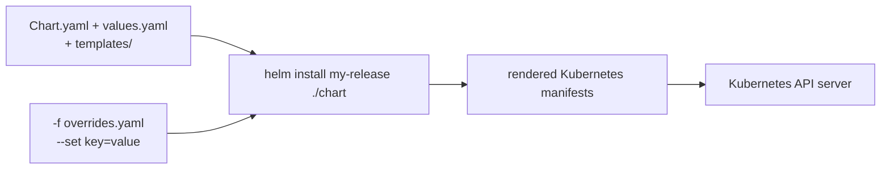
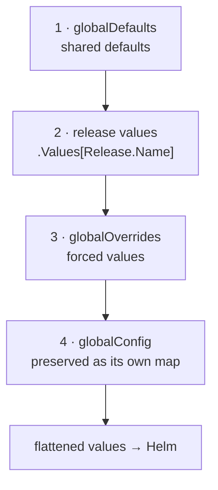
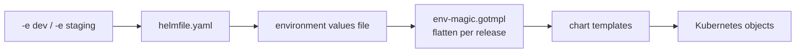

# Helm values in depth

This is the area the thesis treats as its main technical contribution (§2.10): a unified way to manage values across environments without duplicating configuration. The [Kubernetes and Helmfile concept page](../concepts/kubernetes-and-helm.md) walks one value through to a manifest; this page explains the mechanism and why it exists.

## The problem: YAML hell and umbrella charts

Before Helm, each environment needed its own near-identical set of manifests. Changing a single image tag meant editing several files — tedious and error-prone. Helm solves this with **charts**: packages containing `Chart.yaml` (metadata), `values.yaml` (defaults) and `templates/` (YAML with Go template directives).



Templates contain placeholders like `{{ .Values.replicaCount }}`; the actual numbers live in `values.yaml` or an override file. The thesis (§2.9) lists three steps: combine structure with values, render templates, submit to the API server.

## Native Helm precedence

When Helm renders a chart, values are merged in this order — lowest to highest priority (§2.10.1):

1. The chart's own `values.yaml`
2. Parent chart values in an **umbrella chart**
3. Values files passed with `-f`
4. Individual `--set` flags

An umbrella chart is a parent containing subcharts under `charts/`. It overrides a subchart by nesting values under the subchart's name:

```yaml
# parent values.yaml
frontend:
  replicaCount: 2
```

Helm flattens that structure automatically when rendering the `frontend` subchart, so the subchart sees `.Values.replicaCount = 2`. **Globals** declared under `Values.global` are visible from every subchart as `.Values.global.domain`.

## Helmfile's mismatch

Helmfile processes values through Go templates *before* Helm sees them (§2.10.2). It cannot emulate umbrella-chart flattening: if you place `frontend:` blocks in a Helmfile values file, Helm receives them as-is and the chart ignores them because it expects top-level `replicaCount`, not `frontend.replicaCount`.

The thesis frames this as "a fundamental mismatch between Helm's native umbrella chart pattern and Helmfile's value processing architecture", and the project's answer is a release-name-based values template that flattens values itself.

## The unified values strategy

The checked-in implementation is `environments/values/env/env-magic.gotmpl`, which follows the thesis listing nearly verbatim:

```gotmpl
{{- $releaseValues := .Values | get .Release.Name dict | default dict -}}
{{- $globalConfig := .Values | get "globalConfig" dict | default dict -}}
{{- $globalDefaults := .Values | get "globalDefaults" dict | default dict -}}
{{- $globalOverrides := .Values | get "globalOverrides" dict | default dict -}}

{{- $merged := dict -}}
{{- range $k, $v := $globalDefaults -}}
  {{- $_ := set $merged $k $v -}}
{{- end -}}
{{- range $k, $v := $releaseValues -}}
  {{- $_ := set $merged $k $v -}}
{{- end -}}
{{- range $k, $v := $globalOverrides -}}
  {{- $_ := set $merged $k $v -}}
{{- end -}}
{{- if $globalConfig -}}
  {{- $_ := set $merged "globalConfig" $globalConfig -}}
{{- end }}
{{- $merged | toYaml -}}
```

Four composition stages, from lowest to highest priority:



Important properties:

- The loops replace **top-level keys**; they are **not** a recursive merge. A release's `image:` block replaces the whole `image:` map rather than merging field by field.
- `globalConfig` is kept as a separate map so chart templates can read namespace, registry and environment.
- Helmfile's Go templates cannot read chart defaults while rendering, so chart `values.yaml` files remain the baseline and `globalDefaults` can override them.

## One value, end to end

`environments/values/env/dev.yaml` contains:

```yaml
globalConfig:
  namespace: "dev"
  registry: "localhost:5000/"
  pullPolicy: Always
```

Helmfile selects that file with `-e dev`. The `inventory-service` release uses `env-magic.gotmpl`, which flattens the release block and preserves `globalConfig`. The chart template then builds the image name:

```yaml
image: "{{ .Values.globalConfig.registry }}{{ .Values.backend.image.name }}:{{ .Values.backend.image.tag }}"
```

Result: `localhost:5000/inventory-service:latest`. The same path is described step by step in [Kubernetes, Helm, and Helmfile](../concepts/kubernetes-and-helm.md#follow-one-value-into-the-application).

## What the environment files actually populate

The thesis's example environment file defines `globalConfig`, `globalDefaults`, `globalOverrides` and per-release blocks. The checked-in `dev.yaml` and `staging.yaml` contain only `globalConfig` plus release-name blocks — `globalDefaults` and `globalOverrides` are empty by default and simply resolve to `{}`.

| Key | dev | staging |
| --- | --- | --- |
| `globalConfig.namespace` | `dev` | `staging` |
| `globalConfig.env` | `dev` | `staging` |
| `globalConfig.profile` | `dev` | `staging` |
| `globalConfig.registry` | `localhost:5000/` | `localhost:5000/` |
| `globalConfig.pullPolicy` | `Always` | `Always` |
| Frontend Keycloak URL | `http://localhost:8080` | `https://keycloak.local` |
| Ingress | disabled | enabled, `frontend.local` / `keycloak.local` |
| Keycloak proxy mode | `standalone` | `edge` |

See the full [configuration reference](../reference/configuration.md#global-environment-values).

## Helmfile orchestration

A single `environments/helmfile.yaml` defines all releases:

- **Environment values** — `-e dev` → `values/env/dev.yaml`, `-e staging` → `values/env/staging.yaml`.
- **Repositories** — GitLab, Grafana, Stakater Helm repos.
- **Release ordering** — `needs:` declares dependencies, e.g. `ca-issuer` needs `cert-manager`.
- **Defaults** — `timeout: 300`, `wait: true`, `createNamespace: true`.
- **Namespaces** — application releases use `globalConfig.namespace`; infrastructure uses fixed namespaces.



A subtlety worth remembering: `labels.environment` on a release is metadata for selection, not an install condition. Passing `-e dev` selects *values*; it does not prevent other releases from being processed. The tutorial therefore uses `--selector` for a first run — see [namespaces and shared infrastructure](../concepts/kubernetes-and-helm.md#namespaces-and-shared-infrastructure).

## Verify before applying

```bash
helmfile --file environments/helmfile.yaml -e dev \
  --selector name=inventory-service template --skip-needs
```

The thesis also lists `helmfile -e <env> write-values` and `template --args="--debug"` as ways to inspect the resolved values. Rendering does not change the cluster; `sync` does. Both are described in [Kubernetes, Helm, and Helmfile](../concepts/kubernetes-and-helm.md#inspect-before-applying).

## Where to read next

- [Design decisions](../concepts/design-decisions.md#configuration-one-helmfile-with-a-values-template) — why this strategy was chosen.
- [Problems and fixes](../problems-and-fixes.md#values-merges-overwrote-the-wrong-settings) — how the merge order was debugged.
- [Kubernetes objects](kubernetes-objects.md) — the resources the values produce.
