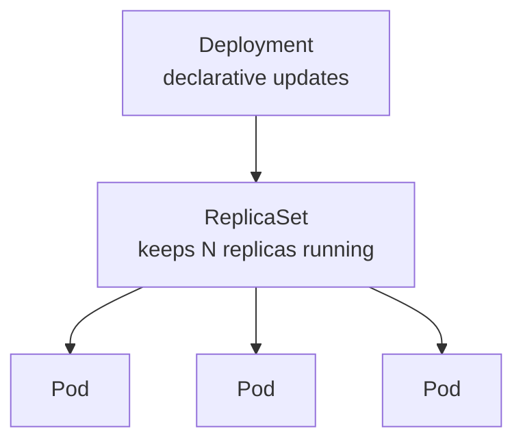

# Kubernetes objects

The building blocks the charts render. Thesis §§2.6–2.8 explains what each object is; this page pairs each one with its concrete use in the repository. The [Kubernetes and Helmfile concept page](../concepts/kubernetes-and-helm.md) shows how a value reaches a manifest.

## Clusters, control plane and nodes

Kubernetes groups machines into a **cluster** that behaves as one resource. Two roles:

| Role | Components | Who manages them |
| --- | --- | --- |
| Control plane ("brain") | `kube-apiserver`, `etcd`, `kube-scheduler`, `kube-controller-manager` | Cluster administrator |
| Worker nodes ("muscle") | `kubelet`, `kube-proxy`, container runtime | Cluster administrator |

The developer's job is to submit desired state to the **API server**; control loops reconcile observed state with that desired state. The thesis (§2.6) uses the example of declaring five replicas when only four are running — a controller creates the missing one. That reconciliation is the basis of self-healing.

In this project the cluster is created by `scripts/startup.sh`:

```bash
minikube start --driver=docker --memory=8g --cpus=4
minikube addons enable ingress dashboard metrics-server registry
```

The developer never writes manifests for the control plane — only application-layer objects, which is exactly the boundary the thesis draws (§2.6).

## Objects as records of intent

Every manifest has four top-level fields:

```yaml
apiVersion: apps/v1
kind: Deployment
metadata:
  name: inventory
spec:
  replicas: 1
```

- **apiVersion** — the API group and version (`v1`, `apps/v1`).
- **kind** — the object type.
- **metadata** — name, namespace, labels, annotations.
- **spec** — the desired state; its structure depends on `kind`. (ConfigMaps use `data:` instead.)

## Pods and Deployments

A **Pod** is the smallest deployable unit: one or more tightly coupled containers sharing network and storage. Pods are **ephemeral** — their IP changes when they are recreated, so nothing should talk to a Pod directly.

You almost never create a Pod by hand. A **Deployment** wraps a ReplicaSet, which wraps Pods:



The hierarchy is why deleting a Pod causes a replacement to appear. Deployments also provide rolling updates and rollback.

In the repo, every workload is a Deployment: `charts/frontend-chart/templates/deployment.yaml`, `charts/inventory-service-chart/templates/application.yaml` (`inventory` + `inventory-db`), the purchase equivalents, `charts/keycloak-chart/templates/keycloak/deployment.yaml`, and `charts/message-broker-chart/templates/deployment.yaml` (`artemis-broker`). A real liveness probe from the broker chart:

```yaml
livenessProbe:
  tcpSocket:
    port: {{ .Values.artemis.livenessProbe.port }}
  initialDelaySeconds: {{ .Values.artemis.livenessProbe.initialDelaySeconds }}
  periodSeconds: {{ .Values.artemis.livenessProbe.periodSeconds }}
```

The thesis (§2.7) distinguishes **liveness** probes (restart a stuck container) from **readiness** probes (remove an unready Pod from Service load balancing); this deployment only configures liveness.

## Namespaces

A namespace is a "virtual cluster" — a scope for names and resources. The project uses:

| Namespace | Contents |
| --- | --- |
| `dev`, `staging` | Two independent copies of the whole application |
| `monitoring` | Alloy, Loki, Grafana, monitoring-stack ConfigMap |
| `cert-manager` | cert-manager and the CA ClusterIssuer |
| `gitlab-runner` | Runner and ephemeral build Pods |
| `kube-system` | Registry addon, Reloader |

Names are unique within a namespace but can repeat across namespaces — which is exactly why `dev` and `staging` can each have a `frontend-service`. Helmfile maps `-e dev` to the `dev` namespace and `-e staging` to `staging` through `globalConfig.namespace`.

## Services and Ingress

A **Service** gives ephemeral Pods a stable virtual IP (ClusterIP) and DNS name. It uses labels and selectors rather than a fixed list of Pod IPs:

```yaml
# Deployment pod template
labels:
  microserviceName: inventory
  component: backend
  env: dev
---
# Service selector — must match exactly
selector:
  microserviceName: inventory
  component: backend
  env: dev
```

The selector is re-evaluated continuously, so scaling or rolling updates need no Service changes. The project's three standard labels are `microserviceName`, `component`, and `env` — they also become log labels in Alloy (see [Grafana Alloy](../technologies/grafana-alloy.md#labels-created-by-the-pipeline)).

Service types in the thesis: **ClusterIP** (internal, default), **NodePort** (static port on each node), **LoadBalancer** (cloud-provided external IP). This project uses ClusterIP for everything; external access is through Ingress or port forwarding.

An **Ingress** is a Layer-7 router (HTTP/HTTPS) and needs an **Ingress Controller** to function. The frontend Ingress routes by path and host:

| Host / path | Backend |
| --- | --- |
| `frontend.local/inventory-api` | `inventory-service:8080` |
| `frontend.local/purchase-api` | `purchase-service:8080` |
| `frontend.local/` | `frontend-service:80` |
| `keycloak.local/` | `keycloak-service:8080` |

Ingress is enabled only in `staging.yaml`; `dev.yaml` disables it and uses forwarded ports. It is also the TLS termination point — see [HTTPS and PKI](pki.md#how-the-project-uses-it).

## ConfigMaps and Secrets

**ConfigMaps** hold non-confidential configuration (up to 1 MiB, plain text in etcd). **Secrets** hold sensitive values; Base64 encoding is *encoding, not encryption* — real protection needs RBAC and encryption at rest.

Both can be injected as environment variables or mounted files. The repository uses `envFrom` with both references:

```yaml
envFrom:
  - configMapRef:
      name: inventory-config
  - secretRef:
      name: inventory-secret
```

The ConfigMap carries `DATASOURCE_URL`, `ARTEMIS_BROKER_URL`, and the Keycloak URLs; the Secret carries passwords encoded at render time with `b64enc`. The frontend's `config.js` is a ConfigMap mounted with `subPath`. See [configuration](../reference/configuration.md#backend-runtime-environment).

## PersistentVolumeClaims

Stateful components need storage that outlives a Pod. A **PVC** requests storage (size, access mode such as `ReadWriteOnce`); a PersistentVolume satisfies it, often provisioned dynamically through a StorageClass.

```yaml
volumeMounts:
  - name: postgres-data
    mountPath: /var/lib/postgresql/data
volumes:
  - name: postgres-data
    persistentVolumeClaim:
      claimName: inventory-db-pvc
```

The project declares PVCs for each PostgreSQL database and for Artemis, typically 1 GiB each. See [stateful components](../concepts/architecture.md#responsibilities).

## Connecting objects and DNS

There are two ways objects reference each other:

1. **Labels + selectors** — Services find Pods (shown above).
2. **Direct name references** — a Pod references a PVC by `claimName`, a ConfigMap or Secret by `configMapRef`/`secretRef`.

Service-to-service traffic uses DNS. CoreDNS runs in `kube-system` and each Pod gets a `/etc/resolv.conf` pointing to it. The short name works within a namespace (`inventory-db-service`); across namespaces you need the FQDN:

```text
<service>.<namespace>.svc.cluster.local
```

The project stays within a namespace, so ConfigMaps use short names like `keycloak-service:8080`, `artemis-service:61616` and `inventory-db-service:5432`. That is why the backend's JWK URL uses cluster DNS rather than `localhost` — see [authentication and roles](../concepts/authentication.md#issuer-and-signing-keys-are-different-concerns).

## What does *not* trigger a restart

The thesis (§2.8.4) is explicit about a common surprise:

- A Pod spec is **immutable**; only changes to the Deployment's Pod *template* cause a rollout.
- Building a new image does not change the template. With a `:latest` tag, nothing changes at all — and an image already cached on the node is not re-pulled.
- ConfigMap content, Secret values and Service definitions can change without restarting Pods.

This project hits exactly that behaviour: image tags are `latest`, `pullPolicy` is `Always` at the environment level, and the Stakater Reloader (annotated with `reloader.stakater.com/auto: "true"`) is the partial workaround. See [problems and fixes](../problems-and-fixes.md#a-latest-push-did-not-update-a-running-pod) and [development workflow](../guides/development.md#build-one-backend-without-the-ci-image).

## Where to read next

- [Helm values in depth](helm-values.md) — how these manifests are generated per environment.
- [HTTPS and PKI](pki.md) — certificates and Ingress TLS.
- [CI/CD pipeline](cicd.md) — what applies these objects.
- [Repository map](../reference/repository.md) — every chart and template.
