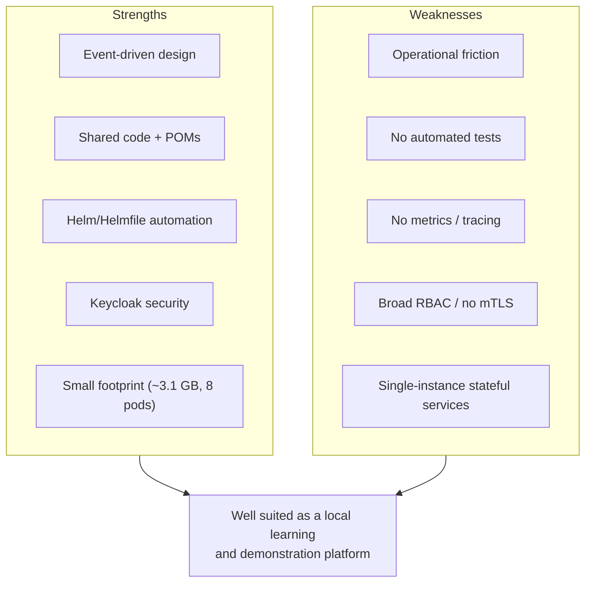

# Limitations and evaluation

An honest assessment of what the project does and does not do. This evaluates the system against its goals and connects the findings to the checked-in configuration. The [problems and fixes](../problems-and-fixes.md) page records how the working parts were debugged.

## What the project achieves

The design concludes that the main objective was met: a modular, containerised purchase system running on Kubernetes. Its stated strengths are:

- **Decoupled architecture.** REST for immediate queries, Artemis for the workflow that spans services.
- **Consistency through shared code.** Parent POMs and the `common` library give every service the same security, logging, and event behaviour.
- **Repeatable deployment.** Helm charts and one Helmfile select an environment and render all resources.
- **Centralised application security.** Keycloak issues tokens; Spring Security enforces roles through shared configuration.
- **Small footprint.** The design reports roughly **3.1 GB of memory and 8 Pods** for the full staging stack — suitable for a laptop with Minikube.

## Operational limitations

| Limitation | What it means here |
| --- | --- |
| Slow development loop | Every code change needs a new image; a rebuild with the same `latest` tag does not restart a Pod automatically. See [development workflow](../guides/development.md). |
| Config reload friction | ConfigMap/Secret changes are not reliably applied; the Stakater Reloader covers only annotated Deployments, and even then not every component reloads cleanly. See [problems and fixes](../problems-and-fixes.md#helm-values-and-environments). |
| Manual workarounds | Some updates still require deleting a resource, re-syncing Helmfile, and deleting Pods to force a restart. |
| Unpinned infrastructure | cert-manager, the runner, and Reloader have chart versions; Loki, Grafana, and Alloy do not. A later sync can resolve different behaviour. See [configuration](../reference/configuration.md#shared-infrastructure). |

## Observability gaps

- **No metrics pipeline.** Spring Actuator exposes `/actuator/prometheus` and `LoggingAspect` records Micrometer meters, but no Prometheus server or dashboards are deployed. See [monitoring](../monitoring-and-logging.md#metrics-are-exposed-but-collection-is-unfinished).
- **Logging is partial.** Alloy ships raw lines; there is no `loki.process` stage to parse CRI envelopes or JSON, and the checked-in `__path__` relabel rule has a suspect replacement. See [Grafana Alloy](../technologies/grafana-alloy.md#discoveryrelabel).
- **No tracing.** The design describes correlation IDs, but the code adds only user, method and class context to logs — no trace or correlation ID is propagated across services. See [the shared library](../concepts/common-library.md#how-a-request-is-observed).

## Security posture

- **Kubernetes RBAC is minimal.** The GitLab Runner service account is bound to `cluster-admin` in the checked-in values — convenient for a learning cluster, not for production. See [design decisions](../concepts/design-decisions.md#cicd-external-gitlab-with-an-in-cluster-runner).
- **East-west traffic is unencrypted.** Services talk over HTTP inside the cluster; there is no service mesh and no mTLS. The [Zero Trust page](zero-trust.md) explains the gap between the implemented IAM foundation and a full Zero Trust design.
- **Development credentials are checked in.** Demo users, verbose JWT logging, a local CA, and permissive runner settings are all present. See [troubleshooting](../guides/troubleshooting.md#unpinned-infrastructure-and-local-credentials).
- **No backup strategy.** Loki data and database state have no defined backup or recovery procedure.

## Functional scope

- **No payment service.** The workflow confirms stock only; no payment gateway is integrated.
- **Basic order management.** Orders cannot be cancelled; that would need a compensating transaction that returns stock to Inventory.
- **Static users.** Users are predefined in the Keycloak realm; there is no registration or profile management.
- **Limited validation.** The controller does not enforce all business constraints (for example a positive quantity). See the [API reference](../reference/api.md#create-a-purchase).

## Reliability and performance

- **Single points of failure.** PostgreSQL, Artemis, and Loki run as single instances.
- **No benchmarks.** No load or performance testing was performed; behaviour under high concurrency is unknown.
- **Manual testing only.** There is no automated unit or integration test suite; the container builds even use `-DskipTests`. See [development workflow](../guides/development.md#build-java-outside-docker).
- **Local only.** Validation happened on Minikube; multi-node, production-like clusters were not tested.

## Evaluation summary

The design treats this as a successful learning outcome rather than a production deployment: the architecture is sound, but reliability, security, and observability need significant work before the same design could be used for real users.

## Future work

The design proposes these next steps, grouped by goal:

| Goal | Proposed work |
| --- | --- |
| Full observability | Add OpenTelemetry tracing, custom business metrics, Prometheus scraping, and alerting in Grafana |
| Zero Trust | Add mTLS between services, possibly through Istio or Linkerd |
| CI/CD maturity | Add automated tests, SAST/DAST and dependency scanning, and progressive delivery such as canary releases |
| Scalability and resilience | Add Horizontal Pod Autoscalers and chaos engineering (LitmusChaos) |
| Features | Implement order cancellation via a compensating saga and a payment service (Stripe/PayPal) |

These are proposals, not features in the repository. The [learning process](../learning-process.md) lists the four items closest to the current setup.

## Where to read next

- [Problems and fixes](../problems-and-fixes.md) — debugging work behind the current implementation.
- [Zero Trust](zero-trust.md) — the security model and what is missing.
- [Observability](observability.md) — logging and metrics in detail.
- [End-to-end use cases](../concepts/use-cases.md) — what the system actually does today.
