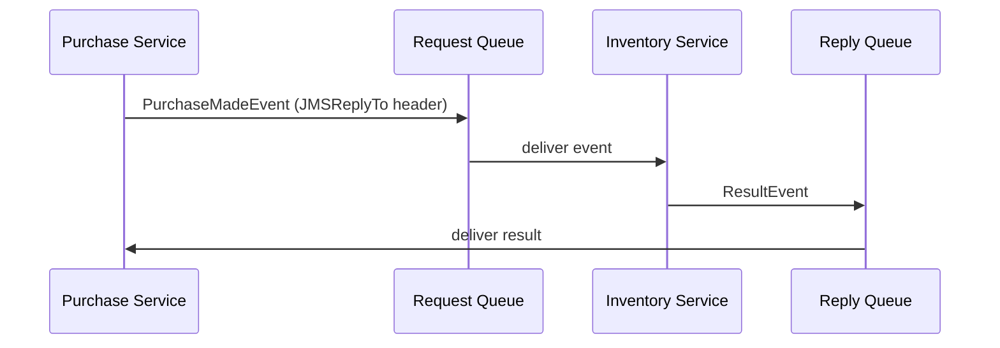
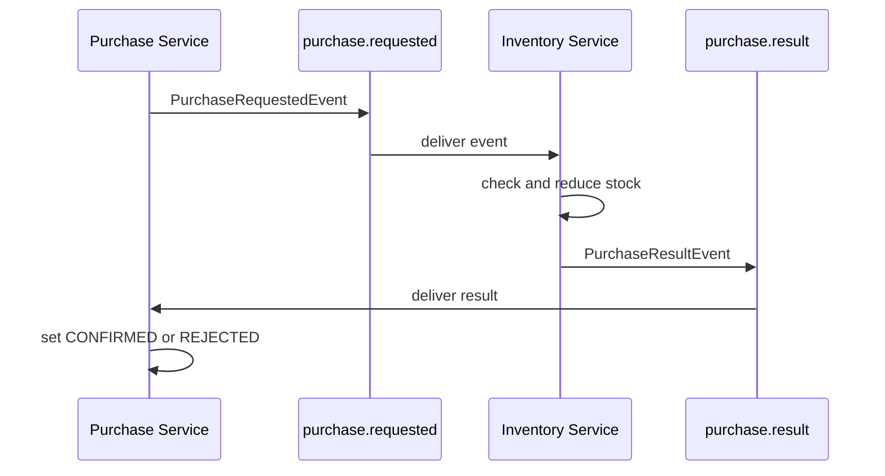
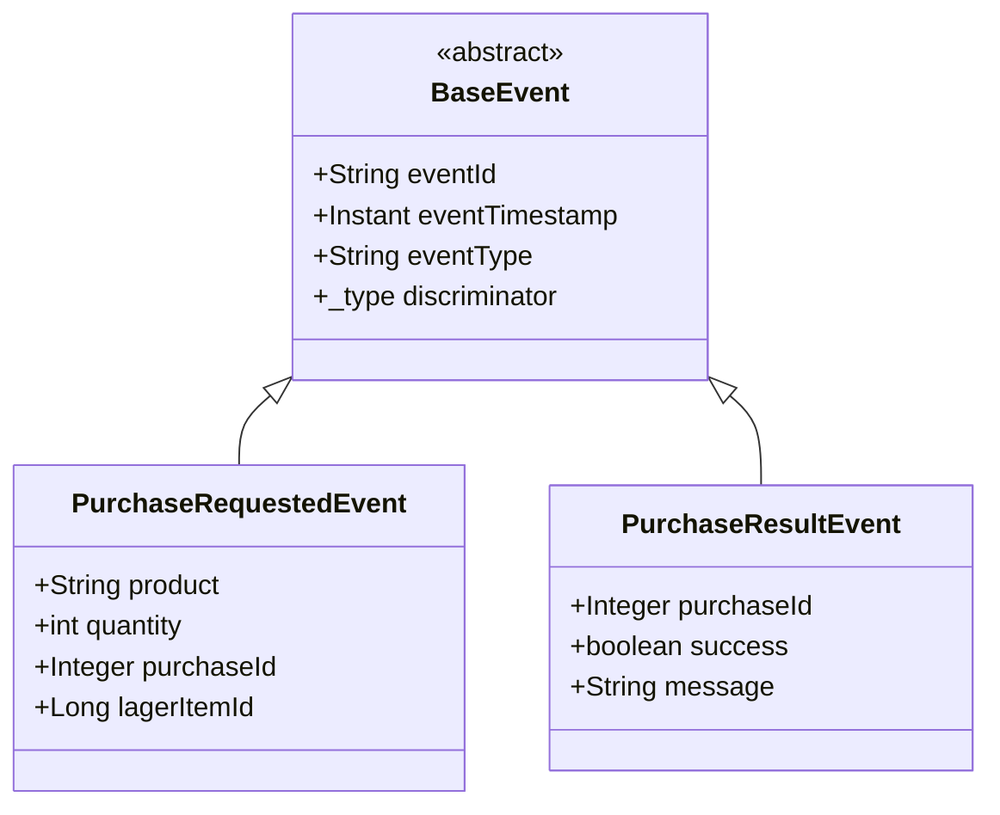

# Asynchronous messaging explained

Why the purchase workflow uses a message broker instead of a direct call, and what the implementation actually does. Thesis §2.14 gives the theory; the [asynchronous purchases concept page](../concepts/messaging.md) documents the checked-in code.

## Message-oriented middleware

A **message broker** sits between services as an intermediary. Instead of Service A calling Service B and waiting, A writes a message and continues; B picks it up later. This is **temporal decoupling** — the services do not have to be online at the same moment.

The thesis (§2.14) lists what a broker provides:

- **Guaranteed delivery** and persistence, so a message survives a restart.
- **Routing** — messages go to queues or topics.
- **Backpressure** — a slow consumer does not block the producer.
- **Loose coupling** — producers and consumers share an event contract, not an implementation.

The project uses **Apache ActiveMQ Artemis**, chosen over RabbitMQ and Kafka for native JMS 2.0 support and operational simplicity.

## Point-to-point queues

The project uses the **point-to-point** model: a message goes to exactly one consumer. The thesis writes this formally as:

```text
∀m ∈ M, ∃!c ∈ C : deliver(m, c)
```

That differs from publish/subscribe topics, where every subscriber receives a copy. The Spring configuration makes the choice explicit:

```properties
spring.jms.pub-sub-domain=false
```

Two fixed queues are declared in `QueueNames.java`:

| Queue | Direction |
| --- | --- |
| `purchase.requested` | Purchase → Inventory |
| `purchase.result` | Inventory → Purchase |

## Request-reply in theory and in this project

The thesis (§2.14.4) describes a request-reply pattern using a dynamic `JMSReplyTo` header: Purchase sends `PurchaseMadeEvent` with a reply destination, Inventory processes it and replies with `ResultEvent`, and Purchase updates the order to confirmed or cancelled.



The implemented code is deliberately simpler:



There is **no `JMSReplyTo` header** in the code — `MessageProducer` simply calls `jmsTemplate.convertAndSend(queueName, message)`. The reply queue is a fixed constant, and the correlation between request and response is the `purchaseId` carried in both events. The project also uses `REJECTED`, not `CANCELLED`, as the negative status. See [the concept page](../concepts/messaging.md#eventual-consistency-in-this-example).

## Events and polymorphic JSON

Both services compile against the same event contract in the `common` module. `BaseEvent` carries a UUID, an `Instant` timestamp and an event type; the two subclasses add their business fields.



Jackson's `@JsonTypeInfo(property = "_type")` writes a discriminator into each JSON message; `JmsConfig` sets the converter's `typeIdPropertyName` to the same `_type` string so the consumer reconstructs the correct subclass. The `JavaTimeModule` handles `Instant`. See [the shared Java library](../concepts/common-library.md#the-event-contract-and-jms-setup).

## The broker itself

Artemis runs from a custom image based on the official one. The thesis (§4.10) notes that only the entrypoint was changed: if a broker instance already exists, the container reuses it instead of trying to create a second one. That avoids errors on restart.

Spring connects in **native** mode to `tcp://artemis-service:61616` with listener concurrency between 1 and 5. The chart deploys one broker replica with a PVC for its journal.

## Benefits and their costs

The thesis closes §2.14 with the usual benefits — resilience, scalability, loose coupling, responsiveness. This project demonstrates them but also shows the cost:

| Benefit | Here | Cost / gap |
| --- | --- | --- |
| Resilience | Messages are persisted by Artemis | Broker is a single point of failure |
| Temporal decoupling | Purchase can succeed while Inventory is slow | Purchase stays `PENDING` until the result arrives |
| Loose coupling | Shared event classes, no direct HTTP call | Both services must agree on the event contract |
| Scalability | More Inventory listeners can consume the queue | No automatic scaling configured |

The deeper correctness issues — no transactional outbox between the database save and the message send, no idempotency check for duplicate events, and no explicit concurrency control on stock — are documented in [asynchronous purchases](../concepts/messaging.md#current-limits) and [limitations](limitations.md#functional-scope).

## Where to read next

- [Asynchronous purchases](../concepts/messaging.md) — the implementation path and its limits.
- [BaseEvent in the shared library](../concepts/common-library.md#the-event-contract-and-jms-setup) — the message contract.
- [End-to-end use cases](../concepts/use-cases.md#2-submit-a-purchase) — the flow from a user's perspective.
- [Problems and fixes](../problems-and-fixes.md) — broker-related debugging.
