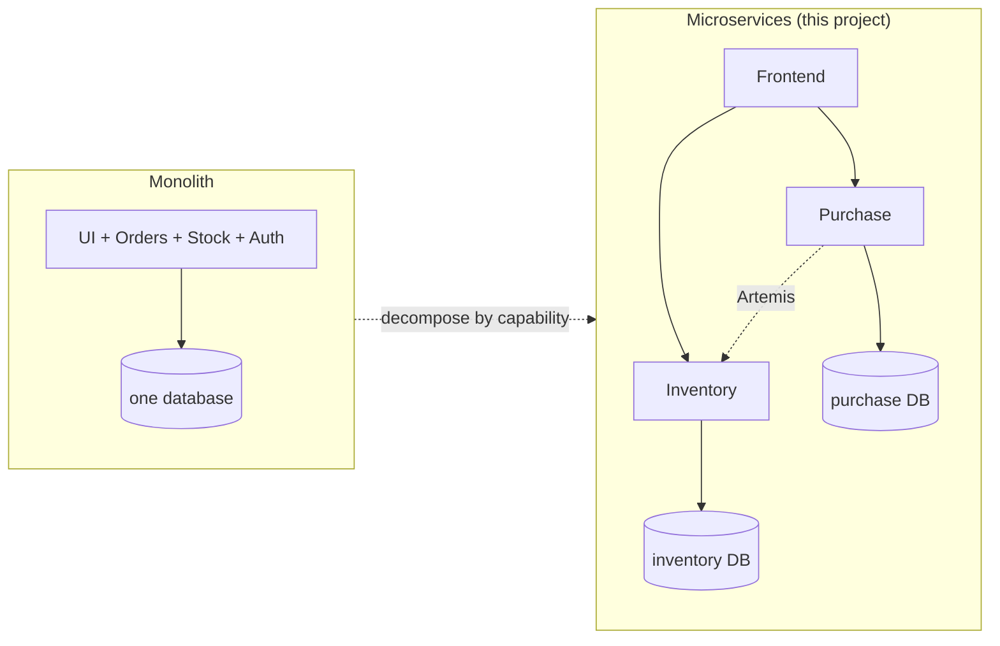
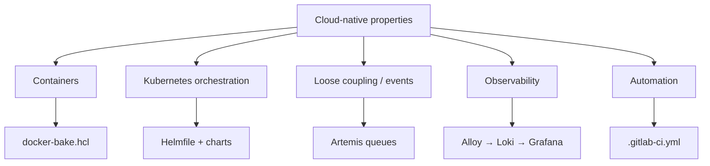
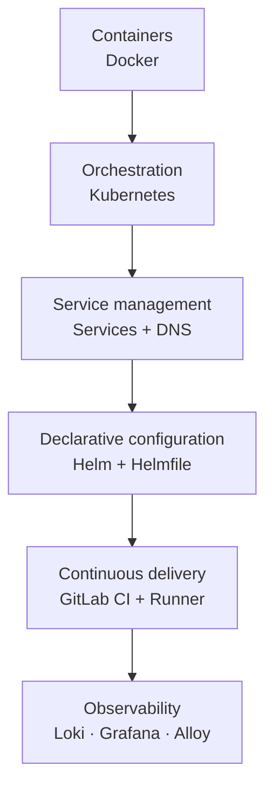

# Microservices and cloud-native foundations

Why the project is shaped the way it is: the move away from monoliths, the principles it follows, and the deployment model it targets. This expands the short overview in [design decisions](../concepts/design-decisions.md).

## From monoliths to microservices

A **monolith** packages all application functions into one deployable unit. Early on that is simple to build and deploy, but as the system grows, a change to one part means rebuilding and redeploying everything, teams step on each other, and a failure in one module can take down the whole application. Scaling means scaling the entire application, even the parts that do not need it.

A **microservices architecture** splits the application into small services organized around business capabilities. Each service:

- has its own data store,
- is deployed independently,
- communicates with others over a network,
- can be written in a different language if needed.

The thesis (§2.1) lists the benefits this project demonstrates — independent deployability, technology heterogeneity, fault isolation, and faster change cycles — along with the costs: distributed-system complexity, network failures, and data consistency problems.

The project keeps the old Compose version as the `Docker-Compsoe-Version` tag precisely because the two models were hard to maintain side by side; see [project history](../project-history.md).

### The monolith in detail (§2.1.1)

The thesis paints the "monolithic misery" with an e-commerce example. A single codebase holds modules named `UserAuthenticationModule`, `InventoryModule` and `PurchaseModule`. They call each other **in process** through direct method calls, and a purchase uses one ACID transaction across all of them. Early on that is pleasant: one `.war` or `.jar` to build, test and deploy.

As it grows, the costs appear:

- **Tight coupling** — a change in one module requires recompiling the whole application.
- **Homogeneous stack** — one language and one runtime for every module.
- **Scale-as-a-unit** — horizontal scaling copies the entire application, including modules that are not under load.
- **Shared fate** — a memory leak in one module can bring down everything.

The thesis calls the decomposition principle **Domain-Driven Design**: organise services around business domains, not technical layers. A **Bounded Context** is an explicit boundary inside which a particular domain model and its rules apply. The project maps three:

| Bounded context | Service | Owns |
| --- | --- | --- |
| User Identity | Keycloak | users, roles, tokens |
| Product Inventory | Inventory Service | stock levels |
| Order Fulfilment | Purchase Service | purchase records |

### The main trade-off: inter-service communication (§2.1.3)

The thesis calls this "the primary trade-off" of microservices. Once calls cross a network:

- **Networks are unreliable** — timeouts, partitions and partial failures need explicit handling.
- **Synchronous REST** is simple but blocks; a slow Inventory service can cause cascading failures.
- **Asynchronous messaging** decouples services but introduces eventual consistency.
- **Cross-service ACID is impractical** — the thesis introduces the **Saga** pattern: a sequence of local transactions with compensating actions. Its illustrative events are `ORDER_CREATED` → `INVENTORY_RESERVED` / `INVENTORY_RESERVATION_FAILED` → `CONFIRMED` or `CANCELLED`.
- **Service discovery** replaces hard-coded addresses; in Kubernetes this is cluster DNS.
- **API evolution** demands versioning so consumers are not broken by changes.

The project's Saga-shaped flow uses different names — `purchase.requested` / `purchase.result` and `PENDING` → `CONFIRMED` / `REJECTED` — but the same idea. See [asynchronous messaging](messaging.md#request-reply-in-theory-and-in-this-project).

## DevOps

DevOps joins development and operations so that building, testing, and deploying become a continuous, automated flow. The thesis describes the usual loop: **plan → code → build → test → release → deploy → operate → monitor**.

### The Three Ways (§2.2.1)

The thesis grounds DevOps in the framework from *The Phoenix Project*:

| Way | Principle | Here |
| --- | --- | --- |
| **First Way** | Systems thinking — optimise the whole flow from development to the customer; remove constraints, reduce batch sizes, automate | `make build-and-push` and `make deploy` collapse many commands; CI builds and deploys in one pipeline |
| **Second Way** | Amplify feedback loops — shorten and strengthen feedback so problems are found near their source | logs in Loki/Grafana, `stern-*` Make targets, the `docs-build` CI job that fails on broken docs |
| **Third Way** | Continual experimentation and learning — high trust, blameless post-mortems, time to improve | the [problems and fixes](../problems-and-fixes.md) page records failures and what each one taught |

### Enabling technologies (§2.2.2)

DevOps is cultural, but these technologies make it practical:

| Technology | Role | Here |
| --- | --- | --- |
| Version control | Single source of truth for code and config | Git/GitLab repository |
| CI/CD | Automate build, test and deploy | `.gitlab-ci.yml`, GitLab Runner |
| Infrastructure as Code | Machine-readable, repeatable infrastructure | Helm charts, Helmfile, `docker-bake.hcl`, `Makefile` |
| Containers and orchestration | Portable units plus automated management | Docker images, Kubernetes/Helmfile |
| Monitoring and observability | Feedback for the Second Way | Loki, Grafana, Alloy; Prometheus discussed but not deployed |

In this project the loop is represented by local iteration (rebuild, redeploy, watch logs), GitLab CI (a push triggers test/build/deploy jobs), and observability (Pod logs land in Loki). See [development workflow](../guides/development.md), [CI/CD pipeline](cicd.md) and [observability](observability.md).

## The Twelve-Factor App (§2.3)

The Twelve-Factor methodology was written for **SaaS** applications. The thesis explicitly notes (§2.3) that this project is *not* SaaS — it runs on a self-hosted local cluster — but the factors still apply as "a clean contract with the underlying platform". Here is each factor explained, with the concrete implementation and any honest gap.

| # | Factor | Explanation and example here |
| --- | --- | --- |
| I | **Codebase** | One codebase in version control, many deployments. This single repo produces `dev` and `staging` deployments from the same commit. |
| II | **Dependencies** | Declare and isolate dependencies explicitly. Maven POMs declare Java libraries; Dockerfile `ARG`s and `.env` pin base image versions — nothing is assumed to exist on the host. |
| III | **Config** | Store deployment-specific config in the environment, strictly separate from code. `application-common.properties` uses `${DATASOURCE_URL:...}` placeholders filled from Kubernetes ConfigMaps and Secrets. |
| IV | **Backing services** | Treat databases, brokers and identity providers as attached resources addressed by a locator in config. JDBC URLs, `tcp://artemis-service:61616` and Keycloak URLs live in ConfigMaps; swapping a database needs no code change. |
| V | **Build, release, run** | Keep the three stages strictly separate. Build = `docker buildx bake`; release = `helmfile -e staging sync` combines the image with config; run = Kubernetes starts the Deployments. |
| VI | **Processes** | Execute the app as stateless processes; persist data in a stateful backing service. The Spring services hold no state between requests; PostgreSQL and Artemis hold it. |
| VII | **Port binding** | Export HTTP as a service by binding a port. `server.port=${SERVER_PORT:8080}` and `containerPort: 8080`, reached through a Kubernetes Service. |
| VIII | **Concurrency** | Scale out through the process model rather than by growing one process. Deployments declare `replicas`; Artemis listener concurrency is 1–5. No HPA is configured, so scaling is manual. |
| IX | **Disposability** | Start and stop quickly, handle graceful shutdown. Pods are disposable and recreated by controllers; the Reloader annotation and `rollout-restart-*` Make targets handle config-driven restarts. |
| X | **Dev/prod parity** | Keep development and production as similar as possible. `dev` and `staging` use the same charts and images on one cluster; the main differences are ingress, TLS and frontend URLs. |
| XI | **Logs** | Treat logs as event streams written to stdout; let the environment collect them. Logback writes JSON to stdout; Alloy ships it to Loki. The application does not write log files. |
| XII | **Admin processes** | Run one-off administrative tasks in the same environment as the app. Flyway migrations run at application startup inside the service process, using the same config. |

Two honest gaps: replica counts are not automatically scaled (no HPA), and stateful components are single-instance. The [limitations page](limitations.md) lists these.

## Cloud-native fundamentals

The CNCF definition (§2.4) emphasises container-based, dynamically orchestrated, loosely coupled systems. The thesis highlights the properties this project demonstrates:

- **Container packaging** — every component has a Dockerfile and a Bake target.
- **Declarative orchestration** — Kubernetes manifests rendered by Helm.
- **Resilience through decoupling** — the purchase workflow survives a slow Inventory service by making `PENDING` explicit.
- **Observability** — structured logs centralised in Loki.
- **Automation** — CI builds and deploys without manual steps.

### The cloud-native technology stack (§2.4.3)

The thesis presents the technologies as a stack, with each layer building on the one below. This is a useful mental model for where each tool in the repository belongs:

| Layer | Role | Tool here |
| --- | --- | --- |
| **Containers** | Package and isolate workloads | Docker images, `docker-bake.hcl` |
| **Orchestration** | Schedule and manage containers across nodes | Kubernetes (Minikube) |
| **Service management** | Discovery and stable networking | Kubernetes Services + cluster DNS |
| **Declarative configuration** | Desired state, versioned and repeatable | Helm charts, Helmfile, values files |
| **Continuous delivery** | Automate build → deploy | GitLab CI, Runner, dind image |
| **Observability** | Understand behaviour from outputs | Loki + Grafana; Alloy collection |

Note that the stack is a *dependency* stack, not the runtime request path — the [nine-layer architecture diagram](../concepts/design-decisions.md#the-nine-layers-at-a-glance) shows the layers from the application's point of view.

## Containerization

Docker packages an application with its dependencies so it runs the same everywhere. The thesis (§2.5) explains the building blocks this project uses:

- **Images and layers** — each instruction in a Dockerfile creates a cached layer. The Java services use multi-stage builds so the final image contains only the JRE and the JAR, not Maven and the JDK.
- **Buildx** — the extended builder that supports the `docker-container` driver and a custom BuildKit configuration. The local HTTP registry needs `insecure = true`; see the [Kubernetes tutorial](../tutorials/local-kubernetes.md).
- **Bake** — `docker-bake.hcl` declares targets (`builder-common`, `inventory-service`, `purchase-service`, `nginx-frontend`, `keycloak`, `artemis`, `dind`), their build contexts, tags, and dependencies. `make build-and-push` wraps it.
- **Registries** — `localhost:5000/` for host builds, `registry.kube-system.svc.cluster.local:80/` for CI builds; both are explained in [containers and builds](containers.md).

See the [repository map](../reference/repository.md) for where each Dockerfile lives.

## What's next

- [Containers and builds](containers.md) — the image pipeline in detail.
- [Kubernetes objects](kubernetes-objects.md) — the resources the charts render.
- [Library and build tools](build-tools.md) — Maven, Lombok, and Flyway.
- [Limitations and evaluation](limitations.md) — where the project stops.
