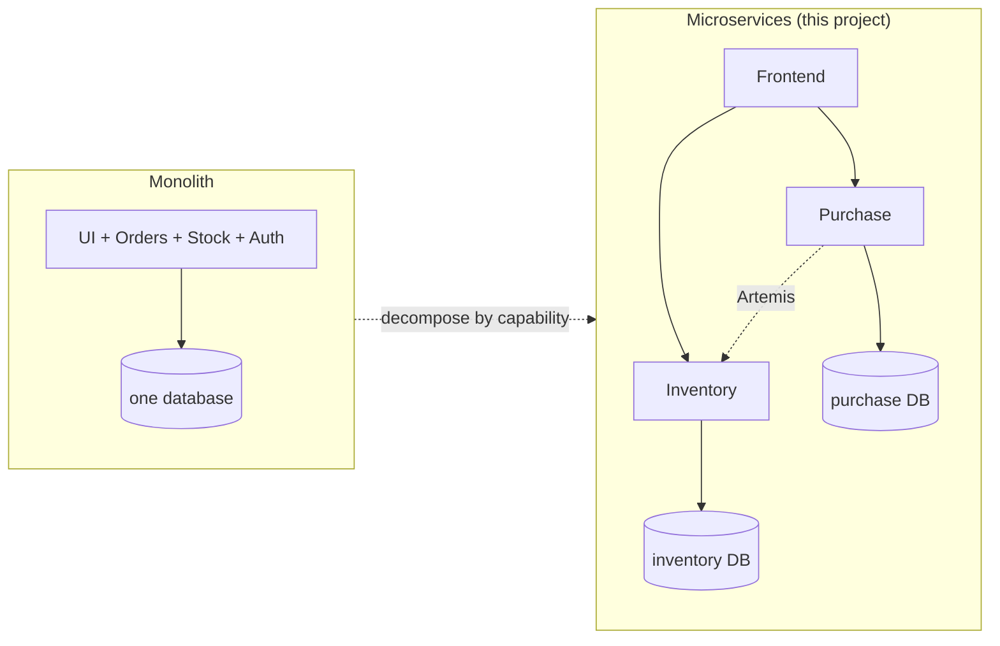
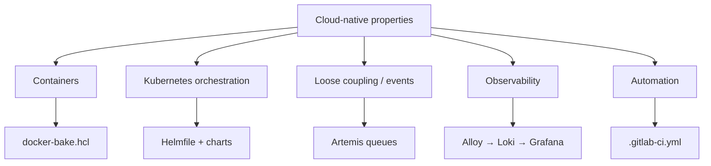

# Microservices and cloud-native foundations

Why the project is shaped the way it is: the move away from monoliths, the principles it follows, and the deployment model it targets. This expands the short overview in [design decisions](../concepts/design-decisions.md).

## From monoliths to microservices

A **monolith** packages all application functions into one deployable unit. Early on that is simple to build and deploy, but as the system grows, a change to one part means rebuilding and redeploying everything, teams step on each other, and a failure in one module can take down the whole application. Scaling means scaling the entire application, even the parts that do not need it.

A **microservices architecture** splits the application into small services organized around business capabilities. Each service:

- has its own data store,
- is deployed independently,
- communicates with others over a network,
- can be written in a different language if needed.

The thesis (§2.1) lists the benefits this project demonstrates — independent deployability, technology heterogeneity, fault isolation, and faster change cycles — along with the costs: distributed-system complexity, network failures, and data consistency problems.

The project keeps the old Compose version as the `Docker-Compsoe-Version` tag precisely because the two models were hard to maintain side by side; see [project history](../project-history.md).

## DevOps

DevOps joins development and operations so that building, testing, and deploying become a continuous, automated flow. The thesis describes the usual loop: **plan → code → build → test → release → deploy → operate → monitor**. In this project that loop is represented by:

- Local iteration — rebuild an image, redeploy a workload, watch the logs (see [development workflow](../guides/development.md)).
- GitLab CI — a push triggers test/build/deploy jobs (see [CI/CD pipeline](cicd.md)).
- Observability — logs from every Pod land in Loki (see [observability](observability.md)).

## The Twelve-Factor App

The Twelve-Factor methodology (§2.3) is a set of rules for software-as-a-service applications. The table shows how each factor appears here, and where the learning project stops short.

| Factor | How it appears in this project |
| --- | --- |
| I. Codebase | One repository, two business services plus shared code |
| II. Dependencies | Maven POMs declare dependencies; Docker images pin base versions in `.env` |
| III. Config | Configuration is injected through ConfigMaps and Secrets, not compiled in |
| IV. Backing services | PostgreSQL and Artemis are treated as attached resources addressed by Service DNS |
| V. Build, release, run | Docker Bake builds, Helmfile releases, Kubernetes runs |
| VI. Processes | Services are stateless; state lives in PostgreSQL and Artemis |
| VII. Port binding | Spring Boot serves HTTP on `8080`, exposed through a Kubernetes Service |
| VIII. Concurrency | Multiple replicas are possible; the charts expose replica counts |
| IX. Disposability | Pods are disposable; startup and shutdown are handled by the container runtime |
| X. Dev/prod parity | `dev` and `staging` run the same stack on one cluster, differing mainly in ingress/TLS |
| XI. Logs | Logs go to stdout as structured JSON and are collected by Alloy |
| XII. Admin processes | Flyway migrations run at application startup |

Two honest gaps: replica counts are not automatically scaled (no HPA), and stateful components are single-instance. The [limitations page](limitations.md) lists these.

## Cloud-native fundamentals

The CNCF definition (§2.4) emphasises container-based, dynamically orchestrated, loosely coupled systems. The thesis highlights the properties this project demonstrates:

- **Container packaging** — every component has a Dockerfile and a Bake target.
- **Declarative orchestration** — Kubernetes manifests rendered by Helm.
- **Resilience through decoupling** — the purchase workflow survives a slow Inventory service by making `PENDING` explicit.
- **Observability** — structured logs centralised in Loki.
- **Automation** — CI builds and deploys without manual steps.

## Containerization

Docker packages an application with its dependencies so it runs the same everywhere. The thesis (§2.5) explains the building blocks this project uses:

- **Images and layers** — each instruction in a Dockerfile creates a cached layer. The Java services use multi-stage builds so the final image contains only the JRE and the JAR, not Maven and the JDK.
- **Buildx** — the extended builder that supports the `docker-container` driver and a custom BuildKit configuration. The local HTTP registry needs `insecure = true`; see the [Kubernetes tutorial](../tutorials/local-kubernetes.md).
- **Bake** — `docker-bake.hcl` declares targets (`builder-common`, `inventory-service`, `purchase-service`, `nginx-frontend`, `keycloak`, `artemis`, `dind`), their build contexts, tags, and dependencies. `make build-and-push` wraps it.
- **Registries** — `localhost:5000/` for host builds, `registry.kube-system.svc.cluster.local:80/` for CI builds; both are explained in [containers and builds](containers.md).

See the [repository map](../reference/repository.md) for where each Dockerfile lives.

## What's next

- [Containers and builds](containers.md) — the image pipeline in detail.
- [Kubernetes objects](kubernetes-objects.md) — the resources the charts render.
- [Library and build tools](build-tools.md) — Maven, Lombok, and Flyway.
- [Limitations and evaluation](limitations.md) — where the project stops.
