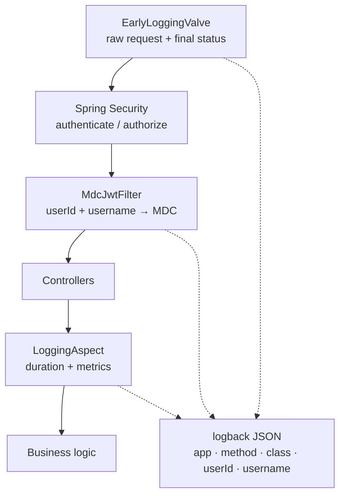
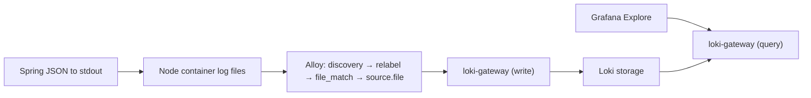

# Observability explained

The three pillars, how the application produces usable signals, and what the deployed stack actually does with them. Thesis §§2.16–2.17 give the theory; §4.8 and the [logging guide](../monitoring-and-logging.md) cover operations.

## Monitoring vs observability

The thesis (§2.16) puts it neatly: **monitoring tells you *if*; observability tells you *why***. Observability means being able to infer a system's internal state from its external outputs — essential when a request crosses several processes and a failure can happen between them.

### The three pillars

| Pillar | What it is | Tool in the thesis |
| --- | --- | --- |
| **Logs** | Timestamped discrete events | Loki (log aggregation) |
| **Metrics** | Numerical measurements over time | Prometheus (scraping + PromQL) |
| **Traces** | End-to-end journey of a request | — (proposed, not implemented) |

The thesis describes Prometheus as a pull-based metrics system, Loki as indexing only metadata labels (cheaper than full-text indexing), Promtail as the collection agent, and Grafana as the visualisation layer. In the Kubernetes deployment, **Grafana Alloy replaced Promtail** — see [Grafana Alloy](../technologies/grafana-alloy.md).

## How the application produces logs

Five components in the `common` module shape a request's logs; see [the shared Java library](../concepts/common-library.md#how-a-request-is-observed) for the code-level view:

1. **PropertyLogger** — runs at startup, prints active profile and resolved environment values (skips `prod`).
2. **EarlyLoggingValve** — a Tomcat valve that logs the raw method/URI before Spring sees the request, and the final status after everything completes.
3. **MdcJwtFilter** — after authentication, puts `userId` (`sub`) and `username` (`preferred_username`) into the MDC; clears it in `finally` to prevent cross-request leakage.
4. **LoggingAspect** — an AOP `@Around` advice that logs entry/exit/duration for controller, service and repository methods, adds `method` and `class` to the MDC, and records Micrometer meters. See [AOP explained](aop.md).
5. **logback-spring.xml** — encodes output as JSON with `app` and the MDC fields; the banner is disabled so startup output stays valid JSON.



The nesting matters: if a request is rejected by a filter, the valve still records it, while the MDC filter only runs when authentication has already populated the principal.

## Structured vs unstructured logs

Unstructured text needs regex parsing, breaks easily when formats change, and scatters context across lines. Structured JSON gives stable fields that a log system can index and query. A typical line from this project contains:

```json
{
  "timestamp": "...",
  "level": "INFO",
  "app": "inventory",
  "method": "getAllProducts",
  "class": "...ProductService",
  "userId": "...",
  "username": "demo001",
  "message": "Method Exited Successfully ... [47ms]"
}
```

The thesis shows richer examples with `event`, `args` and `traceId`; the checked-in Logback config includes only `method`, `class`, `userId` and `username` as MDC keys.

## The deployed log pipeline



Alloy discovers Pods through the Kubernetes API, copies selected labels (`namespace`, `pod`, `container`, `microserviceName`, `component`, `env`) and builds a file path from the Pod UID and container name. It tails the file and pushes lines to the Loki gateway. Grafana queries the same gateway through its provisioned Loki data source.

The [Grafana Alloy deep dive](../technologies/grafana-alloy.md) explains every component, including the relabel rule whose `$2` replacement is suspect, and the absence of a `loki.process` stage to parse CRI envelopes.

## Querying logs

Use the labels the pipeline actually creates:

```logql
{namespace="dev"}
```

```logql
{namespace="dev", microserviceName="inventory"} |= "INFO"
```

For raw lines with a CRI envelope, strip the prefix before applying `| json`. See [query examples](../monitoring-and-logging.md#query-the-labels-this-project-creates).

## Metrics: exposed but not collected

The applications publish `/actuator/prometheus` and the aspect records meters such as `app.method.execution.duration`, `.count` and `.errors`. SecurityConfig even permits that endpoint anonymously so a scraper could reach it.

There is **no Prometheus server, scrape configuration, or Grafana metrics data source** in the Helmfile, so none of those numbers are collected or visualised. The [monitoring guide](../monitoring-and-logging.md#metrics-are-exposed-but-collection-is-unfinished) and [limitations page](limitations.md#observability-gaps) record this boundary.

## Traces: not implemented

The thesis describes correlation IDs propagated across calls and messages, and later proposes OpenTelemetry. The code has **no** trace or correlation ID: `BaseEvent.eventId` is a UUID for each event but is not written into logs or passed between services. `LoggingAspect` is proxy-based method interception, not distributed tracing. See [limitations](limitations.md#observability-gaps).

## Theory vs implementation summary

| Thesis description | Repository reality |
| --- | --- |
| Promtail as collector | Alloy in Kubernetes, Promtail only in the earlier Compose prototype |
| Prometheus + Grafana dashboards | Only Loki + Grafana logs; no Prometheus server |
| Arguments/results logged by aspect | Only method/class names and duration |
| `userId`/`username` on Micrometer tags | Tags are class/method/success/error_type |
| Correlation IDs and `traceId` queries | No trace ID anywhere in code or config |
| Dev uses human-readable logs | Application logger emits JSON in dev too |

## Where to read next

- [Grafana Alloy, explained](../technologies/grafana-alloy.md) — the collector in full detail.
- [AOP explained](aop.md) — the method-level instrumentation.
- [Monitoring and logging guide](../monitoring-and-logging.md) — deploy and query the stack.
- [Limitations and evaluation](limitations.md#observability-gaps) — what is missing and what would fix it.
