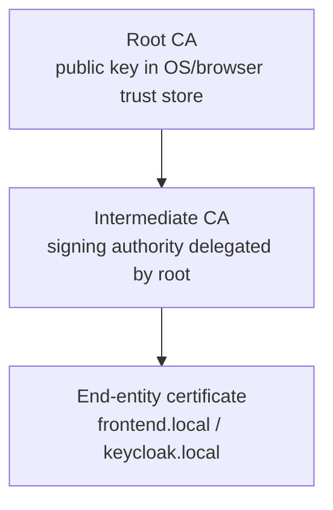
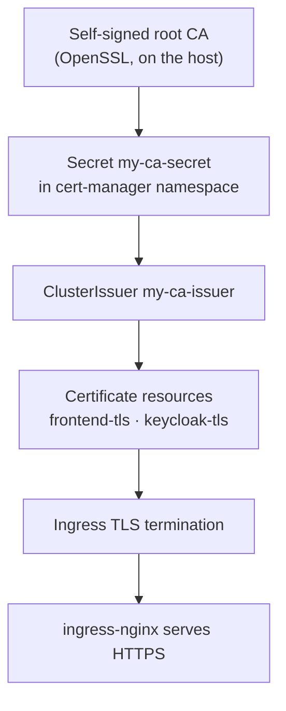

# HTTPS and PKI

How TLS works and how this project issues certificates locally. TLS explains the theory; this page maps it to cert-manager. The hands-on steps are in [certificate management](../certificate-management.md).

## Why encryption is needed

TLS provides TLS as providing three guarantees:

| Guarantee | Meaning |
| --- | --- |
| **Confidentiality** | Data in transit is encrypted; a passive observer cannot read it |
| **Integrity** | A cryptographic MAC detects tampering |
| **Authentication** | A validated certificate proves the server is who it claims to be |

Without authentication, encryption alone would still allow an impostor to intercept traffic.

## Asymmetric cryptography

TLS relies on a **key pair**:

- The **private key** is kept secret. It decrypts data encrypted with the public key and creates digital signatures.
- The **public key** can be distributed. It encrypts data only the matching private key can decrypt, and verifies signatures.

Deriving the private key from the public key is computationally infeasible. This is the basis for both key exchange and digital signatures.

## X.509 certificates and the chain of trust

An **X.509 certificate** is a digital identity credential — a "digital passport". It binds a public key to an entity and contains:

- the subject's public key and identity details,
- the issuer's identity,
- the **issuer's digital signature** — the critical security component,
- validity dates and algorithm information.

Certificates are arranged in a hierarchy:



A client validating a server:

1. Receives the server's certificate chain.
2. Verifies the leaf signature using the intermediate's public key.
3. Verifies the intermediate using the root's public key.
4. Checks the root is in its local trust store.
5. Checks validity dates and that the hostname matches the certificate.

Any failure produces a security warning. Because public CAs do not sign `.local` names, this project creates its own root CA.

## The TLS handshake

The design describes the handshake in five steps:

```mermaid
sequenceDiagram
 autonumber
 participant C as Client (browser)
 participant S as Server (ingress-nginx)
 C->>S: Client Hello (TLS versions, ciphers, random)
 S->>C: Server response + certificate chain + random
 C->>C: Validate chain, dates, hostname
 C->>S: Pre-master secret encrypted with server public key
 S->>S: Decrypt with private key; derive session keys
 C->>S: Symmetric encrypted HTTP requests
```

The asymmetric phase only establishes a shared secret; the bulk of the conversation uses faster symmetric encryption.

## How the project uses it

The project reproduces a production-like certificate workflow without an external provider:



### 1. Root CA

`scripts/setup-certs.sh` generates a 4096-bit key and a 10-year self-signed certificate:

```bash
openssl genrsa -out ca7.key 4096
openssl req -x509 -new -nodes -key ca7.key -sha256 -days 3650 \
 -out ca7.crt -subj '/CN=My Local Root CA 7'
```

The certificate — not the private key — is imported into the host trust store so browsers accept the leaf certificates. The newer documentation recommends generating a fresh CA under `.local/certificate-authority/` rather than reusing the checked-in material; see [certificate management](../certificate-management.md#1-prepare-a-ca).

### 2. CA Secret and ClusterIssuer

The CA certificate and key are stored as a Kubernetes TLS Secret in the `cert-manager` namespace:

```bash
kubectl create secret tls my-ca-secret \
 --cert=./certificate-authority/ca7.crt \
 --key=./certificate-authority/ca7.key -n cert-manager
```

`charts/ca-issuer/templates/issuer.yaml` then defines the issuer:

```yaml
apiVersion: cert-manager.io/v1
kind: ClusterIssuer
metadata:
 name: my-ca-issuer
spec:
 ca:
 secretName: my-ca-secret
```

### 3. Certificate resources

The frontend and Keycloak charts contain Certificate resources referencing `my-ca-issuer`, with `dnsNames: [frontend.local]` and `keycloak.local`, and `secretName: frontend-tls` / `keycloak-tls`. The Ingress templates are also annotated with `cert-manager.io/cluster-issuer: my-ca-issuer` and `nginx.ingress.kubernetes.io/ssl-redirect: "true"`.

cert-manager's ingress-shim can create the Certificate from the annotated Ingress; the explicit Certificate templates are complementary. The leaf Secrets end up in the application namespace, where ingress-nginx uses them for TLS termination.

### 4. Local name resolution

`scripts/update-hosts.sh` maps `frontend.local` and `keycloak.local` to `minikube ip`. Because the Minikube IP can change after a restart, the hosts file may need updating. See [certificate management](../certificate-management.md#3-deploy-staging-application-ingress).

## Switching to a public issuer

The design notes that the workflow is flexible: replacing the self-signed CA with Let's Encrypt requires only a change to the ClusterIssuer, leaving the rest of the pipeline intact. The Ingress annotations would then reference a public ACME issuer instead of `my-ca-issuer`. The `.local` hostnames would need to become real DNS names first.

## Where to read next

- [Certificate management](../certificate-management.md) — step-by-step setup and verification.
- [Kubernetes objects](kubernetes-objects.md#services-and-ingress) — what an Ingress does.
- [Zero Trust](zero-trust.md) — TLS is only one part of a security model.
- [Limitations](limitations.md#security-posture) — why east-west traffic is still unencrypted.
