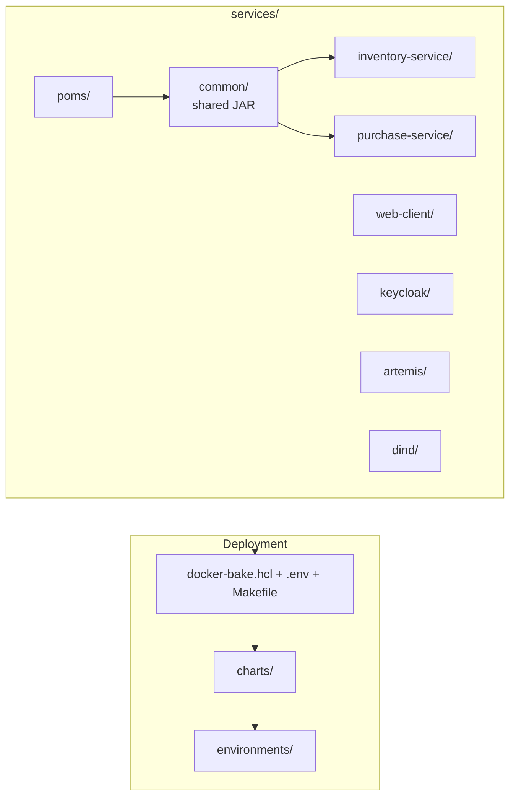

# Business services in detail

The code behind the two business services, following thesis §§4.1–4.4. The [shared Java library](../concepts/common-library.md) covers the common module they both depend on; this page focuses on what is specific to Inventory and Purchase.

## Technology inventory (§4.1)

| Category | Technologies |
| --- | --- |
| Backend | Spring Boot 3.5.3, Java 21, Lombok, the `common` library |
| Containerization | Docker multi-stage builds, Buildx, Bake |
| Orchestration | Kubernetes, Helm, Helmfile |
| Security | Keycloak, OIDC, JWT, Spring Security resource server |
| Messaging | Apache Artemis, JMS, Jackson text messages |
| Observability | JSON logging, AOP, Micrometer, Alloy/Loki/Grafana |
| CI/CD | GitLab Runner with Kubernetes executor, custom dind image |
| Data | PostgreSQL, Flyway |

The thesis lists an **implementation roadmap** (§4.1.3): project structure and common library first, then service implementation, then containerisation and orchestration, then infrastructure and security, then CI/CD and automation. The git history follows that order — see [learning process](../learning-process.md).

## Repository structure (§4.2)

The repository keeps code and deployment definitions side by side:



Each business service has the same internal layout under `src/main/java/swtp/clouddemo/`:

| Package | Responsibility |
| --- | --- |
| `controller` | REST endpoints, `@PreAuthorize` role checks |
| `dto` | Input/output shapes |
| `entity` | JPA entities mapped to the Flyway-owned tables |
| `repository` | Spring Data repositories |
| `service` | Business logic, transactions |
| `messaging` | JMS listeners (and result publishing in Inventory) |

Migrations live under `src/main/resources/db/migration/`. The full map is in the [repository map](../reference/repository.md).

## Inventory Service (§4.4.1)

**Responsibility:** stock management and product inventory operations.

- **Stack:** Spring Boot, Spring JMS, Spring Security, Artemis, Flyway.
- **Communication:** synchronous REST for queries, asynchronous JMS for reservations.
- **Data:** its own PostgreSQL database, schema managed by Flyway.

### Schema

```sql
DROP TABLE IF EXISTS lager_item;
CREATE TABLE lager_item (
    id SERIAL PRIMARY KEY,
    product VARCHAR(255),
    quantity INTEGER
);
```

`V1__init.sql` creates the table; `V2__addData.sql` truncates it and inserts 20 seed rows. See [Maven, Lombok and Flyway](build-tools.md#the-real-migrations).

### Application wiring

The main class imports shared configuration and enables JMS listeners:

```java
@SpringBootApplication
@EnableJms
@Import({CommonConfig.class})
public class InventoryServiceApplication { ... }
```

`CommonConfig` component-scans `swtp.clouddemo.common` and exposes the `JwtAuthConverter` bean, so the service inherits security, messaging and logging behaviour. See [the shared Java library](../concepts/common-library.md#the-maven-hierarchy).

### REST endpoint

```java
@RestController
@RequestMapping("inventory-api")
@RequiredArgsConstructor
public class ProductController {
    private final LagerService productService;

    @PreAuthorize("hasRole('USER')")
    @GetMapping("/inventory")
    public List<ProductDto> getAllProducts() {
        return productService.getAllProducts();
    }
}
```

The repository filters out products with quantity zero or negative, so sold-out items disappear from the list. See the [HTTP API reference](../reference/api.md#inventory-products).

### Message listener

```java
@JmsListener(destination = QueueNames.PURCHASE_REQUESTED)
public void handlePurchaseRequested(PurchaseRequestedEvent event) {
    boolean available = lagerService.consumeProductIfAvailable(
        event.getLagerItemId(), event.getQuantity());
    String message = available ? "Inventory reserved successfully" : "Inventory out of stock";
    messageProducer.sendMessage(QueueNames.PURCHASE_RESULT,
        new PurchaseResultEvent(event.getPurchaseId(), available, message));
}
```

The check and the stock reduction happen inside `LagerService`. Note that there is no explicit idempotency check or concurrency control around that two-step operation — see [current limits](../concepts/messaging.md#current-limits).

## Purchase Service (§4.4.2)

**Responsibility:** transaction processing for client purchase requests.

- Uses the same `common` library for security, events and logging.
- Sends `PurchaseRequestedEvent` to `purchase.requested`.
- Consumes `PurchaseResultEvent` from `purchase.result` and applies the final status.

### Schema and evolution

The schema grew across three migrations, which is a nice illustration of Flyway's purpose:

| Migration | Change |
| --- | --- |
| `V1__init.sql` | Creates `purchases` (id, lager_item_id, product_name, quantity, timestamp) |
| `V2__status.sql` | Adds `status VARCHAR(20) NOT NULL DEFAULT 'PENDING'` |
| `V3__userId.sql` | Adds `user_id VARCHAR(255) NOT NULL` |

### Creating a purchase

```java
@Override
public PurchaseDtoOut createPurchase(PurchaseDtoIn dtoIn) throws JsonProcessingException {
    String userId = jwtService.getUserId();                 // JWT sub claim
    Purchase saved = purchaseRepository.save(PurchaseMapper.toEntity(dtoIn, userId));
    PurchaseRequestedEvent event = new PurchaseRequestedEvent(
        saved.getProductName(), saved.getQuantity(), saved.getId(), saved.getLagerItemId());
    messageProducer.sendMessage(QueueNames.PURCHASE_REQUESTED, event);
    return PurchaseMapper.toDto(saved);
}
```

Two things to notice:

1. The JWT subject is stored as `user_id`, tying the record to the authenticated user — but the listing queries do **not** filter by it. See [authentication](../concepts/authentication.md#role-mapping).
2. Saving the entity and sending the message are **separate operations** with no transactional outbox, so a failure between them can leave a `PENDING` purchase with no message. See [eventual consistency](../concepts/messaging.md#eventual-consistency-in-this-example).

The response DTO contains `id`, `productName`, `quantity` and `timestamp` — **not** status. That is why the tutorial uses a status-filtered query to observe completion. See [first purchase](../tutorials/first-purchase.md#verify-completion).

### Applying the result

`PurchaseResultListener` receives the result, maps `success` to `CONFIRMED` or `REJECTED`, and calls `PurchaseServiceImpl.updatePurchaseStatus(...)`. The `PurchaseStatus` enum has exactly three values: `PENDING`, `CONFIRMED`, `REJECTED`.

## How the two services differ

| Aspect | Inventory | Purchase |
| --- | --- | --- |
| Primary data | `lager_item` stock rows | `purchases` records |
| JMS role | Consumer of requests, publisher of results | Publisher of requests, consumer of results |
| Seed data | 20 products via `V2__addData.sql` | none |
| User identity | not used | `user_id` from JWT `sub` |
| Schema migrations | 2 | 3 |

## Where to read next

- [Asynchronous purchases](../concepts/messaging.md) — the event flow and its limits.
- [Spring Boot and request flow](spring-boot.md) — how an HTTP request reaches these controllers.
- [Keycloak and OIDC](keycloak.md) — where the user ID in the token comes from.
- [End-to-end use cases](../concepts/use-cases.md) — both services working together.
