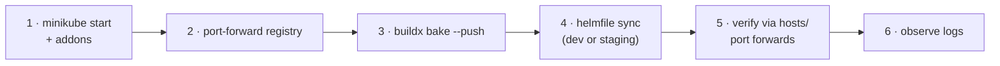

# The complete development workflow

Everything from thesis §4.7 in one place: cluster setup, registry access, image builds, environment values, dual environments, host routing, certificates and the full loop. The [tutorials](../tutorials/local-kubernetes.md) do the same steps interactively; this page explains why each one exists.

## 1. Minikube cluster configuration (§4.7.2)

The one-time bootstrap from `scripts/startup.sh`:

```bash
minikube delete
minikube start --driver=docker --memory=8g --cpus=4
minikube addons enable ingress
minikube addons enable dashboard
minikube addons enable metrics-server
minikube addons enable registry
```

| Choice | Reason from the thesis |
| --- | --- |
| Docker driver | Native Docker integration and consistent runtime behaviour |
| 8 GB memory | Enough for Keycloak, the monitoring stack and several services |
| 4 CPUs | Parallel service execution |
| Ingress addon | NGINX Ingress Controller for external access |
| Registry addon | Local image storage for custom builds |
| Metrics server | Enables resource monitoring and HPA (though no HPA is configured) |

Ongoing cluster commands: `minikube stop` to pause, `minikube start` to resume, `minikube delete` to tear down. The tutorial avoids `scripts/startup.sh` for everyday use because it starts with `minikube delete` — see [troubleshooting](../guides/troubleshooting.md#existing-helper-script-limitations).

## 2. Registry port forwarding (§4.7.2)

After every restart, the local registry must be reachable from the host:

```bash
nohup kubectl port-forward -n kube-system service/registry 5000:80 > portforward.log 2>&1 &
```

This creates a tunnel from host port 5000 to the in-cluster registry Service, so `docker push localhost:5000/...` works from the host while Pods pull from the same registry internally. `nohup` keeps the tunnel alive across terminal sessions. The host/node address confusion this creates is one of the project's recurring debugging problems — see [problems and fixes](../problems-and-fixes.md#pods-could-not-pull-images-from-the-in-cluster-registry).

## 3. Build and push (§4.7.3)

```bash
docker buildx bake builder-common --push
docker buildx bake application-images --push
```

The first command builds the shared Maven-cache image; the second builds the six application images. CI does the same but first rewrites `REGISTRY` to the cluster-internal address. See [containers and builds](containers.md).

## 4. Deploy with Helmfile (§4.7.4)

```bash
helmfile -e staging --file ./environments sync
helmfile -e dev --file ./environments sync
```

One Helmfile defines all releases. Environment selection (`-e`) chooses the values file; `needs:` orders releases; `globalConfig.namespace` decides which namespace application workloads land in. The unified values strategy is detailed in [Helm values in depth](helm-values.md).



## 5. Dual environment strategy (§4.7.6)

| | `dev` | `staging` |
| --- | --- | --- |
| Access | port forwards | ingress-nginx + HTTPS |
| Frontend URL | `http://localhost:4200` | `https://frontend.local` |
| Keycloak URL | `http://localhost:8080` | `https://keycloak.local` |
| Ingress | disabled | enabled with TLS |
| Keycloak proxy mode | `standalone` | `edge` |
| Namespace | `dev` | `staging` |

Both environments run the same images and charts; only the values differ. This is dev/prod parity in practice. See [Kubernetes, Helm and Helmfile](../concepts/kubernetes-and-helm.md#namespaces-and-shared-infrastructure).

## 6. Hosts file configuration (§4.7.7)

Staging hostnames are local names, not public DNS:

```bash
minikube ip
# add to /etc/hosts:
192.168.49.2 frontend.local
192.168.49.2 keycloak.local
```

The Minikube IP can change after a restart, so the hosts file may need updating. `scripts/update-hosts.sh` automates it. The Ingress controller routes by the `Host` header, so without these entries the browser never reaches the right Service. See [certificate management](../certificate-management.md#4-verify-https).

## 7. Certificates and security (§4.7.8)

Namespaces isolate security-sensitive components: `cert-manager` for the CA and issuer, `gitlab-runner` for CI, `monitoring` for logs, and `dev`/`staging` for applications. The CA secret, ClusterIssuer and TLS Secrets are described in [HTTPS and PKI](pki.md#how-the-project-uses-it).

## 8. Complete loop (§4.7.9)

The thesis's "iterative development process" is:

1. **Cluster initialisation** — one-time Minikube setup with addons.
2. **Registry configuration** — port forward for local image pushes.
3. **Code modification** — develop a feature or fix.
4. **Image reconstruction** — rebuild `builder-common` and the application images.
5. **Environment deployment** — `helmfile -e staging sync`.
6. **Validation** — test through the configured hostnames.

Change management depends on what changed:

| Change | Required action |
| --- | --- |
| Application code | Rebuild and push images, then resync the environment |
| Helm chart | Resync without rebuilding images |
| Values file | Resync only the affected environment |
| Cluster configuration | May need a Minikube restart and reconfiguration |

## Practical caveats

- A rebuilt image with the same `latest` tag does not restart a Pod; use `make rollout-restart-*` or delete the Pod. See [development workflow](../guides/development.md#build-one-backend-without-the-ci-image).
- `helmfile sync` does not reliably reload Alloy's ConfigMap, so some config changes need manual delete/reapply. See [problems and fixes](../problems-and-fixes.md#helm-values-and-environments).
- The helper scripts have known rough edges; the tutorials use explicit commands instead. See [troubleshooting](../guides/troubleshooting.md#existing-helper-script-limitations).

## Where to read next

- [Run on local Kubernetes](../tutorials/local-kubernetes.md) — the hands-on version of steps 1–5.
- [Helm values in depth](helm-values.md) — what `sync` actually renders.
- [CI/CD pipeline](cicd.md) — how the pipeline automates this loop.
- [Problems and fixes](../problems-and-fixes.md) — the debugging behind each step.
