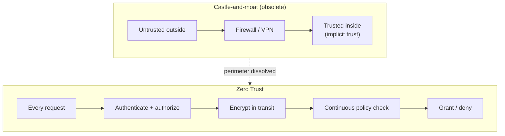

# Zero Trust explained

Why "network location equals trust" no longer works, what replaces it, and how much of that this project implements. The [limitations](limitations.md#security-posture) states the gaps plainly.

## The failure of the perimeter model

Traditional security used a **castle-and-moat** model: a strong firewall at the edge, and implicit trust for anything inside. Firewalls, VPNs and network segmentation enforced the boundary.

The design lists four shifts that dissolved that perimeter:

1. **No single perimeter** — resources span public clouds, private clouds and edge locations.
2. **East-west traffic dominates** — in microservices most traffic is service-to-service *inside* the cluster; a perimeter filter cannot see lateral movement.
3. **Ephemeral workloads** — Pods get transient IPs, so static IP-based firewall rules become unmanageable.
4. **Remote work and BYOD** — VPNs extend the trust zone; one compromised device can undermine least privilege.

The flawed assumption is that **network location equates to trust**. In a dynamic system, a breach is "not a matter of *if* but *when*".

## Zero Trust principles

Formalised by NIST in **SP 800-207**, Zero Trust follows "**never trust, always verify**": every request — from a user, service or device — is authenticated, authorized and encrypted regardless of origin.

| Principle | Meaning in the design |
| --- | --- |
| Assume breach | Minimise blast radius through segmentation |
| Verify explicitly | Use identity, device health, behaviour — not source IP |
| Least privilege | Just-in-time, just-enough access for humans *and* machine identities |
| Continuous assessment | Trust is not one-time; revoke access in real time |
| Protect data in depth | Encryption at rest and in transit, microsegmentation, monitoring |



## Implementation patterns

The design maps the principles to concrete technologies:

- **IAM as the central pillar** — users authenticate with OIDC; services may use client credentials; tokens carry claims and roles that resource servers enforce.
- **Service mesh** — Istio or Linkerd provide mutual TLS for east-west traffic and fine-grained network policies such as "purchase-service may talk to inventory-service only on port 8080".
- **Secrets management** — Vault or cloud key stores replace hard-coded credentials, with leasing and rotation.
- **API gateway** — handles north-south traffic: TLS termination, token validation, rate limiting.

The design is explicit that a service mesh is **not implemented** here; the project focuses on the foundational identity-centric layer as "the first and most critical step".

## What this project implements

| Layer | Status | Evidence |
| --- | --- | --- |
| User authentication | ✅ OIDC via Keycloak, PKCE | [Keycloak and OIDC](keycloak.md) |
| Authorization | ✅ Role checks via shared Spring Security config and `@PreAuthorize("hasRole('USER')")` | [security foundation](../concepts/common-library.md#security-foundation) |
| North-south TLS | ✅ cert-manager + ingress-nginx for `frontend.local` / `keycloak.local` | [HTTPS and PKI](pki.md) |
| Token validation | ✅ issuer + JWK set, signed RS256 tokens | [authentication](../concepts/authentication.md#issuer-and-signing-keys-are-different-concerns) |
| Kubernetes RBAC | ⚠️ Minimal; runner bound to `cluster-admin` | [CI/CD pipeline](cicd.md#the-gitlab-runner) |
| East-west mTLS | ❌ Internal traffic is plain HTTP | ConfigMaps use `http://` Service URLs |
| Service mesh | ❌ None | No Istio/Linkerd chart |
| Secrets management | ⚠️ Kubernetes Secrets with demo defaults; no Vault | [configuration](../reference/configuration.md#backend-runtime-environment) |
| Backup / DR | ❌ None | [limitations](limitations.md#security-posture) |

## Kubernetes RBAC

Keycloak governs **application-level** access — who may call an API. It says nothing about who may read a ConfigMap or create a Pod. In this repository the GitLab Runner's ServiceAccount is bound to the built-in `cluster-admin` ClusterRole so build Pods can run Helm and kubectl. That is convenient for a learning cluster and explicitly flagged as insecure in the chart values. See [CI/CD pipeline](cicd.md#the-gitlab-runner).

## East-west traffic

Services reach each other with plain HTTP through cluster DNS:

```text
tcp://artemis-service:61616
http://keycloak-service:8080/...
jdbc:postgresql://inventory-db-service:5432/...
```

There is no mTLS between Pods, no service mesh, and no network policy restricting which Pod may talk to which. TLS terminates at the Ingress; everything behind it is unencrypted. The [HTTPS and PKI page](pki.md#how-the-project-uses-it) covers the north-south half.

## Verbose logging as a security risk

The checked-in `JwtAuthConverter` logs token metadata, claims and a token fragment; `SecurityConfig` logs JWT header/payload prefixes; `PropertyLogger` logs configuration values including passwords. The design describes rich diagnostic logging, but these statements should not be copied into a real deployment. See [authentication and roles](../concepts/authentication.md#diagnose-access-failures) and [troubleshooting](../guides/troubleshooting.md#unpinned-infrastructure-and-local-credentials).

## Moving toward Zero Trust

The design's future work (Chapter 7) proposes:

1. **mTLS between services**, ideally managed by Istio or Linkerd.
2. **Proper RBAC** — least-privilege ServiceAccounts instead of `cluster-admin`.
3. **Secrets rotation** with a dedicated secret store.
4. **Tracing and continuous monitoring** so anomalous behaviour can be detected, not just logged.

These are proposals, not repository features. See [limitations](limitations.md#future-work).

## Where to read next

- [Keycloak and OIDC](keycloak.md) — the identity layer that *is* implemented.
- [HTTPS and PKI](pki.md) — TLS theory and local certificates.
- [Limitations and evaluation](limitations.md#security-posture) — the honest assessment.
- [Problems and fixes](../problems-and-fixes.md) — how some of these issues were encountered in practice.
