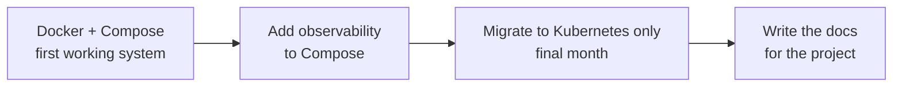

# Learning process

This page records how this project was built, which sources were used, and what remains open. It is written for recruiters reviewing the work. The [technology stack](technologies/overview.md) describes the tools in more detail.

## Approach

- **Incremental implementation.** Each part was written, run, checked in the logs, fixed, and tested before moving to the next.
- **Primary sources first.** Official documentation, a few videos, and other people's GitHub code were the main references.
- **Step-by-step validation.** Every change was tested as it was made, not deferred to the end.

## Sources

| Source | Used for |
| --- | --- |
| TechWorld with Nana (YouTube) | First introduction to Kubernetes |
| Kubernetes documentation | Workloads, Services, networking, namespaces |
| Spring Boot, Spring AOP and Spring Security docs | Services, method interception, JWT resource servers |
| Docker and Docker Buildx / Bake docs | Multi-stage builds, image targets, local registry |
| Helm and Helmfile docs | Charts, values, release ordering |
| cert-manager, Grafana Alloy and Loki docs | Local TLS, log collection and querying |
| Other people's GitHub code | Small libraries, focused examples and full implementations; comparing patterns before using them |
| OIDC and PKI references | Authorization code + PKCE flow, certificate handling |

The technologies used here are summarized in [Technology stack, explained](technologies/overview.md).

## Migration to Kubernetes

The system started on Docker Compose. In the final month the whole stack moved to Kubernetes and Compose stopped being maintained:

- **One cluster, two namespaces.** `dev` and `staging` run independently.
- **Declarative deployment.** Helm charts, driven by Helmfile with separate environment values.
- **Production-like access.** Ingress, TLS from a local certificate authority, and a GitLab Runner pipeline that builds images and runs `helmfile sync`.

The old Compose version is kept as the `Docker-Compsoe-Version` tag.

## Version history

- **`Docker-Compsoe-Version`** — the original Compose implementation.
- **`pre-zensical`** — the committed baseline before the Zensical documentation migration. The implementation was already complete at that point.

## Roadmap — not implemented

- **Hot reloading and a faster development cycle.** Every code change currently needs an image rebuild and often a manual restart; configuration changes are not reliably reloaded.
- **A metrics pipeline.** Actuator metrics are exposed, but no Prometheus server or dashboards are deployed.
- **Automated tests.** Validation has been manual and step by step; service and API/messaging tests are not in place.
- **Production hardening.** Autoscaling, mTLS between services, and progressive delivery.

These are deliberate boundaries of a learning project, not claims about the current deployment. See [troubleshooting](guides/troubleshooting.md) for the day-to-day friction they cause.

## What's next

- [Problems and fixes](problems-and-fixes.md) — debugging work from the git history.
- [Technology stack, explained](technologies/overview.md)
- [Grafana Alloy, explained](technologies/grafana-alloy.md)
- [Design decisions](concepts/design-decisions.md)
- [Project history](project-history.md)
