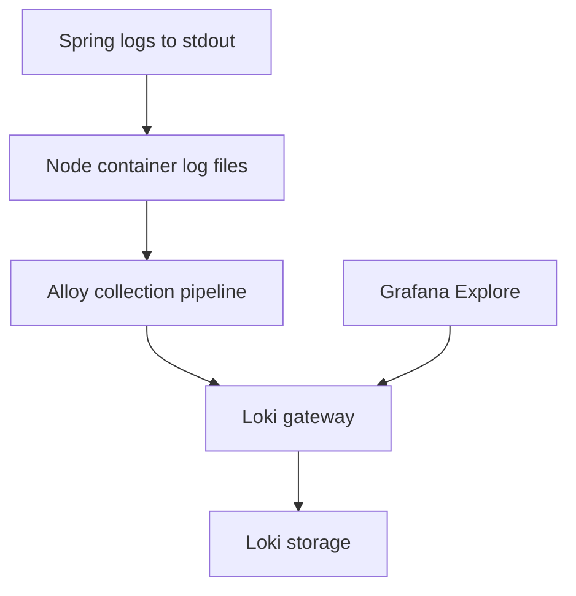

# Grafana Alloy and logging

This page follows a log from a Spring service to Grafana. The Kubernetes logging stack uses **Alloy to collect**, **Loki to store**, and **Grafana to query**. Grafana itself does not read the container log files.



## The application produces structured logs

`services/common/src/main/resources/logback-spring.xml` configures JSON output with fields including `timestamp`, `level`, `app`, `thread`, and `message`. The staging profile uses JSON appenders for application and framework logs. Development application logs are JSON, while some other output remains plain text. Several JMS listener messages use `System.out.println`, so not every line is JSON.

`LoggingAspect` wraps application service, controller, and repository methods to record entries, exits, failures, and durations. It adds `method` and `class` to the logging context and records Micrometer timers and counters. This is Spring AOP around matching proxied method calls; it is not distributed tracing.

## Understand the Alloy component graph

The actual pipeline is stored in `charts/monitoring-stack-chart/templates/alloy-configmap.yaml` as the `alloy-config` ConfigMap. `environments/values/charts/alloy-values.yaml` tells the upstream Alloy chart to use that existing ConfigMap and mount log directories.

| Component | What it does here | Output used by |
| --- | --- | --- |
| `discovery.kubernetes "pods"` | Discovers Kubernetes Pods and metadata | Relabel rules |
| `discovery.relabel "pod_logs"` | Converts selected metadata into labels and constructs `__path__` | File matching |
| `local.file_match "pod_logs"` | Expands file path patterns into file targets | File reader |
| `loki.source.file "pod_logs"` | Reads log files and forwards entries | Loki writer |
| `loki.write "loki"` | Pushes entries to the Loki HTTP endpoint | Loki gateway |

For example, this rule preserves the namespace as a queryable label:

```alloy
rule {
  source_labels = ["__meta_kubernetes_namespace"]
  target_label  = "namespace"
}
```

The project also maps Pod name, container name, `microserviceName`, `component`, and `env`. Kubernetes discovery names such as `__meta_kubernetes_pod_label_env` describe where the metadata comes from; the resulting `env` label is what you use in LogQL. The writer sends to:

```text
http://loki-gateway.monitoring.svc.cluster.local/loki/api/v1/push
```

See [Grafana's Kubernetes log collection guide](https://grafana.com/docs/alloy/latest/collect/logs-in-kubernetes/) for the component model and alternative collection approaches.

## Known collection details to verify

The checked-in path rule combines Pod UID and container name using `/`, then uses `replacement = "/var/log/pods/*$1/$2/*.log"` without an explicit two-group regex. The default single capture does not supply both `$1` and `$2`. If Alloy finds no files, inspect this rule first. A two-capture form for that intended path would be:

```alloy
rule {
  source_labels = ["__meta_kubernetes_pod_uid", "__meta_kubernetes_pod_container_name"]
  separator     = "/"
  regex         = "(.*)/(.*)"
  target_label  = "__path__"
  replacement   = "/var/log/pods/*$1/$2/*.log"
}
```

This is a proposed correction to compare with your node's paths, not a change already made to the application chart. Check the [relabel reference](https://grafana.com/docs/alloy/latest/reference/components/discovery/discovery.relabel/) and inspect real targets before applying it.

The pipeline reads files directly and contains no `loki.process` stage to decode CRI/Docker envelopes or parse application JSON. Check the raw stored line before choosing a JSON query. Also verify discovery permissions, host mounts, and which nodes each collector covers; cluster-wide discovery does not make remote node files available locally.

## Deploy and inspect the stack

This adds shared `monitoring` resources to the cluster. Review `loki-values.yml`, `grafana-values.yml`, and `alloy-values.yaml` first: Loki uses SingleBinary mode with MinIO, Grafana provisions a Loki data source, and Alloy requests root access to mounted logs. Upstream logging chart versions are not pinned in Helmfile, so review rendered output for the versions you resolve.

```bash
helmfile --file environments/helmfile.yaml -e dev \
  --selector name=monitoring-stack --selector name=loki \
  --selector name=grafana --selector name=alloy-logs sync
kubectl get pods,svc,pvc -n monitoring
kubectl get configmap alloy-config -n monitoring -o yaml
kubectl logs -n monitoring -l app.kubernetes.io/instance=alloy-logs \
  --all-containers=true --tail=100
kubectl port-forward -n monitoring service/grafana 3000:80
```

Open <http://localhost:3000>, sign in using the local configuration in `grafana-values.yml`, and select the **Loki** data source in Explore. The checked-in credentials are for a learning environment. Create activity in [the purchase tutorial](tutorials/first-purchase.md) and select a recent time range.

## Query the labels this project creates

Start broad:

```logql
{namespace="dev"}
```

Narrow to a backend and search raw lines:

```logql
{namespace="dev", microserviceName="inventory"} |= "INFO"
```

If the stored line is already a JSON object, parse its fields:

```logql
{namespace="staging", microserviceName="purchase"}
| json
| __error__=""
| level="INFO"
| line_format "{{.timestamp}} {{.level}} {{.app}} {{.message}}"
```

If the line begins with a CRI envelope such as `timestamp stdout F {json...}`, remove that envelope before JSON parsing for this query:

```logql
{namespace="staging", microserviceName="purchase"}
| pattern "<_> <_> <_> <payload>"
| line_format "{{.payload}}"
| json
| __error__=""
| level="INFO"
```

These queries replace the old `{service="$service", stream="stdout"}` examples. The current relabel configuration does not explicitly create `service` or `stream`, and the app field is normally `inventory` or `purchase`, rather than `purchase-system`. Use the label browser to confirm actual ingested labels. The [Loki query documentation](https://grafana.com/docs/loki/latest/query/log_queries/) explains filtering and parser errors.

## Metrics are exposed, but collection is unfinished

The shared Spring configuration enables `/actuator/prometheus`. `LoggingAspect` contributes `app.method.execution.duration`, `app.method.execution.count`, and `app.method.execution.errors` meters; Prometheus naming conventions change their exported names.

There is **no Prometheus server release or scrape configuration in the current Helmfile**. Grafana provisions only a Loki data source, and this Alloy configuration collects logs only. Exposed metrics are therefore an extension point, not a working metrics dashboard supplied by this deployment.
