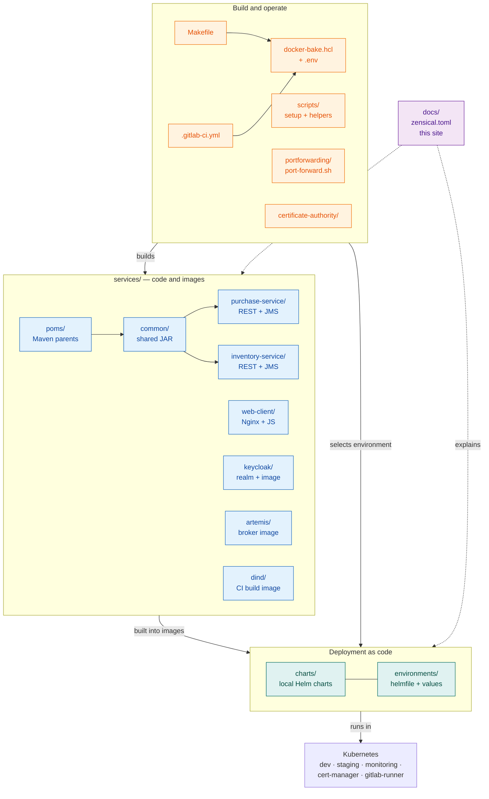

# Repository map

The repository keeps code, deployment definitions, build tooling, and documentation side by side. The diagram groups them by role; solid arrows show how source becomes a running deployment, dotted arrows show what the docs explain.

| Path | What to look for |
| --- | --- |
| `services/purchase-service/` | Purchase API, persistence, request publisher, result listener, Flyway migrations |
| `services/inventory-service/` | Inventory API, stock updates, request listener, result publisher, migrations |
| `services/common/` | Security configuration, JWT conversion, JMS setup, events, AOP, and logging |
| `services/poms/` | Shared Maven base and parent POMs |
| `services/web-client/` | Static HTML/CSS/JavaScript frontend and Nginx image |
| `services/keycloak/` | Keycloak image and imported realm JSON |
| `services/artemis/` | Artemis image, entrypoint, and broker configuration |
| `services/dind/` | Docker-in-Docker image and registry/tool configuration for the original CI runner |
| `charts/` | Local Helm charts for application and supporting resources |
| `environments/helmfile.yaml` | Release definitions and environment inputs |
| `environments/values/env/` | Dev/staging overrides and the release values template |
| `environments/values/charts/` | Loki, Grafana, Alloy, and GitLab runner values |
| `scripts/` | Installation, startup, registry builder, certificate, host, and logging helpers |
| `portforwarding/` | Background port-forward helper |
| `certificate-authority/` | Historical local certificate material; use your own CA for a new setup |
| `docker-bake.hcl`, `.env`, `Makefile` | Image build definitions, versions, and build/deploy commands |
| `.gitlab-ci.yml` | Original runner/build/deploy pipeline plus documentation build validation |
| `docs/` | The single Markdown documentation tree |
| `zensical.toml` | Site navigation and theme configuration |
| `requirements-docs.txt` | Pinned Zensical version |

## Follow a feature through the Java code

Begin with `services/purchase-service/src/main/java/swtp/clouddemo/purchase/controller/PurchaseController.java`, then read `service/PurchaseServiceImpl.java`. Its event contract and producer are in `services/common/src/main/java/swtp/clouddemo/common/`.

On the Inventory side, follow `messaging/PurchaseRequestedListener.java` into `service/LagerService.java`. Return to Purchase through `messaging/PurchaseResultListener.java`. This is the code path behind the [messaging explanation](../concepts/messaging.md).

## Follow a configuration change

Start with an environment file, follow it through `env-magic.gotmpl`, inspect the selected chart's `values.yaml` and templates, then check the resulting ConfigMap/Secret and Deployment. The [Kubernetes and Helm page](../concepts/kubernetes-and-helm.md) walks through that path.

## Documentation migration

The two Next.js/Fumadocs scaffolds previously lived in `purchase-system-cloud-native/` and `purchase-system-funmadocs/`. They contained generated starter pages. They have been removed in favor of this docs tree, and the original certificate and logging pages have been rewritten in place so their Markdown paths remain useful.

The root README is an entry point. Contribution instructions live in [contributing](../contributing.md). The supplied `Best documentation tools.md` conversation is background material for the migration and remains outside the published documentation tree. The [project history](../project-history.md) records the relevant development context without publishing that entire conversation.
