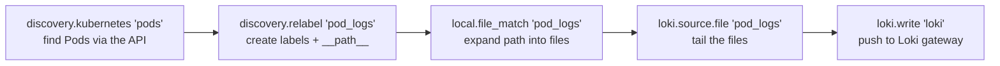

# Grafana Alloy

Grafana Alloy is a telemetry collector that receives, transforms, and forwards logs, metrics, and traces. In this project it runs in the `monitoring` namespace and performs one task: reading container log files from Kubernetes Pods and writing them to Loki. It replaced Promtail, which the earlier Docker Compose version used.

The configuration is stored in the `alloy-config` ConfigMap in `charts/monitoring-stack-chart/templates/alloy-configmap.yaml`. The upstream Helm chart is told to use that ConfigMap through `environments/values/charts/alloy-values.yaml`.

## Before you begin

- Deploy the logging stack as described in [Grafana Alloy and logging](../monitoring-and-logging.md#deploy-and-inspect-the-stack).
- Know how [workload labels are defined](../concepts/kubernetes-and-helm.md#deployment-service-and-labels), since the collector turns those labels into queryable log labels.
- No application changes are required. Spring Boot writes JSON to stdout; Alloy starts at the container log file.

## Components and pipelines

An Alloy configuration is a graph of typed **components**. A component has a type and a label, for example `discovery.kubernetes "pods"`. Each component exports values that other components reference, such as `discovery.kubernetes.pods.targets`. Connecting them with `forward_to` builds a pipeline.

| Component | Role |
| --- | --- |
| `discovery.kubernetes "pods"` | Finds Pods through the Kubernetes API |
| `discovery.relabel "pod_logs"` | Builds log labels and the `__path__` of the log files |
| `local.file_match "pod_logs"` | Expands `__path__` into files that exist on the node |
| `loki.source.file "pod_logs"` | Tails the matched files |
| `loki.write "loki"` | Pushes entries to the Loki gateway |



### discovery.kubernetes

```alloy
discovery.kubernetes "pods" {
 role = "pod"
}
```

With `role = "pod"`, the component watches the Kubernetes API and produces one **target** per Pod. A target is a set of labels. Kubernetes metadata arrives as internal labels such as `__meta_kubernetes_namespace`, `__meta_kubernetes_pod_name`, and `__meta_kubernetes_pod_uid`. Labels starting with `__` are used during processing and are normally dropped before data is sent on.

Discovery answers which Pods exist. It does not make their log files readable.

### discovery.relabel

`discovery.relabel` applies rules to the discovered targets. Each rule reads `source_labels`, optionally joins them with `separator`, and writes the result to `target_label`.

```alloy
rule {
 source_labels = ["__meta_kubernetes_namespace"]
 target_label = "namespace"
}
```

This copies the internal namespace metadata into a `namespace` label that can be queried in Loki. The configuration does the same for `pod`, `container`, `microserviceName`, `component`, and `env`. The last three come from the standard labels on the workloads, so deployment labels, log labels, and Grafana queries use the same names.

One rule builds `__path__`, which tells the next component which files to read:

```alloy
rule {
 source_labels = ["__meta_kubernetes_pod_uid", "__meta_kubernetes_pod_container_name"]
 separator = "/"
 target_label = "__path__"
 replacement = "/var/log/pods/*$1/$2/*.log"
}
```

!!! warning "The replacement has no second capture group"
 The `replacement` refers to `$1` and `$2`, but the rule has no `regex` with two capture groups, so `$2` is not filled from a second group. If Alloy finds no files, inspect this rule first. A two-capture form to compare with your node's paths is:

 ```alloy
 regex = "(.*)/(.*)"
 replacement = "/var/log/pods/*$1/$2/*.log"
 ```

 This is a proposed correction, not a change already applied to the chart. See the [relabel reference](https://grafana.com/docs/alloy/latest/reference/components/discovery/discovery.relabel/).

### local.file_match

```alloy
local.file_match "pod_logs" {
 path_targets = discovery.relabel.pod_logs.output
}
```

`local.file_match` expands the `__path__` pattern into files present on the node's filesystem.

!!! note "Discovery is not access"
 Alloy can discover every Pod in a cluster, but it can only read files mounted into its own Pod. The chart mounts `/var/log` and `/var/lib/docker/containers` and runs as root, which is how logs of other Pods on the same node become visible.

### loki.source.file

```alloy
loki.source.file "pod_logs" {
 targets = local.file_match.pod_logs.targets
 forward_to = [loki.write.loki.receiver]
}
```

`loki.source.file` tails each matched file and forwards the lines. No `loki.process` stage is configured, so nothing decodes CRI/Docker envelopes or parses the JSON produced by Logback. Alloy ships the raw line; Loki stores it.

### loki.write

```alloy
loki.write "loki" {
 endpoint {
 url = "http://loki-gateway.monitoring.svc.cluster.local/loki/api/v1/push"
 }
}
```

The writer sends entries to the Loki gateway through its cluster Service DNS name. Grafana queries the same gateway: Alloy writes to it, Grafana reads from it.

## Labels created by the pipeline

| Label | Source |
| --- | --- |
| `namespace`, `pod`, `container` | Kubernetes metadata |
| `microserviceName`, `component`, `env` | Standard labels on the workload Pods |

Older examples used `{service="$service", stream="stdout"}`. The current pipeline does not create those labels. Start broad and narrow down:

```logql
{namespace="dev"}
```

```logql
{namespace="dev", microserviceName="inventory"} |= "INFO"
```

Because there is no parsing stage, inspect the raw line before using `| json`. A line with a CRI envelope such as `timestamp stdout F {...}` needs that prefix removed first:

```logql
{namespace="staging", microserviceName="purchase"}
| pattern "<_> <_> <_> <payload>"
| line_format "{{.payload}}"
| json
| __error__=""
```

More queries are listed in [Grafana Alloy and logging](../monitoring-and-logging.md#query-the-labels-this-project-creates).

## Where Spring Boot fits

Logback in the [shared Java library](../concepts/common-library.md#how-a-request-is-observed) writes JSON lines to stdout with `app`, `userId`, `username`, `method`, and `class` fields. That happens inside the Java process. Alloy's work starts later, at the container log file:

```text
Spring Boot → stdout (JSON) → node log file → Alloy → Loki → Grafana
```

## Verify the collector

```bash
kubectl get configmap alloy-config -n monitoring -o yaml
kubectl get pods -n monitoring
kubectl logs -n monitoring -l app.kubernetes.io/instance=alloy-logs \
 --all-containers=true --tail=100
kubectl port-forward -n monitoring service/grafana 3000:80
```

Open Grafana, select Explore and the Loki data source, then query `{namespace="dev"}`.

## What's next

- [Grafana Alloy and logging](../monitoring-and-logging.md) — deploy and query the stack.
- [Technology stack, explained](overview.md) — where Alloy sits among the other tools.
- [Troubleshooting](../guides/troubleshooting.md#grafana-shows-no-logs) — common collection failures.
- [Grafana Alloy documentation](https://grafana.com/docs/alloy/latest/) — component reference.
