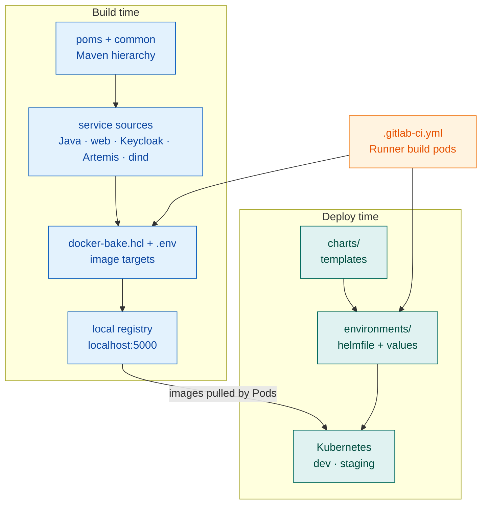

# Technology stack

This page maps the technologies used in this project to the role each one plays. It serves as a map for the rest of the documentation rather than a setup guide. For a deeper explanation of one component, start with [Grafana Alloy, explained](grafana-alloy.md).

## At a glance

- **Application:** [Spring Boot](../concepts/common-library.md), Java 21, Maven, Lombok.
- **Data:** PostgreSQL, Flyway migrations, one database per service.
- **Communication:** REST for direct queries, Apache Artemis and JMS for asynchronous work.
- **Security:** Keycloak, OpenID Connect with PKCE, JWT validation in Spring Security.
- **Packaging:** Docker, Docker Buildx, Docker Bake.
- **Platform:** Kubernetes, Helm, Helmfile, ingress-nginx, cert-manager.
- **Observability:** Logback JSON, Spring AOP, Grafana Alloy, Loki, Grafana.
- **CI/CD:** GitLab CI, GitLab Runner with the Kubernetes executor, Docker-in-Docker.

## Application and data

| Tool | What it is | Role here |
| --- | --- | --- |
| Spring Boot | A Java framework for building web applications with minimal setup | Each business service is its own app with REST controllers, services, and repositories |
| Java 21 / Maven | The language runtime and the build/dependency tool | Parent POMs keep versions and shared dependencies in one place |
| Lombok | A library that generates boilerplate Java code | Keeps entities and DTOs short |
| PostgreSQL | A relational database | Each service owns a separate database |
| Flyway | A schema migration tool | Versioned SQL files create tables and seed data on startup |

The two services do not share a database. Purchase stores purchase records; Inventory stores stock. Independent data stores allow the services to be deployed and changed separately. See [system architecture](../concepts/architecture.md#responsibilities) and [the shared Java library](../concepts/common-library.md#the-maven-hierarchy).

## Communication and security

- **REST** is synchronous request/response over HTTP. The browser uses it when an immediate answer is needed, such as reading inventory.
- **Apache Artemis** is a message broker. Purchase saves a request and publishes it to a queue; Inventory consumes it later and publishes a result to a second queue. A purchase therefore has a `PENDING` state. See [asynchronous purchases](../concepts/messaging.md).
- **JMS** is the Java API used to talk to the broker. Message types and queue names are shared by both services in the `common` library.
- **Keycloak** is an identity provider. The browser signs in there and receives a JWT; services validate the token instead of handling passwords. See [authentication and roles](../concepts/authentication.md).
- **OIDC and PKCE** are the login protocol and its protection for browser clients. PKCE prevents an intercepted authorization code from being exchanged by another party.
- **JWT** is the signed token carrying issuer, subject, and roles. Spring Security verifies the signature against Keycloak's public keys and maps roles such as `user` to `ROLE_USER`.
- **Spring Security** enforces those roles at endpoint and method level through the shared configuration.

## Packaging and platform

- **Docker** packages each service with its dependencies into an image, so it runs the same way everywhere.
- **Buildx and Bake** build the images. Bake defines targets and their order in `docker-bake.hcl`; the Java services start from a cached `builder-common` image.
- **Kubernetes** runs the images as Pods and keeps them running. Deployments define containers, Services provide stable addresses, ConfigMaps and Secrets supply configuration, and PVCs store database data.
- **Namespaces** separate `dev` from `staging` on one cluster. Platform tooling lives in `monitoring`, `cert-manager`, and `gitlab-runner`.
- **Helm** renders Kubernetes manifests from templates and values. **Helmfile** coordinates releases and selects an environment. See [Kubernetes, Helm, and Helmfile](../concepts/kubernetes-and-helm.md).
- **Ingress** routes external HTTPS requests to the right Service by host and path. It is disabled in `dev`, where ports are forwarded manually.
- **cert-manager** issues staging TLS certificates from a local CA generated with OpenSSL. See [certificate management](../certificate-management.md).

## Observability

- **Logback** in the `common` library produces the logs. Spring profiles select human-readable output in development and JSON in staging; MDC adds user and method context.
- **AOP** wraps service, controller, and repository methods to log duration and errors without adding logging code to every method. It is method interception, not distributed tracing.
- **Grafana Alloy** reads container log files and forwards them. Its pipeline is explained in [Grafana Alloy, explained](grafana-alloy.md).
- **Loki** stores logs and supports LogQL queries. **Grafana** searches and visualizes them. The labels created by Alloy determine what can be filtered.
- **Prometheus metrics** are exposed by the applications, but no Prometheus server is deployed. See [metrics collection](../monitoring-and-logging.md#metrics-are-exposed-but-collection-is-unfinished).

## CI/CD

- **GitLab CI** runs the pipeline defined in `.gitlab-ci.yml`: test, build, deploy.
- **GitLab Runner with the Kubernetes executor** starts a fresh build Pod for each job instead of using a fixed machine.
- **Docker-in-Docker** is the custom build image. It contains a Docker daemon, Buildx, Helm, Helmfile, and kubectl, so a job can build images and deploy them. The Pod is removed when the job finishes.

## Build and deployment flow

Source code and shared Maven modules become images. Charts and environment values become Kubernetes resources. The runner drives both.

The alternatives considered at these points — BOM versus parent POM, Harbor versus the Minikube registry, Compose versus Kubernetes — are recorded in [design decisions](../concepts/design-decisions.md).

## What's next

- [Grafana Alloy, explained](grafana-alloy.md) — the deepest walkthrough of a single component.
- [Learning process](../learning-process.md) — how these tools were learned.
- [End-to-end use cases](../concepts/use-cases.md) — the stack working together.
- [Repository map](../reference/repository.md) — the files behind each tool.
